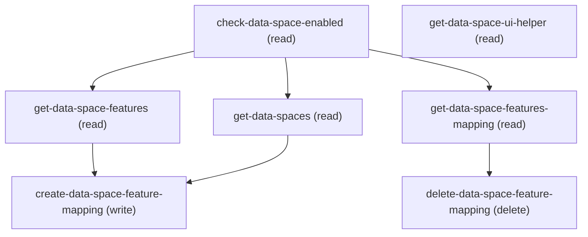

# Managing Data Space Feature Mappings

## When to Use This Skill

Manage Education Cloud feature → Data Cloud data-space mappings.
`getDataSpaceFeatures` returns an EDU-scoped choices list
(STUDENT_SUCCESS, FINANCIAL_AID) — but the create path itself is a
pass-through to CDP's DataSpaceAwareFeatureType enum and accepts any
value the delegate recognises (e.g. ECI_EXPERIENCE); prefer the
choices list to keep the workflow EDU-scoped. Pickable data spaces
come from `getDataSpaces` (`devName`, matched case-insensitively).
Single-mapping-per-feature is enforced server-side: create returns
{status:'400', messageBody:'Duplicate dataSpaceFeatureMapping for
feature'} if a mapping for the same featureName already exists.
Both write steps carry in-band {status, messageBody} inside a
HTTP-200 envelope. Use this SOR (not /ssot/data-space-feature-
mappings) when the workflow is EDU-scoped — the EDU controller
adds the duplicate check, multi-feature aggregation, feature
display-label UDD join, and STUDENT_INSIGHTS product-usage
telemetry that the bare CDP Connect API doesn't.

## Workflow

Ordering (write path): check-data-space-enabled → get-data-spaces →
get-data-space-features → create-data-space-feature-mapping → verify
via get-data-space-features-mapping. Delete path:
get-data-space-features-mapping (source the mappingId from row.id) →
delete-data-space-feature-mapping → verify via
get-data-space-features-mapping. Skip get-data-space-ui-helper when
driving programmatically — it returns an LWC-only bean handle.
`feature` on create-data-space-feature-mapping MUST be one of the
two Education Cloud features returned by get-data-space-features
(Student Success, Financial Aid) — the create step does not enforce
this itself, unlike the Setup UI dropdown which only offers those
two. If asked to map a feature that isn't one of these two, warn
that it is out of scope for this Education Cloud workflow rather
than calling create with it. Both write steps carry in-band
{status, messageBody} inside a HTTP-200 envelope — always inspect
body.status, not the HTTP code. dataSpace matching is
case-insensitive. Delete error copy references "featureName" but
the value passed IS the mappingId.

## Critical Constraints

**Preconditions:**

- Org must have Data Cloud (CDP) provisioned and userCanAccessDataCloudAndApp access — the controller's class-level @ServiceComponentAccessGuard rejects unauthorized callers before any method runs. (check: `Data Cloud app access`)
- At least one Data Space must exist (default or custom) for createDataSpaceFeatureMapping to bind to; getDataSpaces returns the candidate list. Without a provisioned data space, the create call has no valid dataSpace input.
- Education Cloud licensing/feature must be active in the org — the EDU subset (STUDENT_SUCCESS, FINANCIAL_AID) is only meaningful when those EDU features are licensed; calls succeed structurally but the mapped feature has no consumer otherwise.

**Destructive operations — require explicit user confirmation:**

- **`delete-data-space-feature-mapping`** — Delete one mapping by mappingId (sourced from
get-data-space-features-mapping[].id). Success→{status:'200',
messageBody:'DataSpace feature dataSpaceFeatureMapping deleted
successfully'}. NOT idempotent: re-submitting an already-deleted
mappingId OR passing an unknown mappingId surfaces {status:'500',
messageBody:"Error deleting dataspace feature dataSpaceFeatureMapping:
dataSpace-feature mapping with featureName: <mappingId> doesn't
exist"} — note the error copy says "featureName:" even though the
value passed IS the mappingId; that is the CDP delegate's error
wording and the caller should treat any status:'500' with "doesn't
exist" as "id already gone".
AURA-IS-CANONICAL: CDP DELETE /ssot/data-space-feature-mappings/
{mappingId} bypasses the STUDENT_INSIGHTS telemetry the EDU
controller emits.
  - Rollback: No automatic rollback.

## Operations Reference

Operations grouped by purpose. Use these as the building blocks for the workflows above.

### Summary

| Operation | Purpose | Status | Call | Depends on |
|-----------|---------|--------|------|------------|
| `check-data-space-enabled` | read | implemented | `GET /headless/invoke/platform/data-space-feature-mappings` | — |
| `get-data-spaces` | read | implemented | `GET /headless/invoke/platform/data-space-feature-mappings/get-data-spaces` | `check-data-space-enabled` |
| `get-data-space-ui-helper` | read | proposed | `GET /headless/invoke/platform/data-space-feature-mappings/get-data-space-uihelper` | — |
| `get-data-space-features` | read | proposed | `GET /headless/invoke/platform/data-space-feature-mappings/get-data-space-features` | `check-data-space-enabled` |
| `create-data-space-feature-mapping` | write | proposed | `PATCH /headless/invoke/platform/data-space-feature-mappings/create-data-space-feature-mapping` | `get-data-space-features`, `get-data-spaces` |
| `get-data-space-features-mapping` | read | proposed | `GET /headless/invoke/platform/data-space-feature-mappings/get-data-space-features-mapping` | `check-data-space-enabled` |
| `delete-data-space-feature-mapping` | delete | proposed | `DELETE /headless/invoke/platform/data-space-feature-mappings/delete-data-space-feature-mapping` | `get-data-space-features-mapping` |

### Dependency graph

### Read operations

#### `check-data-space-enabled`

Pre-flight boolean: is CDP provisioned AND does the user have access?
Gate the SOR's write path on this — a false response means the write
steps will fail. AURA-IS-CANONICAL: no public Connect/Tooling/Metadata
equivalent returns the composite (hasCDP && userCanAccessDataCloudAndApp)
boolean; each half is exposed separately but the composite is only
surfaced by this controller.

**Call:** `GET /headless/invoke/platform/data-space-feature-mappings`   — status: `implemented`

**Output:** true when Data Cloud is provisioned and the calling user has Data Cloud app access; false otherwise. Caller should short-circuit the rest of the SOR on false.

#### `get-data-spaces`

List Data Spaces available to bind a feature to. Use the returned
`devName` as the `dataSpace` input to create-data-space-feature-mapping.
dataSpace lookup is CASE-INSENSITIVE at write time (both `"default"` and
`"Default"` resolve to the same record). AURA-IS-CANONICAL: the public
Connect grid endpoint returns names only and drops typed fields
consumers rely on (id, prefix, permSet, isSharingRestricted,
isPreSelectedSandboxDataspace, status enum).

**Call:** `GET /headless/invoke/platform/data-space-feature-mappings/get-data-spaces`   — status: `implemented`

**Depends on:** `check-data-space-enabled`

**Output:** Array of: {id, devName, name, prefix, createdBy, modifiedDateTime, description, status (ACTIVE|PROCESSING|ERROR), type (DEFAULT|CUSTOM), permSet, definitionId, modifiedByUserName, isSharingRestricted, isPreSelectedSandboxDataspace}. Pass devName as the dataSpace input downstream.

#### `get-data-space-ui-helper`

Agent-skip. Returns an LWC-only Spring bean handle for reflective
template access — no JSON value pattern an agent can consume.
AURA-IS-CANONICAL by nature: bean-handle surfaces are not exposed
via Connect/Tooling/Metadata. Skip when driving the workflow
programmatically; the step exists only for the LWC's imperative load.

**Call:** `GET /headless/invoke/platform/data-space-feature-mappings/get-data-space-uihelper`   — status: `proposed`

**Output:** A data-space UI bundle exposing the data-space service, packaging data, and the latest datakit deployment status per data space. Not a JSON value object; agents should ignore.

#### `get-data-space-features`

List the EDU-scoped feature CHOICES an admin can bind: {label, value}
rows filtered to the EDU_DC_FEATURES allowlist (values STUDENT_SUCCESS,
FINANCIAL_AID; labels from the DataSpaceAwareFeatureType UDD enum). The
allowlist filter applies HERE at the choices reader — the create path
itself does NOT re-check the allowlist, so an admin invoking the create
step with a non-EDU FeatureNameEnum value will succeed structurally.
Prefer feeding `value` from this response to keep the workflow scoped.

**Call:** `GET /headless/invoke/platform/data-space-feature-mappings/get-data-space-features`   — status: `proposed`

**Depends on:** `check-data-space-enabled`

**Output:** Array of {label: string (display name from UDD enum), value: string (apiValue, one of STUDENT_SUCCESS or FINANCIAL_AID)}. Pass value as the feature input to create-data-space-feature-mapping.

#### `get-data-space-features-mapping`

List existing feature→data-space mappings (flat rows). Controller
loops FeatureNameEnum values for featureCloud=EducationCloud and joins
`featureDisplayLabel` from the DataSpaceAwareFeatureType UDD enum;
the returned rows are whatever mappings exist in CDP for those
features — including non-EDU-allowlist features an admin (or another
caller) mapped previously. Each row's `id` IS the CDP mappingId
consumed by delete-data-space-feature-mapping.
AURA-IS-CANONICAL: CDP /ssot/data-space-feature-mappings forces N
round trips (one per featureName) and drops the featureDisplayLabel
UDD-enum join.

**Call:** `GET /headless/invoke/platform/data-space-feature-mappings/get-data-space-features-mapping`   — status: `proposed`

**Depends on:** `check-data-space-enabled`

**Output:** Array of {id (CDP mappingId for use in delete), featureName (apiValue: STUDENT_SUCCESS|FINANCIAL_AID|other), dataSpace (devName), featureVersion (e.g. '1'), featureDisplayLabel (display name from UDD enum, falls back to featureName when not found)}. Each row is a live mapping; missing features mean no mapping exists for that feature.

### Write operations

#### `create-data-space-feature-mapping`

Bind one feature to one Data Space. `feature` MUST be one of the two
Education Cloud features: Student Success (STUDENT_SUCCESS) or
Financial Aid (FINANCIAL_AID) — matches the Setup UI's Feature
dropdown, which only offers these two by design. Other Salesforce
clouds have their own features that also technically pass this API,
but they are NOT part of Education Cloud and will not behave as an
Education Cloud admin expects. The server does not reject them
outright: an out-of-scope-but-otherwise-valid feature creates a real
mapping (silently wrong for this workflow); a truly unrecognized
value fails with a server error. Always call get-data-space-features
first and use its response for `feature`; treat any value it didn't
return as unsuitable for this workflow, and warn rather than proceed
if an agent is about to pass one.

**Call:** `PATCH /headless/invoke/platform/data-space-feature-mappings/create-data-space-feature-mapping`   — status: `proposed`

**Inputs:**

- `feature` *(`String`)* — Value for the feature field.
- `dataSpace` *(`String`)* — Value for the data space field.

**Depends on:** `get-data-space-features`, `get-data-spaces`

**Output:** On success: {status:'200', messageBody:'DataSpace feature dataSpaceFeatureMapping created successfully', mappingId: <CDP mappingId for use in delete>}. On duplicate: {status:'400', messageBody:'Duplicate dataSpaceFeatureMapping for feature'}. On other error: {status:'500', messageBody:'Error creating dataspace feature mapping: <cause>'}. Caller MUST check the body's status field — HTTP envelope is always 200.

### Destructive operations

#### `delete-data-space-feature-mapping`

Delete one mapping by mappingId (sourced from
get-data-space-features-mapping[].id). Success→{status:'200',
messageBody:'DataSpace feature dataSpaceFeatureMapping deleted
successfully'}. NOT idempotent: re-submitting an already-deleted
mappingId OR passing an unknown mappingId surfaces {status:'500',
messageBody:"Error deleting dataspace feature dataSpaceFeatureMapping:
dataSpace-feature mapping with featureName: <mappingId> doesn't
exist"} — note the error copy says "featureName:" even though the
value passed IS the mappingId; that is the CDP delegate's error
wording and the caller should treat any status:'500' with "doesn't
exist" as "id already gone".
AURA-IS-CANONICAL: CDP DELETE /ssot/data-space-feature-mappings/
{mappingId} bypasses the STUDENT_INSIGHTS telemetry the EDU
controller emits.

**Call:** `DELETE /headless/invoke/platform/data-space-feature-mappings/delete-data-space-feature-mapping`   — status: `proposed`

**Inputs:**

- `mappingId` *(`String`)*

**Depends on:** `get-data-space-features-mapping`

**Output:** On success: {status:'200', messageBody:'DataSpace feature dataSpaceFeatureMapping deleted successfully'}. On error: {status:'500', messageBody:'Error deleting dataspace feature dataSpaceFeatureMapping: <cause>'}. HTTP envelope is always 200; check body status.
