# Managing Wizard Ui Decision Table Components

## When to Use This Skill

BRE Decision Tables wizard (Details → Logic → Behaviour → Preview): create / update / delete / sync (refresh) a Decision Table and CRUD its dataset-link Payload. Definition CRUD + sync substitute to Connect /connect/business-rules/decision-table/definitions and /connect/decision-table/refresh (BRE Taurus, Decision Table enabled gated). Activate / deactivate, Payload (DecisionTableDatasetLink) CRUD, list-view defaulting, getAll*ApiNames, and org-value limits stay AURA-IS-CANONICAL — no public Connect equivalent.

## Critical Constraints

**Preconditions:**

- Org has Business Rules Engine Decision Tables enabled (every Connect op carries x-sfdc.org-access-check Decision Table enabled; the wizard mounts only when Decision Table entitlement returns true). (check: `Decision Table enabled`)
- Running user has InteractionCalculation admin access for advanced data-source flows (CDP/DLO/data-spaces parameter resolution + row data preview gated by @ServiceComponentAccessGuard Interaction Calculation admin access). (check: `Interaction Calculation admin access`)

**Destructive operations — require explicit user confirmation:**

- **`decision-table-controller-delete-decision-table`** — Permanently remove a Decision Table by id. Connect deleteDecisionTableGet on /definitions/{decisionTableId}. Org-perm gated. Caller resolves the id via the prerequisite getAllDecisionTableApiNames step.
  - Rollback: No automatic rollback.
- **`decision-table-controller-delete-payload`** — Remove a dataset-link Payload. Caller passes the payload-identifier map. AURA-IS-CANONICAL — no public Connect dataset-link delete endpoint.
  - Rollback: No automatic rollback.

## Operations Reference

Operations grouped by purpose. Use these as the building blocks for the workflows above.

### Summary

| Operation | Purpose | Status | Call | Depends on |
|-----------|---------|--------|------|------------|
| `constants-details` | — | implemented | — | — |
| `constants-logic` | — | implemented | — | `constants-details` |
| `constants-behaviour` | — | implemented | — | `constants-logic` |
| `constants-preview` | — | implemented | — | `constants-behaviour` |
| `decision-table-controller-is-user-valid` | validate | implemented | `GET /headless/invoke/platform/decision-tables` | — |
| `decision-table-controller-create-and-get-decision-process-type-list-view` | read | implemented | `PATCH /headless/invoke/platform/decision-tables/create-and-get-decision-process-type-list-view` | `decision-table-controller-is-user-valid` |
| `decision-table-controller-save-decision-table` | write | implemented | `PATCH /headless/invoke/platform/decision-tables/save-decision-table` | `constants-preview`, `decision-table-controller-is-user-valid` |
| `decision-table-controller-delete-decision-table` | delete | implemented | `DELETE /headless/invoke/platform/decision-tables/delete-decision-table` | `decision-table-controller-get-all-decision-table-api-names` |
| `decision-table-controller-activate-decision-table` | write | implemented | `PATCH /headless/invoke/platform/decision-tables/activate-decision-table` | `decision-table-controller-get-all-decision-table-api-names` |
| `decision-table-controller-deactivate-decision-table` | write | implemented | `PATCH /headless/invoke/platform/decision-tables/deactivate-decision-table` | `decision-table-controller-get-all-decision-table-api-names` |
| `decision-table-controller-save-payload` | write | implemented | `PATCH /headless/invoke/platform/decision-tables/save-payload` | `decision-table-controller-is-user-valid` |
| `decision-table-controller-sync-decision-table` | write | implemented | `PATCH /headless/invoke/platform/decision-tables/sync-decision-table` | `decision-table-controller-get-all-decision-table-api-names` |
| `decision-table-controller-delete-payload` | delete | implemented | `DELETE /headless/invoke/platform/decision-tables/delete-payload` | `decision-table-controller-get-all-payload-api-names` |
| `decision-table-controller-get-all-payload-api-names` | read | implemented | `GET /headless/invoke/platform/decision-tables/get-all-payload-api-names` | `decision-table-controller-is-user-valid` |
| `decision-table-controller-update-payload` | write | implemented | `PATCH /headless/invoke/platform/decision-tables/update-payload` | `decision-table-controller-get-all-payload-api-names` |
| `decision-table-controller-get-all-decision-table-api-names` | read | implemented | `GET /headless/invoke/platform/decision-tables/get-all-decision-table-api-names` | `decision-table-controller-is-user-valid` |
| `decision-table-controller-update-decision-table` | write | implemented | `PATCH /headless/invoke/platform/decision-tables/update-decision-table` | `decision-table-controller-get-all-decision-table-api-names` |
| `decision-table-controller-get-org-values-for-list-view` | read | implemented | `GET /headless/invoke/platform/decision-tables/get-org-values-for-list-view` | `decision-table-controller-is-user-valid` |
| `decision-table-controller-get-org-values-for-details-page` | read | implemented | `GET /headless/invoke/platform/decision-tables/get-org-values-for-details-page` | `decision-table-controller-is-user-valid` |

### Dependency graph

```mermaid
graph TD
  constants_details["constants-details"]
  constants_logic["constants-logic"]
  constants_behaviour["constants-behaviour"]
  constants_preview["constants-preview"]
  decision_table_controller_is_user_valid["decision-table-controller-is-user-valid (validate)"]
  decision_table_controller_create_and_get_decision_process_type_list_view["decision-table-controller-create-and-get-decision-process-type-list-view (read)"]
  decision_table_controller_save_decision_table["decision-table-controller-save-decision-table (write)"]
  decision_table_controller_delete_decision_table["decision-table-controller-delete-decision-table (delete)"]
  decision_table_controller_activate_decision_table["decision-table-controller-activate-decision-table (write)"]
  decision_table_controller_deactivate_decision_table["decision-table-controller-deactivate-decision-table (write)"]
  decision_table_controller_save_payload["decision-table-controller-save-payload (write)"]
  decision_table_controller_sync_decision_table["decision-table-controller-sync-decision-table (write)"]
  decision_table_controller_delete_payload["decision-table-controller-delete-payload (delete)"]
  decision_table_controller_get_all_payload_api_names["decision-table-controller-get-all-payload-api-names (read)"]
  decision_table_controller_update_payload["decision-table-controller-update-payload (write)"]
  decision_table_controller_get_all_decision_table_api_names["decision-table-controller-get-all-decision-table-api-names (read)"]
  decision_table_controller_update_decision_table["decision-table-controller-update-decision-table (write)"]
  decision_table_controller_get_org_values_for_list_view["decision-table-controller-get-org-values-for-list-view (read)"]
  decision_table_controller_get_org_values_for_details_page["decision-table-controller-get-org-values-for-details-page (read)"]
  constants_details --> constants_logic
  constants_logic --> constants_behaviour
  constants_behaviour --> constants_preview
  decision_table_controller_is_user_valid --> decision_table_controller_create_and_get_decision_process_type_list_view
  constants_preview --> decision_table_controller_save_decision_table
  decision_table_controller_is_user_valid --> decision_table_controller_save_decision_table
  decision_table_controller_get_all_decision_table_api_names --> decision_table_controller_delete_decision_table
  decision_table_controller_get_all_decision_table_api_names --> decision_table_controller_activate_decision_table
  decision_table_controller_get_all_decision_table_api_names --> decision_table_controller_deactivate_decision_table
  decision_table_controller_is_user_valid --> decision_table_controller_save_payload
  decision_table_controller_get_all_decision_table_api_names --> decision_table_controller_sync_decision_table
  decision_table_controller_get_all_payload_api_names --> decision_table_controller_delete_payload
  decision_table_controller_is_user_valid --> decision_table_controller_get_all_payload_api_names
  decision_table_controller_get_all_payload_api_names --> decision_table_controller_update_payload
  decision_table_controller_is_user_valid --> decision_table_controller_get_all_decision_table_api_names
  decision_table_controller_get_all_decision_table_api_names --> decision_table_controller_update_decision_table
  decision_table_controller_is_user_valid --> decision_table_controller_get_org_values_for_list_view
  decision_table_controller_is_user_valid --> decision_table_controller_get_org_values_for_details_page
```

### Read operations

#### `decision-table-controller-create-and-get-decision-process-type-list-view`

Default-create (if absent) and return the Decision Process Type list view (BRE-specific filter/column shape). AURA-IS-CANONICAL — Tooling ListView CRUD requires precomputing the payload, dropping the BRE-specific defaulting.

**Call:** `PATCH /headless/invoke/platform/decision-tables/create-and-get-decision-process-type-list-view`   — status: `implemented`

**Depends on:** `decision-table-controller-is-user-valid`

#### `decision-table-controller-get-all-payload-api-names`

List API names of every dataset-link Payload — for selection lists and uniqueness validation. AURA-IS-CANONICAL — no public Connect payload listing; tooling_sobject_coverage has no DecisionTableDatasetLink entry.

**Call:** `GET /headless/invoke/platform/decision-tables/get-all-payload-api-names`   — status: `implemented`

**Depends on:** `decision-table-controller-is-user-valid`

#### `decision-table-controller-get-all-decision-table-api-names`

List API names of every Decision Table; controller adds entitlement gating. AURA-IS-CANONICAL — Connect getDecisionTableTemplateList returns templates not org tables; tooling_sobject_coverage has no DecisionTable entry.

**Call:** `GET /headless/invoke/platform/decision-tables/get-all-decision-table-api-names`   — status: `implemented`

**Depends on:** `decision-table-controller-is-user-valid`

#### `decision-table-controller-get-org-values-for-list-view`

Read org-level Decision Table limits (DecisionTableOrgValueResponse: maxDecisionTable, maxRowsForLowVolume, maxRowsForHighVolume, maxRefreshPerHourLowVolDT, currentNoOfDecisionTable, status). AURA-IS-CANONICAL — no Connect endpoint exposes the BRE limits bag.

**Call:** `GET /headless/invoke/platform/decision-tables/get-org-values-for-list-view`   — status: `implemented`

**Depends on:** `decision-table-controller-is-user-valid`

#### `decision-table-controller-get-org-values-for-details-page`

Read org-level Decision Table limits scoped to a specific table id (adds per-table validation context such as maxOutputParametersPerHbpoDt). AURA-IS-CANONICAL — no Connect equivalent.

**Call:** `GET /headless/invoke/platform/decision-tables/get-org-values-for-details-page`   — status: `implemented`

**Depends on:** `decision-table-controller-is-user-valid`

### Write operations

#### `decision-table-controller-save-decision-table`

Persist a new Decision Table. Connect postDecisionTableCreate accepts DecisionTableDefinitionInputRepresentation (collectOperator/conditionType/decisionResultPolicy enums, sourceObject, parameters); returns DecisionTableDefinitionOutputRepresentation with assigned id.

**Call:** `PATCH /headless/invoke/platform/decision-tables/save-decision-table`   — status: `implemented`

**Depends on:** `constants-preview`, `decision-table-controller-is-user-valid`

#### `decision-table-controller-activate-decision-table`

Transition Decision Table to Active so the runtime evaluates it. AURA-IS-CANONICAL — Connect v66 has no activate verb; bre-leo headless route is dispatcher-routed Aura.

**Call:** `PATCH /headless/invoke/platform/decision-tables/activate-decision-table`   — status: `implemented`

**Depends on:** `decision-table-controller-get-all-decision-table-api-names`

#### `decision-table-controller-deactivate-decision-table`

Transition Decision Table to Inactive while preserving configuration. AURA-IS-CANONICAL — Connect v66 has no deactivate verb; bre-leo headless route is dispatcher-routed Aura.

**Call:** `PATCH /headless/invoke/platform/decision-tables/deactivate-decision-table`   — status: `implemented`

**Depends on:** `decision-table-controller-get-all-decision-table-api-names`

#### `decision-table-controller-save-payload`

Create a dataset-link Payload (DecisionTableDatasetLink) attached to dtId. payloadSetupObj carries source DLO/sObject + field mapping. AURA-IS-CANONICAL — Connect v66 has no payload / dataset-link namespace.

**Call:** `PATCH /headless/invoke/platform/decision-tables/save-payload`   — status: `implemented`

**Depends on:** `decision-table-controller-is-user-valid`

#### `decision-table-controller-sync-decision-table`

Refresh the Decision Table — re-evaluate source-object linkage, rebuild cached row data. Connect postDecisionTableRefresh body: {decisionTableId (required), instantRefreshRecordsIds}; returns DecisionTableRefreshStatus + errorMessage.

**Call:** `PATCH /headless/invoke/platform/decision-tables/sync-decision-table`   — status: `implemented`

**Depends on:** `decision-table-controller-get-all-decision-table-api-names`

#### `decision-table-controller-update-payload`

Edit the dataset-link Payload attached to dtId — change field mapping or source. AURA-IS-CANONICAL — no public Connect dataset-link CRUD.

**Call:** `PATCH /headless/invoke/platform/decision-tables/update-payload`   — status: `implemented`

**Depends on:** `decision-table-controller-get-all-payload-api-names`

#### `decision-table-controller-update-decision-table`

Update an existing Decision Table. Connect patchDecisionTableGet on /definitions/{decisionTableId} — same DecisionTableDefinitionInputRepresentation body as create; returns DecisionTableOutputRepresentation. (Spec text 'for deletion' is auto-gen typo; verb is PATCH.)

**Call:** `PATCH /headless/invoke/platform/decision-tables/update-decision-table`   — status: `implemented`

**Depends on:** `decision-table-controller-get-all-decision-table-api-names`

### Destructive operations

#### `decision-table-controller-delete-decision-table`

Permanently remove a Decision Table by id. Connect deleteDecisionTableGet on /definitions/{decisionTableId}. Org-perm gated. Caller resolves the id via the prerequisite getAllDecisionTableApiNames step.

**Call:** `DELETE /headless/invoke/platform/decision-tables/delete-decision-table`   — status: `implemented`

**Depends on:** `decision-table-controller-get-all-decision-table-api-names`

#### `decision-table-controller-delete-payload`

Remove a dataset-link Payload. Caller passes the payload-identifier map. AURA-IS-CANONICAL — no public Connect dataset-link delete endpoint.

**Call:** `DELETE /headless/invoke/platform/decision-tables/delete-payload`   — status: `implemented`

**Depends on:** `decision-table-controller-get-all-payload-api-names`

### Other operations

#### `constants-details`

Wizard step 1 of 4 — Details. NAVIGATION (no controller call); collect label / API name / description / source-object selection. Persistence happens at Save after Preview.

**Status:** `implemented`

#### `constants-logic`

Wizard step 2 of 4 — Logic. NAVIGATION; configure input/output column definitions, condition operators, row matrix. Buffered client-side until Save.

**Status:** `implemented`

**Depends on:** `constants-details`

#### `constants-behaviour`

Wizard step 3 of 4 — Behaviour. NAVIGATION; pick hit policy (FirstMatch / OutputOrder / Priority / RuleOrder / UniqueValues / AnyValue / CollectOperator) + conditionType (All / Any / Custom). Buffered client-side until Save.

**Status:** `implemented`

**Depends on:** `constants-logic`

#### `constants-preview`

Wizard step 4 of 4 — Preview. NAVIGATION; renders buffered configuration for review. Save commits via Connect postDecisionTableCreate (or patchDecisionTableGet for edits).

**Status:** `implemented`

**Depends on:** `constants-behaviour`

#### `decision-table-controller-is-user-valid`

Pre-flight Decision Table entitlement gate; the wizard mounts and downstream calls run only when this returns true. AURA-IS-CANONICAL — no public Connect entitlement endpoint.

**Call:** `GET /headless/invoke/platform/decision-tables`   — status: `implemented`
