# Managing Decision Tables

## When to Use This Skill

Manage Decision Tables in Setup — this page validates the current user's access, displays a list view of Decision Process Types (Decision Tables), and supports creating new list views for organizing them. An agent would invoke this SOR when a user needs to view existing decision tables, verify their permissions to manage them, or create a filtered list view for decision process types. The page delegates table creation to a child wizard component (lookupTableWizardCreation) and uses the standard listViewManager for browsing records.

## Critical Constraints

**Preconditions:**

- User must have InteractionCalculation InteractionCalculationAdminAccess access (check: `Interaction Calculation admin access`)
- User must have InteractionPlatform access (check: `an internal early-access feature`)

**Destructive operations — require explicit user confirmation:**

- **`delete-decision-table`** — Delete decision table.
  - Rollback: No automatic rollback.
- **`delete-payload`** — Delete payload.
  - Rollback: No automatic rollback.

## Operations Reference

Operations grouped by purpose. Use these as the building blocks for the workflows above.

### Summary

| Operation | Purpose | Status | Call | Depends on |
|-----------|---------|--------|------|------------|
| `is-user-valid` | read | implemented | `GET /headless/invoke/platform/decision-tables` | — |
| `create-and-get-decision-process-type-list-view` | write | implemented | `PATCH /headless/invoke/platform/decision-tables/create-and-get-decision-process-type-list-view` | — |
| `get-decision-table-details` | read | implemented | `GET /headless/invoke/platform/decision-tables/get-decision-table-details` | — |
| `get-dt-object-list` | read | implemented | `GET /headless/invoke/platform/decision-tables/get-dtobject-list` | — |
| `get-dsl-object-list` | read | implemented | `GET /headless/invoke/platform/decision-tables/get-dslobject-list` | — |
| `save-decision-table` | write | implemented | `PATCH /headless/invoke/platform/decision-tables/save-decision-table` | — |
| `get-object-fields-with-info` | read | implemented | `GET /headless/invoke/platform/decision-tables/get-object-fields-with-info` | — |
| `get-related-object-fields-with-info` | read | implemented | `GET /headless/invoke/platform/decision-tables/get-related-object-fields-with-info` | — |
| `get-decision-table-parameters-map` | read | implemented | `GET /headless/invoke/platform/decision-tables/get-decision-table-parameters-map` | — |
| `get-payload-mapping-details` | read | implemented | `GET /headless/invoke/platform/decision-tables/get-payload-mapping-details` | — |
| `delete-decision-table` | delete | implemented | `DELETE /headless/invoke/platform/decision-tables/delete-decision-table` | `save-decision-table` |
| `activate-decision-table` | write | implemented | `PATCH /headless/invoke/platform/decision-tables/activate-decision-table` | — |
| `deactivate-decision-table` | write | implemented | `PATCH /headless/invoke/platform/decision-tables/deactivate-decision-table` | `activate-decision-table` |
| `get-object-fields` | read | implemented | `GET /headless/invoke/platform/decision-tables/get-object-fields` | — |
| `get-dsl-metadata` | read | implemented | `GET /headless/invoke/platform/decision-tables/get-dslmetadata` | — |
| `save-payload` | write | implemented | `PATCH /headless/invoke/platform/decision-tables/save-payload` | — |
| `sync-decision-table` | write | implemented | `PATCH /headless/invoke/platform/decision-tables/sync-decision-table` | — |
| `delete-payload` | delete | implemented | `DELETE /headless/invoke/platform/decision-tables/delete-payload` | — |
| `get-all-payload-api-names` | read | implemented | `GET /headless/invoke/platform/decision-tables/get-all-payload-api-names` | — |
| `update-payload` | write | implemented | `PATCH /headless/invoke/platform/decision-tables/update-payload` | — |
| `get-all-decision-table-api-names` | read | implemented | `GET /headless/invoke/platform/decision-tables/get-all-decision-table-api-names` | — |
| `update-decision-table` | write | implemented | `PATCH /headless/invoke/platform/decision-tables/update-decision-table` | — |
| `verify-sync-decision-table` | read | implemented | `GET /headless/invoke/platform/decision-tables/get-decision-table-last-sync-date` | `sync-decision-table` |
| `get-org-values-for-list-view` | read | implemented | `GET /headless/invoke/platform/decision-tables/get-org-values-for-list-view` | — |
| `get-org-values-for-details-page` | read | implemented | `GET /headless/invoke/platform/decision-tables/get-org-values-for-details-page` | — |
| `get-related-sobjects` | read | implemented | `GET /headless/invoke/platform/decision-tables/get-related-sobjects` | — |
| `populate-related-objects-list-for-edit` | write | implemented | `PATCH /headless/invoke/platform/decision-tables/populate-related-objects-list-for-edit` | — |
| `org-has-bre-internal-pilot-enabled` | read | implemented | `GET /headless/invoke/platform/decision-tables/org-has-breinternal-pilot-enabled` | — |
| `get-decision-table-row-data` | read | implemented | `GET /headless/invoke/platform/decision-tables/get-decision-table-row-data` | — |
| `get-data-lake-objects` | read | implemented | `GET /headless/invoke/platform/decision-tables/get-data-lake-objects` | — |
| `get-data-spaces` | read | implemented | `GET /headless/invoke/platform/decision-tables/get-data-spaces` | — |
| `get-dlo-fields-with-info` | read | proposed | `GET /headless/invoke/platform/decision-tables/get-dlo-fields-with-info` | — |

### Dependency graph

```mermaid
graph TD
  is_user_valid["is-user-valid (read)"]
  create_and_get_decision_process_type_list_view["create-and-get-decision-process-type-list-view (write)"]
  get_decision_table_details["get-decision-table-details (read)"]
  get_dt_object_list["get-dt-object-list (read)"]
  get_dsl_object_list["get-dsl-object-list (read)"]
  save_decision_table["save-decision-table (write)"]
  get_object_fields_with_info["get-object-fields-with-info (read)"]
  get_related_object_fields_with_info["get-related-object-fields-with-info (read)"]
  get_decision_table_parameters_map["get-decision-table-parameters-map (read)"]
  get_payload_mapping_details["get-payload-mapping-details (read)"]
  delete_decision_table["delete-decision-table (delete)"]
  activate_decision_table["activate-decision-table (write)"]
  deactivate_decision_table["deactivate-decision-table (write)"]
  get_object_fields["get-object-fields (read)"]
  get_dsl_metadata["get-dsl-metadata (read)"]
  save_payload["save-payload (write)"]
  sync_decision_table["sync-decision-table (write)"]
  delete_payload["delete-payload (delete)"]
  get_all_payload_api_names["get-all-payload-api-names (read)"]
  update_payload["update-payload (write)"]
  get_all_decision_table_api_names["get-all-decision-table-api-names (read)"]
  update_decision_table["update-decision-table (write)"]
  verify_sync_decision_table["verify-sync-decision-table (read)"]
  get_org_values_for_list_view["get-org-values-for-list-view (read)"]
  get_org_values_for_details_page["get-org-values-for-details-page (read)"]
  get_related_sobjects["get-related-sobjects (read)"]
  populate_related_objects_list_for_edit["populate-related-objects-list-for-edit (write)"]
  org_has_bre_internal_pilot_enabled["org-has-bre-internal-pilot-enabled (read)"]
  get_decision_table_row_data["get-decision-table-row-data (read)"]
  get_data_lake_objects["get-data-lake-objects (read)"]
  get_data_spaces["get-data-spaces (read)"]
  get_dlo_fields_with_info["get-dlo-fields-with-info (read)"]
  save_decision_table --> delete_decision_table
  activate_decision_table --> deactivate_decision_table
  sync_decision_table --> verify_sync_decision_table
```

### Read operations

#### `is-user-valid`

Is user valid.

**Call:** `GET /headless/invoke/platform/decision-tables`   — status: `implemented`

#### `get-decision-table-details`

Get decision table details.

**Call:** `GET /headless/invoke/platform/decision-tables/get-decision-table-details`   — status: `implemented`

**Inputs:**

- `decisionTableId` *(`String`)*

#### `get-dt-object-list`

List sObjects eligible as a DecisionTable source, ranked by searchTerm. AURA-IS-CANONICAL: helper enforces a DT-eligibility filter (volumeType-aware) over the org's sObjects that sObject describe / EntityDefinition cannot reconstruct.

**Call:** `GET /headless/invoke/platform/decision-tables/get-dtobject-list`   — status: `implemented`

**Inputs:**

- `searchTerm` *(`String`)*
- `volumeType` *(`String`)*

**Output:** List<Map<String,Object>> — array of DT-eligible source-object descriptors (typically {entityApiName, label, kind, ...}); ranked by searchTerm. Used to populate the source-object picker.

#### `get-dsl-object-list`

List DSL (DecisionTable Source Language) objects ranked by searchTerm. AURA-IS-CANONICAL: DSL index is feature-internal; no Tooling or sObject equivalent.

**Call:** `GET /headless/invoke/platform/decision-tables/get-dslobject-list`   — status: `implemented`

**Inputs:**

- `searchTerm` *(`String`)*

**Output:** List<Map<String,Object>> — array of DSL-object descriptors filtered by searchTerm, used to populate the DSL source-object picker.

#### `get-object-fields-with-info`

Read sObject fields grouped into DT-eligibility buckets (writable/lookup/picklist) for the parameter mapper. AURA-IS-CANONICAL: bucketed Map shape diverges from sObject describe.

**Call:** `GET /headless/invoke/platform/decision-tables/get-object-fields-with-info`   — status: `implemented`

**Inputs:**

- `entityApiName` *(`String`)*

#### `get-related-object-fields-with-info`

Batched read of fields across multiple related sObjects, grouped entity → bucket → field. AURA-IS-CANONICAL: batch atomicity + bucket shape unreconstructible from per-entity describes.

**Call:** `GET /headless/invoke/platform/decision-tables/get-related-object-fields-with-info`   — status: `implemented`

**Inputs:**

- `relatedEntitiesApiNameList` *(`List<JSONObject>`)*
  - schema: `#/components/schemas/JSONObject`

#### `get-decision-table-parameters-map`

Transform wizard parameter rows + sourceObject + dataSourceType into the parameter-map shape DT persistence consumes. AURA-IS-CANONICAL: admin-gated (Interaction Calculation admin access); no public surface exposes the wizard-shape mapping.

**Call:** `GET /headless/invoke/platform/decision-tables/get-decision-table-parameters-map`   — status: `implemented`

**Inputs:**

- `parameterDetails` *(`List<Map<String, Object>>`)*
- `sourceObject` *(`String`)*
- `dataSourceType` *(`String`)*

#### `get-payload-mapping-details`

Get payload mapping details.

**Call:** `GET /headless/invoke/platform/decision-tables/get-payload-mapping-details`   — status: `implemented`

**Inputs:**

- `decisionTableId` *(`String`)*

**Output:** Map<String,Object> describing the dataset-link payload bound to a DecisionTable id (source DLO/object api name, field mappings, refresh cadence). Specific keys are feature-internal.

#### `get-object-fields`

Flat list of sObject fields filtered to DT-eligible types as List<Map<String,String>> name/type pairs. AURA-IS-CANONICAL: feature-shaped filter diverges from sObject describe.

**Call:** `GET /headless/invoke/platform/decision-tables/get-object-fields`   — status: `implemented`

**Inputs:**

- `entityApiName` *(`String`)*

**Output:** List<Map<String,String>> — flat list of field name/type pairs filtered to DT-eligible types. Each map carries a small set of string-keyed metadata (typically `name` + `type`).

#### `get-dsl-metadata`

Resolve DSL editor metadata for a list of edit requests; returns a Map carrying decisionTableParamId / entities / objectFields / paramFieldsData. AURA-IS-CANONICAL: DSL editor metadata is feature-internal; no public surface.

**Call:** `GET /headless/invoke/platform/decision-tables/get-dslmetadata`   — status: `implemented`

**Inputs:**

- `editDSLRequest` *(`List<Map<String, Object>>`)*

**Output:** Map<String,Object> with named keys: `decisionTableParamId`, `entities`, `objectFields`, `paramFieldsData` — the DSL editor's metadata bundle.

#### `get-all-payload-api-names`

List api names (developerName) of every dataset-link payload across the org. AURA-IS-CANONICAL: no public payload-CRUD surface; pre-save uniqueness check used before save-payload.

**Call:** `GET /headless/invoke/platform/decision-tables/get-all-payload-api-names`   — status: `implemented`

#### `get-all-decision-table-api-names`

List api names (developerName) of every DecisionTable in the org. AURA-IS-CANONICAL: pre-save uniqueness check; the public Connect surface lists DT definitions paginated, not the bare-name list this helper returns.

**Call:** `GET /headless/invoke/platform/decision-tables/get-all-decision-table-api-names`   — status: `implemented`

#### `verify-sync-decision-table`

Get decision table last sync date.

**Call:** `GET /headless/invoke/platform/decision-tables/get-decision-table-last-sync-date`   — status: `implemented`

**Inputs:**

- `decisionTableId` *(`String`)*

**Depends on:** `sync-decision-table`

#### `get-org-values-for-list-view`

Read org-level config used to render the Decision Tables list-view (feature-pilot flags, DSL availability, list-view defaults). AURA-IS-CANONICAL: returns the typed DecisionTableOrgValueResponse — no public surface aggregates these org settings.

**Call:** `GET /headless/invoke/platform/decision-tables/get-org-values-for-list-view`   — status: `implemented`

#### `get-org-values-for-details-page`

Read org-level config used to render a Decision Table details page for a given DT id. AURA-IS-CANONICAL: same shape as get-org-values-for-list-view (DecisionTableOrgValueResponse) but parameterised by decisionTableId; no public equivalent.

**Call:** `GET /headless/invoke/platform/decision-tables/get-org-values-for-details-page`   — status: `implemented`

**Inputs:**

- `decisionTableId` *(`String`)*

#### `get-related-sobjects`

Read child-relationship sObjects, grouped Map<String,Map<String,List<String>>>; on ServiceException returns {ERROR:{message:[msg]}}. AURA-IS-CANONICAL: error-shape wrapping diverges from sObject describe.

**Call:** `GET /headless/invoke/platform/decision-tables/get-related-sobjects`   — status: `implemented`

**Inputs:**

- `entityApiName` *(`String`)*

**Output:** Map<String,Map<String,List<String>>> — child-relationship sObjects grouped. On ServiceException the response is {ERROR: {message: [<exception-message>]}} (single-key map carrying the failure).

#### `org-has-bre-internal-pilot-enabled`

Org has bre internal pilot enabled.

**Call:** `GET /headless/invoke/platform/decision-tables/org-has-breinternal-pilot-enabled`   — status: `implemented`

#### `get-decision-table-row-data`

Read DT row data shaped for the wizard/edit grid; returns Map with `decisionTableData` key. AURA-IS-CANONICAL: admin-gated; envelope diverges from Connect /decision-table/{id}/data ({rows,totalRows} runtime grid).

**Call:** `GET /headless/invoke/platform/decision-tables/get-decision-table-row-data`   — status: `implemented`

**Inputs:**

- `decisionTableDetails` *(`Map<String, Object>`)*

**Output:** Map<String,Object> with key `decisionTableData` carrying the wizard-shaped row-data payload.

#### `get-data-lake-objects`

List Data-Cloud DLOs available as a DT source within a chosen data space. AURA-IS-CANONICAL: helper filters DLOs to DT-eligible kinds; pure DLO listing lacks the DT-eligibility filter.

**Call:** `GET /headless/invoke/platform/decision-tables/get-data-lake-objects`   — status: `implemented`

**Inputs:**

- `dataSpaceName` *(`String`)*

#### `get-data-spaces`

List Data-Cloud data spaces eligible as a DT source (must contain at least one DT-source DLO). AURA-IS-CANONICAL: pure data-spaces listing is unfiltered; helper restricts to DT-eligible spaces.

**Call:** `GET /headless/invoke/platform/decision-tables/get-data-spaces`   — status: `implemented`

#### `get-dlo-fields-with-info`

Read fields of one or more Data-Cloud DLOs grouped into DT-eligibility buckets, parallel to get-object-fields-with-info on sObjects. AURA-IS-CANONICAL: DT-bucketed shape diverges from raw DLO field describe.

**Call:** `GET /headless/invoke/platform/decision-tables/get-dlo-fields-with-info`   — status: `proposed`

**Inputs:**

- `relatedEntitiesApiNameList` *(`List<JSONObject>`)*
  - schema: `#/components/schemas/JSONObject`

### Write operations

#### `create-and-get-decision-process-type-list-view`

Create and get decision process type list view.

**Call:** `PATCH /headless/invoke/platform/decision-tables/create-and-get-decision-process-type-list-view`   — status: `implemented`

**Inputs:**

- `listViewName` *(`String`)* — Name of the list view.

#### `save-decision-table`

Save decision table.

**Call:** `PATCH /headless/invoke/platform/decision-tables/save-decision-table`   — status: `implemented`

**Inputs:**

- `decisionTableDetails` *(`Map<String, Object>`)* — Value for decision table details.

#### `activate-decision-table`

Activate decision table.

**Call:** `PATCH /headless/invoke/platform/decision-tables/activate-decision-table`   — status: `implemented`

**Inputs:**

- `decisionTableId` *(`String`)* — Id of the decision table.

#### `deactivate-decision-table`

Deactivate decision table.

**Call:** `PATCH /headless/invoke/platform/decision-tables/deactivate-decision-table`   — status: `implemented`

**Inputs:**

- `decisionTableId` *(`String`)* — Id of the decision table.

**Depends on:** `activate-decision-table`

#### `save-payload`

Save payload.

**Call:** `PATCH /headless/invoke/platform/decision-tables/save-payload`   — status: `implemented`

**Inputs:**

- `dtId` *(`String`)* — Id of the dt.
- `payloadSetupObj` *(`Map<String, Object>`)* — Value for payload setup obj.

#### `sync-decision-table`

Sync decision table.

**Call:** `PATCH /headless/invoke/platform/decision-tables/sync-decision-table`   — status: `implemented`

**Inputs:**

- `decisionTableId` *(`String`)* — Id of the decision table.

#### `update-payload`

Update payload.

**Call:** `PATCH /headless/invoke/platform/decision-tables/update-payload`   — status: `implemented`

**Inputs:**

- `dtId` *(`String`)* — Id of the dt.
- `payloadUpdateObj` *(`Map<String, Object>`)* — Value for payload update obj.

#### `update-decision-table`

Update decision table.

**Call:** `PATCH /headless/invoke/platform/decision-tables/update-decision-table`   — status: `implemented`

**Inputs:**

- `decisionTableId` *(`String`)* — Id of the decision table.
- `decisionTableDetails` *(`Map<String, Object>`)* — Value for decision table details.

#### `populate-related-objects-list-for-edit`

Batched read of child-relationship sObjects across a list of entities, grouped by entity. Read-only despite purpose:write. AURA-IS-CANONICAL: admin-gated; batch + ERROR-key fallback are the value-add.

**Call:** `PATCH /headless/invoke/platform/decision-tables/populate-related-objects-list-for-edit`   — status: `implemented`

**Inputs:**

- `entityApiNames` *(`List<String>`)* — Value for entity api names.

### Destructive operations

#### `delete-decision-table`

Delete decision table.

**Call:** `DELETE /headless/invoke/platform/decision-tables/delete-decision-table`   — status: `implemented`

**Inputs:**

- `decisionTableId` *(`String`)*

**Depends on:** `save-decision-table`

#### `delete-payload`

Delete payload.

**Call:** `DELETE /headless/invoke/platform/decision-tables/delete-payload`   — status: `implemented`

**Inputs:**

- `payload` *(`Map<String, Object>`)*
