# Managing Energy Utilities Preconfig

## When to Use This Skill

Reusable pre-configuration recipe for Energy & Utilities Cloud, shared by feature-level setup flows such as Tariff Comparison and Multisite. Enables the org-level Salesforce Pricing, Revenue Cloud, Quote, Order, and Context Service preferences; creates the Commercial and Technical Product2 record types plus their supporting permission sets; sets sharing (OWD) defaults on the EU + Revenue Cloud object set; adjusts the Product2 page layout (adds 12 fields and 5 related lists needed by Product Catalog Management); provisions the Product Specification type/record-type scaffolding (Commercial + Technical, with IsCommercial disabled on the Technical record type); instantiates the seven Tariff/attribute decision tables from their templates with initial ExpressionSetVersions activated (source-object DTs auto-populate from their backing SObjects; CSV-backed DTs are activated empty — row content is out of scope for feature setup and can be loaded later by any flow that calls `postDecisionTableRows`); and activates the Standard Price Book. Every step routes through a headless-dispatched Salesforce API — no Setup UI interaction is required.

## Workflow

Ordering is load-bearing and steps must run in the listed sequence — each layer depends on the previous org preferences being active. Step 1 (`enable-eu-sales`) is a master toggle: many downstream permission sets + the tariff/multisite feature toggles will not resolve until this is on. Steps 2-6 flip the Salesforce Pricing, Instant Pricing, Revenue Cloud, Quote, and Order org preferences — the Revenue Cloud toggle is what makes the RevenueLifecycleManagement* permission sets addressable in later assignments. Step 7 provisions Context Service; without it the E&U context definitions cannot be created or extended. Steps 8-9 create the Commercial + Technical Product2 record types before Step 12 assigns the Product2-record-type-access permission set. Step 10-11 create the two admin permission sets (`create-eu-product2-rt-access-permset`, `create-activate-order-permission-set`); Step 12 (`assign-preconfig- permission-sets`) is the single fan-out permset composite — it MUST run after every preceding permset has been created. Step 13 sets Org-Wide Defaults on the EU + Revenue Cloud object set (permanent org state — choose Private / ControlledByParent per intent). Step 14 mutates the Product2 page layout (adds 12 fields + 5 related lists) via Tooling REST — verify with a follow-on Layout describe. Steps 15-16 stand up ProductSpecification types + their record types (`IsCommercial=false` on the Technical record type is deliberate). Steps 17-23 activate the seven Tariff/attribute decision tables from their templates — the source-object DTs auto-populate on activation; the CSV-backed DTs stay empty and rows land later via `postDecisionTableRows`. Step 24 activates the Standard Price Book — safe to re-run (idempotent). None of the org preference or singleton-metadata writes expose a per-write echo; verify by reading the corresponding Settings GET after the write and confirming the flipped flag. Every step routes through `/headless/metadata`, `/headless/invoke/…`, direct sObject REST, Tooling REST, or Connect API — never through `sf` CLI or raw MDAPI deploy (hosted MCP clients have no shell).

## Operations Reference

Operations grouped by purpose. Use these as the building blocks for the workflows above.

### Summary

| Operation | Purpose | Status | Call | Depends on |
|-----------|---------|--------|------|------------|
| `enable-eu-sales` | write | proposed | `PUT /services/data/v67.0/headless/metadata` | — |
| `enable-salesforce-pricing` | write | implemented | `PATCH /services/data/v67.0/setup/org/preferences/CorePricingPreference` | — |
| `enable-instant-pricing` | write | implemented | `PATCH /headless/invoke/platform/revenue-settings/set-instant-pricing-enabled` | `enable-salesforce-pricing` |
| `enable-revenue-cloud-features` | write | implemented | `PATCH /headless/invoke/platform/revenue-settings/set-revenue-management-enabled` | — |
| `enable-quote-settings` | write | implemented | `PUT /services/data/v67.0/headless/metadata` | — |
| `enable-order-settings` | write | implemented | `PUT /services/data/v67.0/headless/metadata` | — |
| `enable-context-service` | write | implemented | `PUT /services/data/v67.0/connect/contextservice/access/contextServiceEnabled/{uniqueIdentifier}` | — |
| `create-product-commercial-record-type` | write | implemented | `POST /services/data/v67.0/tooling/sobjects/RecordType` | — |
| `create-product-technical-record-type` | write | implemented | `POST /services/data/v67.0/tooling/sobjects/RecordType` | — |
| `create-eu-product2-rt-access-permset` | write | implemented | `POST /services/data/v67.0/headless/metadata` | `create-product-commercial-record-type`, `create-product-technical-record-type` |
| `create-activate-order-permission-set` | write | implemented | `POST /services/data/v67.0/headless/metadata` | — |
| `assign-preconfig-permission-sets` | write | implemented | `POST /services/data/v67.0/sobjects/PermissionSetAssignment` | `enable-salesforce-pricing`, `enable-revenue-cloud-features`, `create-eu-product2-rt-access-permset`, `create-activate-order-permission-set` |
| `setup-owd-settings` | write | implemented | `PUT /services/data/v67.0/headless/metadata` | `enable-salesforce-pricing`, `enable-revenue-cloud-features` |
| `adjust-product-page-layout` | write | implemented | `PATCH /services/data/v67.0/tooling/sobjects/Layout/{layoutId}` | — |
| `create-product-specification-types` | write | implemented | `POST /services/data/v67.0/sobjects/ProductSpecificationType` | — |
| `create-product-specification-record-types` | write | implemented | `POST /services/data/vXX.0/tooling/sobjects/ProductSpecificationRecType` | `create-product-commercial-record-type`, `create-product-technical-record-type`, `create-product-specification-types` |
| `create-catalog-category-decision-table` | write | implemented | `sor://authored/decision-table-version-activate` | — |
| `create-attribute-binding-decision-table` | write | implemented | `sor://authored/decision-table-version-activate` | — |
| `create-service-product-config-decision-table` | write | implemented | `sor://authored/decision-table-version-activate` | — |
| `create-tariff-attribute-config-decision-table` | write | implemented | `sor://authored/decision-table-version-activate` | — |
| `create-attribute-details-config-decision-table` | write | implemented | `sor://authored/decision-table-hbase-activate` | — |
| `create-attribute-picklist-config-decision-table` | write | implemented | `sor://authored/decision-table-hbase-activate` | — |
| `create-consumption-param-decision-table` | write | implemented | `sor://authored/decision-table-version-activate` | — |
| `activate-standard-price-book` | write | implemented | `PATCH /services/data/v67.0/sobjects/Pricebook2/{pricebookId}` | — |

### Dependency graph

```mermaid
graph TD
  enable_eu_sales["enable-eu-sales (write)"]
  enable_salesforce_pricing["enable-salesforce-pricing (write)"]
  enable_instant_pricing["enable-instant-pricing (write)"]
  enable_revenue_cloud_features["enable-revenue-cloud-features (write)"]
  enable_quote_settings["enable-quote-settings (write)"]
  enable_order_settings["enable-order-settings (write)"]
  enable_context_service["enable-context-service (write)"]
  create_product_commercial_record_type["create-product-commercial-record-type (write)"]
  create_product_technical_record_type["create-product-technical-record-type (write)"]
  create_eu_product2_rt_access_permset["create-eu-product2-rt-access-permset (write)"]
  create_activate_order_permission_set["create-activate-order-permission-set (write)"]
  assign_preconfig_permission_sets["assign-preconfig-permission-sets (write)"]
  setup_owd_settings["setup-owd-settings (write)"]
  adjust_product_page_layout["adjust-product-page-layout (write)"]
  create_product_specification_types["create-product-specification-types (write)"]
  create_product_specification_record_types["create-product-specification-record-types (write)"]
  create_catalog_category_decision_table["create-catalog-category-decision-table (write)"]
  create_attribute_binding_decision_table["create-attribute-binding-decision-table (write)"]
  create_service_product_config_decision_table["create-service-product-config-decision-table (write)"]
  create_tariff_attribute_config_decision_table["create-tariff-attribute-config-decision-table (write)"]
  create_attribute_details_config_decision_table["create-attribute-details-config-decision-table (write)"]
  create_attribute_picklist_config_decision_table["create-attribute-picklist-config-decision-table (write)"]
  create_consumption_param_decision_table["create-consumption-param-decision-table (write)"]
  activate_standard_price_book["activate-standard-price-book (write)"]
  enable_salesforce_pricing --> enable_instant_pricing
  create_product_commercial_record_type --> create_eu_product2_rt_access_permset
  create_product_technical_record_type --> create_eu_product2_rt_access_permset
  enable_salesforce_pricing --> assign_preconfig_permission_sets
  enable_revenue_cloud_features --> assign_preconfig_permission_sets
  create_eu_product2_rt_access_permset --> assign_preconfig_permission_sets
  create_activate_order_permission_set --> assign_preconfig_permission_sets
  enable_salesforce_pricing --> setup_owd_settings
  enable_revenue_cloud_features --> setup_owd_settings
  create_product_commercial_record_type --> create_product_specification_record_types
  create_product_technical_record_type --> create_product_specification_record_types
  create_product_specification_types --> create_product_specification_record_types
```

### Write operations

#### `enable-eu-sales`

Metadata IndustriesSettings PUT — set `<enableEUSales>true</enableEUSales>`. `IndustriesSettings` is a Settings singleton so `fullName` MUST be `Industries` (not `IndustriesSettings`); the bare `<enableEUSales>` child is a targeted-merge write and the other IndustriesSettings bits stay untouched. Dispatch to the version-qualified `/services/data/v67.0/headless/metadata` (the bare `/headless/metadata` path does not resolve). Wire body is `{"type","fullName","xmlRep"}` — `xmlRep` is a Metadata-API XML string in the `http://soap.sforce.com/2006/04/metadata` namespace, not flat JSON fields. Verify with a follow-on `GET /services/data/v67.0/headless/metadata?type=IndustriesSettings&fullName=Industries`.

**Call:** `PUT /services/data/v67.0/headless/metadata`   — status: `proposed`

#### `enable-salesforce-pricing`

Flips the org's CorePricingPreference setting, turning on Salesforce Pricing.

**Call:** `PATCH /services/data/v67.0/setup/org/preferences/CorePricingPreference`   — status: `implemented`

#### `enable-instant-pricing`

Enables the Instant Pricing companion setting on Revenue Settings. Runs immediately after Salesforce Pricing is enabled.

**Call:** `PATCH /headless/invoke/platform/revenue-settings/set-instant-pricing-enabled`   — status: `implemented`

**Depends on:** `enable-salesforce-pricing`

#### `enable-revenue-cloud-features`

Flips the master `RevenueManagementEnabled` toggle on Revenue Settings — the single master switch that cascades and gates the entire Revenue Cloud feature suite. Wire body key MUST be `value` (the Aura controller parameter name); other names are rejected with a REQUEST_ERROR. Several downstream permission sets in Step 10 only materialize once this toggle is on — running Step 10 before this step will fail to resolve them.

**Call:** `PATCH /headless/invoke/platform/revenue-settings/set-revenue-management-enabled`   — status: `implemented`

#### `enable-quote-settings`

Metadata QuoteSettings deploy enabling Quotes and allowing quotes to be created without a related Opportunity. Dispatch to the version-qualified `/services/data/v67.0/headless/metadata` (the bare `/headless/metadata` path does not resolve). Wire body is `{"type","fullName","xmlRep"}` — `xmlRep` is a Metadata-API XML string, not flat JSON fields.

**Call:** `PUT /services/data/v67.0/headless/metadata`   — status: `implemented`

#### `enable-order-settings`

Metadata OrderSettings deploy enabling negative quantity, zero quantity, order events, and Enhanced Commerce Orders on Orders. Enhanced Commerce Orders is a precondition for Multisite's Product Discovery browse context to resolve to a non-default context definition. Dispatch to the version-qualified `/services/data/v67.0/headless/metadata` (the bare `/headless/metadata` path does not resolve). Wire body is `{"type","fullName","xmlRep"}` — `xmlRep` is a Metadata-API XML string, not flat JSON fields.

**Call:** `PUT /services/data/v67.0/headless/metadata`   — status: `implemented`

#### `enable-context-service`

Enables Context Service access for the org via the Connect API access endpoint, keyed on a caller-supplied unique identifier.

**Call:** `PUT /services/data/v67.0/connect/contextservice/access/contextServiceEnabled/{uniqueIdentifier}`   — status: `implemented`

#### `create-product-commercial-record-type`

Tooling REST create — creates an active, made-available Commercial record type on Product2. Body is a `FullName` + `Metadata` envelope, not raw MDAPI XML: `{"FullName": "Product2.Commercial", "Metadata": {"label": "Commercial", "active": true}}`.

**Call:** `POST /services/data/v67.0/tooling/sobjects/RecordType`   — status: `implemented`

#### `create-product-technical-record-type`

Tooling REST create — creates an active, made-available Technical record type on Product2. Body is a `FullName` + `Metadata` envelope, not raw MDAPI XML: `{"FullName": "Product2.Technical", "Metadata": {"label": "Technical", "active": true}}`.

**Call:** `POST /services/data/v67.0/tooling/sobjects/RecordType`   — status: `implemented`

#### `create-eu-product2-rt-access-permset`

Metadata PermissionSet create granting record type visibility on Product2 for both Commercial and Technical, with Commercial set as the default.

**Call:** `POST /services/data/v67.0/headless/metadata`   — status: `implemented`

**Depends on:** `create-product-commercial-record-type`, `create-product-technical-record-type`

#### `create-activate-order-permission-set`

Metadata PermissionSet create granting the ActivateOrder app permission under Sales, with its required Read/Edit Order object permission prerequisites.

**Call:** `POST /services/data/v67.0/headless/metadata`   — status: `implemented`

#### `assign-preconfig-permission-sets`

Batch-assigns 16 permission sets to the admin user. Canonical Names (Name field, not Label) that resolve against the org after Steps 2 + 3 have enabled Salesforce Pricing + Revenue Cloud Features: `EAndUCloudPermissionSet`, `EUBillingAccountPermissionSet`, `ProductCatalogManagementAdministrator`, `CorePricingAdmin`, `CorePricingManager`, `CorePricingDesignTimeUser`, `EAndUCoreSalesPermissionSet`, `BREDesigner`, `RevLifecycleManagementCoreCPQAssetization`, `RevLifecycleManagementCalculatePricesApi`, `RevLifecycleManagementPlaceOrderApi`, `RevLifecycleManagementProductAndPriceConfigurationApi`, `ProductDiscoveryAdmin`, `ConsumerSalesUser`, `ActivateOrder`, `EUProduct2RTAccess`. Label ≠ Name across this roster: "Rule Engine Designer" = `BREDesigner`; "Product Catalog Management Designer" = `ProductCatalogManagementAdministrator`; "Energy & Utilities Cloud Features" = `EAndUCloudPermissionSet`; the Salesforce Pricing family is backed by `CorePricing*` Names; the RLM API family (CalculatePrices, PlaceOrder, ProductAndPriceConfiguration, Assetize Order) is backed by `RevLifecycleManagement*` Names. Canonical dispatch is a direct PermissionSetAssignment sobject create, one call per permission set — the admin user Id and each permission set's Id are resolved via preflight SOQL before the fan-out.

**Call:** `POST /services/data/v67.0/sobjects/PermissionSetAssignment`   — status: `implemented`

**Depends on:** `enable-salesforce-pricing`, `enable-revenue-cloud-features`, `create-eu-product2-rt-access-permset`, `create-activate-order-permission-set`

#### `setup-owd-settings`

Metadata deploy of internal sharingModel = Read (Public Read Only) across 13 EU + Revenue Cloud objects: ProductCatalog, AttributeDefinition, AttributePicklist, AttributeCategory, AttributeCategoryAttribute, ProductClassification, ProductClassificationAttr, ProductComponentGroup, BillingAccount, EnergyServiceAgreement, ServicePoint, UnitOfMeasure, ExpressionSet. Some of these objects (ProductCatalog, ProductClassificationAttr) only resolve once Revenue Cloud / RLM features are enabled — this step must run after Step 2 (Enable Salesforce Pricing) and Step 3 (Enable Revenue Cloud Features). Object API names MUST match the org's stored names: ProductCatalog (not Catalog), ProductClassificationAttr (not ProductClassificationAttribute) — the source-doc labels drift from the platform API names. `DecisionTable` is deliberately excluded: it is a non-customizable platform sObject (metadata deploy responds `UNKNOWN_EXCEPTION: Can't deploy non-customizable CustomObject`), so its internal sharingModel cannot be set through this surface.

**Call:** `PUT /services/data/v67.0/headless/metadata`   — status: `implemented`

**Depends on:** `enable-salesforce-pricing`, `enable-revenue-cloud-features`

#### `adjust-product-page-layout`

Tooling REST PATCH on the Product2 Layout to append 12 new fields and 5 new related lists. The field labels in the source spec resolve to these Product2 API names — Based On → `BasedOnId`, Unit of Measure → `UnitOfMeasureId`, Product Type → `Type`, Sell only with other products → `IsSoldOnlyWithOtherProds`, Specification Type → `SpecificationType` (this one MUST be marked `Readonly` in the layout body — writable throws `FIELD_INTEGRITY_EXCEPTION`), and the remaining seven map by their spec label (`AvailabilityDate`, `ConfigureDuringSale`, `DiscontinuedDate`, `DisplayUrl`, `EndOfLifeDate`, `UsageModelType`, `IsAssetizable`). Related lists are addressed by their `RelatedListDefinition.DurableId` (NOT display label) — `RelatedProductCategories`, `ProductClassificationAttributes`, `ProductAttributeDefinitions`, `RelatedProductSellingModelOption`, `RelatedParentProduct`.

**Call:** `PATCH /services/data/v67.0/tooling/sobjects/Layout/{layoutId}`   — status: `implemented`

#### `create-product-specification-types`

Creates the two ProductSpecificationType records that categorize Product Specifications as Commercial or Technical.

**Call:** `POST /services/data/v67.0/sobjects/ProductSpecificationType`   — status: `implemented`

#### `create-product-specification-record-types`

Tooling REST POST fans out one call per record-type binding. The entity `ProductSpecificationRecType` is TOOLING-family-only — CRUD lives on `/services/data/vXX.0/tooling/sobjects/ProductSpecificationRecType` (the standard `/sobjects/` surface returns 404, and Metadata API RecordType deploy is rejected because `ProductSpecificationRecType` is not in the RecordType.SobjectType restricted picklist). Each POST body binds a Product2 RecordType Id (from step 7) to a ProductSpecificationType picklist value (from step 13a) and sets `IsCommercial` at create time — Commercial=true, Technical=false — so no follow-on PATCH is required.

**Call:** `POST /services/data/vXX.0/tooling/sobjects/ProductSpecificationRecType`   — status: `implemented`

**Depends on:** `create-product-commercial-record-type`, `create-product-technical-record-type`, `create-product-specification-types`

#### `create-catalog-category-decision-table`

Instantiates the CatalogCategoryConfigDT template as CatalogToCategoryAndServiceTypeDecisionTable and activates its initial ExpressionSetVersion (v1). No rows loaded — row content is out of scope for feature setup.

**Call:** `sor://authored/decision-table-version-activate`   — status: `implemented`

#### `create-attribute-binding-decision-table`

Instantiates the AttributeBindingDT template as EntityAndFieldToAttributeDecisionTable and activates its initial ExpressionSetVersion (v1). No rows loaded.

**Call:** `sor://authored/decision-table-version-activate`   — status: `implemented`

#### `create-service-product-config-decision-table`

Instantiates the ServiceProductConfigDT template as UtilitiesTariffComparisonProductConfig and activates its initial ExpressionSetVersion (v1). No rows loaded.

**Call:** `sor://authored/decision-table-version-activate`   — status: `implemented`

#### `create-tariff-attribute-config-decision-table`

Instantiates the TariffAttributeConfigDT template with matching apiName TariffAttributeConfigDT and activates its initial ExpressionSetVersion (v1). No rows loaded.

**Call:** `sor://authored/decision-table-version-activate`   — status: `implemented`

#### `create-attribute-details-config-decision-table`

Instantiates the AttributeDetailsConfigDT template with matching apiName AttributeDetailsConfigDT and activates it. This is a source-object (HBASE) decision table — its rows auto-populate from the AttributeDefinition SObject; no row upload or caller-supplied data is needed.

**Call:** `sor://authored/decision-table-hbase-activate`   — status: `implemented`

#### `create-attribute-picklist-config-decision-table`

Instantiates the AttributePicklistConfigDT template with matching apiName AttributePicklistConfigDT and activates it. Source-object (HBASE) decision table — rows auto-populate from the AttributePicklist SObject; no row upload or caller-supplied data is needed.

**Call:** `sor://authored/decision-table-hbase-activate`   — status: `implemented`

#### `create-consumption-param-decision-table`

Instantiates the ConsumptionParamDT template with matching apiName ConsumptionParamDT and activates its initial ExpressionSetVersion (v1). No rows loaded.

**Call:** `sor://authored/decision-table-version-activate`   — status: `implemented`

#### `activate-standard-price-book`

Resolves the org's Standard Price Book Id and flips IsActive to true.

**Call:** `PATCH /services/data/v67.0/sobjects/Pricebook2/{pricebookId}`   — status: `implemented`

## Notes

- **scope:** Fully headless Energy & Utilities Cloud pre-configuration recipe. Reusable by feature-level SORs — Tariff Comparison Setup and Multisite Setup — via `depends_on` at the SOR level.
