# Managing Configure Eu Cloud Multisite

## When to Use This Skill

Enables Energy & Utilities multisite features on an org that already has E&U Sales configured (or configures it inline if not). Use when a user says "enable multisite for Energy and Utilities" or "turn on multisite quoting." Idempotent — reads current pref state first, skips any pref already enabled.

## Workflow

If the user just says "enable/configure multisite" (rather than separately running preconfig first), don't stop at the energy-utilities-preconfig precondition check below and hand the user a blocker — call get_sor_detail('energy-utilities-preconfig') and run its steps first. It's fully idempotent (read-verify-first at every step per its own agent_guidance), so running it against an org where it already ran is safe and a no-op; there's no need to pre-check whether it ran before deciding to run it. Only after that returns clean should this SOR's steps run. Pattern for this SOR's own steps: read getIndustriesEnergyUtilitiesPrefs first. If euSalesPrefMap.isPrefEnabled is already true, skip the euSales write. If euMultisiteFeaturePrefMap.showPrefToggle is false, the org lacks the EU Multisite feature entitlement — this is a license-level gate with no API fix; surface as a blocker rather than retrying. Otherwise write euMultisiteFeature=true, then verify via re-read.

## Critical Constraints

**Preconditions:**

- `energy-utilities-preconfig` (this SOR's top-level `depends_on`) must have already run against the target org — same convention as the sibling TariffComparisonSetup SOR, which declares the identical dependency for the same reason: several steps here overlap in scope with what preconfig already provisions (the 4 multisite permission sets queried in query-multisite-permsets overlap by name with permsets preconfig assigns to the admin; query-decision-table-ids resolves 3 of the 7 canonical decision tables preconfig instantiates; the pricing-procedure steps in STEP 6 assume Salesforce Pricing + Revenue Cloud + Context Service are already enabled, which preconfig owns). This SOR does not inline preconfig's steps itself, but the agent driving this SOR should: on a bare "enable/configure multisite" request, run energy-utilities-preconfig first (see this SOR's top-level `agent_guidance`) rather than guessing at partial enablement or stopping to ask the user to go run it separately — preconfig is idempotent and safe to run unconditionally as a first step. (check: `energy-utilities-preconfig has already run`)
- Org must have the Energy & Utilities Cloud license provisioned (master license gate). Without it the setup tree leaf is not visible. (check: `Energy & Utilities Cloud license`)
- User must have Customize Application or System Administrator so the settings guard admits every controller call. (check: `Energy & Utilities settings access`)
- Required for euMultisiteFeature specifically. If euMultisiteFeaturePrefMap.showPrefToggle=false in the read response, the EU Multisite feature is not provisioned. No API can grant it — it's a license entitlement the admin must arrange. (check: `EU Multisite feature`)

## Verification Checklist

After every write operation, confirm the effect by re-reading state:

- After `enable-eu-sales`, `enable-multisite-feature`: call `verify-multisite-features` (`GET /headless/invoke/industries/industries-energy-utilities/get-industries-energy-utilities-prefs`)
- After `enable-external-pricing`: call `verify-external-pricing` (`GET /headless/invoke/industries/industries-energy-utilities/get-industries-energy-utilities-prefs`)
- After `assign-multisite-permsets`: call `verify-multisite-permsets` (`GET /services/data/v67.0/query`)
- After `assign-standard-user-additional-permsets`: call `verify-standard-user-additional-permsets` (`GET /services/data/v67.0/query`)
- After `set-fls-node-status-quote-line-item`, `set-fls-node-status-order-item`: call `verify-node-status-fls` (`GET /services/data/v67.0/query`)
- After `activate-eu-sales-transaction-context`: call `verify-multisite-context-definition` (`GET /services/data/v67.0/connect/context-definitions/{contextDefinitionId}`)
- After `activate-product-discovery-context`: call `verify-product-discovery-context-active` (`GET /services/data/v67.0/query`)
- After `set-product-discovery-browse-context-def`: call `verify-product-discovery-browse-context-def` (`GET /headless/invoke/platform/product-discovery-settings`)
- After `add-opportunity-product-recipients-related-list`: call `verify-opportunity-product-recipients-related-list` (`GET /services/data/v67.0/tooling/query`)
- After `enable-configure-products-at-runtime`, `enable-configuration-rules-and-constraints`: call `verify-constraint-model-revenue-settings` (`GET /headless/invoke/platform/revenue-settings/get-initial-states`)
- After `assign-product-configurator-permset`: call `verify-product-configurator-permset` (`GET /services/data/v67.0/query`)

## Operations Reference

Operations grouped by purpose. Use these as the building blocks for the workflows above.

### Summary

| Operation | Purpose | Status | Call | Depends on |
|-----------|---------|--------|------|------------|
| `read-eu-prefs` | read | implemented | `GET /headless/invoke/industries/industries-energy-utilities/get-industries-energy-utilities-prefs` | — |
| `enable-eu-sales` | write | implemented | `PATCH /headless/invoke/industries/industries-energy-utilities/set-industries-energy-utilities-pref` | `read-eu-prefs` |
| `enable-multisite-feature` | write | implemented | `PATCH /headless/invoke/industries/industries-energy-utilities/set-industries-energy-utilities-pref` | `read-eu-prefs`, `enable-eu-sales` |
| `verify-multisite-features` | verify | implemented | `GET /headless/invoke/industries/industries-energy-utilities/get-industries-energy-utilities-prefs` | `enable-eu-sales`, `enable-multisite-feature` |
| `enable-external-pricing` | write | implemented | `PATCH /headless/invoke/industries/industries-energy-utilities/set-industries-energy-utilities-pref` | `read-eu-prefs` |
| `verify-external-pricing` | verify | implemented | `GET /headless/invoke/industries/industries-energy-utilities/get-industries-energy-utilities-prefs` | `enable-external-pricing` |
| `query-multisite-permsets` | read | implemented | `GET /services/data/v67.0/query` | — |
| `query-admin-user` | read | implemented | `GET /services/data/v67.0/query` | `query-multisite-permsets` |
| `assign-multisite-permsets` | write | implemented | `POST /services/data/v67.0/sobjects/PermissionSetAssignment` | `query-admin-user` |
| `verify-multisite-permsets` | verify | implemented | `GET /services/data/v67.0/query` | `assign-multisite-permsets` |
| `check-existing-standard-user` | read | implemented | `GET /services/data/v67.0/query` | — |
| `query-standard-user-profile` | read | implemented | `GET /services/data/v67.0/query` | `check-existing-standard-user` |
| `create-standard-user` | write | implemented | `POST /services/data/v67.0/sobjects/User/` | `query-standard-user-profile`, `check-existing-standard-user` |
| `query-standard-user-additional-permsets` | read | implemented | `GET /services/data/v67.0/query` | — |
| `query-standard-user-existing-additional-permset-assignments` | read | implemented | `GET /services/data/v67.0/query` | `create-standard-user`, `check-existing-standard-user`, `query-standard-user-additional-permsets` |
| `assign-standard-user-additional-permsets` | write | implemented | `POST /services/data/v67.0/sobjects/PermissionSetAssignment/` | `create-standard-user`, `check-existing-standard-user`, `query-standard-user-additional-permsets`, `query-standard-user-existing-additional-permset-assignments` |
| `verify-standard-user-additional-permsets` | verify | implemented | `GET /services/data/v67.0/query` | `assign-standard-user-additional-permsets` |
| `create-quote-line-item-node-status-field` | write | implemented | `POST /services/data/v67.0/tooling/sobjects/CustomField` | — |
| `create-order-item-node-status-field` | write | implemented | `POST /services/data/v67.0/tooling/sobjects/CustomField` | `create-quote-line-item-node-status-field` |
| `set-fls-node-status-quote-line-item` | write | implemented | `POST /services/data/v67.0/sobjects/FieldPermissions` | `create-quote-line-item-node-status-field` |
| `set-fls-node-status-order-item` | write | implemented | `POST /services/data/v67.0/sobjects/FieldPermissions` | `create-order-item-node-status-field` |
| `verify-node-status-fls` | verify | implemented | `GET /services/data/v67.0/query` | `set-fls-node-status-quote-line-item`, `set-fls-node-status-order-item` |
| `extend-sales-transaction-context` | write | implemented | `POST /services/data/v67.0/connect/context-definitions` | — |
| `get-sales-transaction-item-node-id` | read | implemented | `GET /services/data/v67.0/connect/context-definitions/{contextDefinitionId}` | `extend-sales-transaction-context` |
| `add-multisite-context-attributes` | write | implemented | `POST /services/data/v67.0/connect/context-nodes/{contextNodeId}/context-attributes` | `get-sales-transaction-item-node-id` |
| `tag-multisite-context-attributes` | write | implemented | `POST /services/data/v67.0/connect/context-definitions/{contextDefinitionId}/context-tags` | `add-multisite-context-attributes` |
| `map-multisite-attributes-to-quote` | write | implemented | `POST /services/data/v67.0/connect/context-node-mappings/{contextNodeMappingId}/context-attribute-mappings` | `tag-multisite-context-attributes` |
| `map-multisite-attributes-to-order` | write | implemented | `POST /services/data/v67.0/connect/context-node-mappings/{contextNodeMappingId}/context-attribute-mappings` | `tag-multisite-context-attributes` |
| `mark-quote-entities-mapping-default` | read | implemented | `GET /services/data/v67.0/query` | `map-multisite-attributes-to-quote`, `map-multisite-attributes-to-order` |
| `set-quote-entities-mapping-default` | write | implemented | `PATCH /services/data/v67.0/sobjects/ContextMapping/{mappingId}` | `mark-quote-entities-mapping-default` |
| `activate-eu-sales-transaction-context` | write | implemented | `PATCH /services/data/v67.0/connect/context-definitions/{contextDefinitionId}` | `set-quote-entities-mapping-default` |
| `verify-multisite-context-definition` | verify | implemented | `GET /services/data/v67.0/connect/context-definitions/{contextDefinitionId}` | `activate-eu-sales-transaction-context` |
| `query-decision-table-ids` | read | implemented | `GET /services/data/v67.0/query` | `set-quote-entities-mapping-default` |
| `extend-product-discovery-context` | write | implemented | `POST /services/data/v67.0/sobjects/ContextDefinition/` | — |
| `find-product-discovery-mapping` | read | implemented | `GET /services/data/v67.0/query` | `extend-product-discovery-context` |
| `set-product-discovery-mapping-default` | write | implemented | `PATCH /services/data/v67.0/sobjects/ContextMapping/{mappingId}` | `find-product-discovery-mapping` |
| `activate-product-discovery-context` | write | implemented | `PATCH /services/data/v67.0/sobjects/ContextDefinitionVersion/{versionId}` | `set-product-discovery-mapping-default` |
| `verify-product-discovery-context-active` | verify | implemented | `GET /services/data/v67.0/query` | `activate-product-discovery-context` |
| `check-context-definitions-needing-sync` | read | implemented | `GET /services/data/v67.0/connect/context-definitions` | `verify-multisite-context-definition`, `verify-product-discovery-context-active` |
| `sync-highlighted-context-definitions` | write | implemented | `PATCH /services/data/v67.0/connect/context-definitions/upgrades` | `check-context-definitions-needing-sync` |
| `read-product-discovery-settings-baseline` | read | implemented | `GET /headless/invoke/platform/product-discovery-settings` | `sync-highlighted-context-definitions` |
| `set-product-discovery-browse-context-def` | write | implemented | `PATCH /headless/invoke/platform/product-discovery-settings/set-browse-context-def` | `read-product-discovery-settings-baseline` |
| `verify-product-discovery-browse-context-def` | verify | implemented | `GET /headless/invoke/platform/product-discovery-settings` | `set-product-discovery-browse-context-def` |
| `get-opportunity-layout` | read | implemented | `GET /services/data/v67.0/tooling/query` | `verify-product-discovery-browse-context-def` |
| `add-opportunity-product-recipients-related-list` | write | implemented | `PATCH /services/data/v67.0/tooling/sobjects/Layout/{layoutId}` | `get-opportunity-layout` |
| `verify-opportunity-product-recipients-related-list` | verify | implemented | `GET /services/data/v67.0/tooling/query` | `add-opportunity-product-recipients-related-list` |
| `read-revenue-settings-baseline` | read | implemented | `GET /headless/invoke/platform/revenue-settings` | — |
| `enable-order-events` | write | implemented | `PATCH /headless/invoke/platform/revenue-settings/set-transaction-processor-enabled` | `read-revenue-settings-baseline` |
| `get-revenue-settings-constraint-prefs` | read | implemented | `GET /headless/invoke/platform/revenue-settings/get-initial-states` | — |
| `enable-configure-products-at-runtime` | write | implemented | `PATCH /headless/invoke/platform/revenue-settings/set-product-configurator-pref-enabled` | `get-revenue-settings-constraint-prefs` |
| `enable-configuration-rules-and-constraints` | write | implemented | `PATCH /headless/invoke/platform/revenue-settings/set-pcm-config-rule-pref-enabled` | `get-revenue-settings-constraint-prefs` |
| `verify-constraint-model-revenue-settings` | verify | implemented | `GET /headless/invoke/platform/revenue-settings/get-initial-states` | `enable-configure-products-at-runtime`, `enable-configuration-rules-and-constraints` |
| `query-product-configurator-permset` | read | implemented | `GET /services/data/v67.0/query` | `enable-configure-products-at-runtime` |
| `assign-product-configurator-permset` | write | implemented | `POST /services/data/v67.0/sobjects/PermissionSetAssignment` | `query-product-configurator-permset` |
| `verify-product-configurator-permset` | verify | implemented | `GET /services/data/v67.0/query` | `assign-product-configurator-permset` |

### Dependency graph

```mermaid
graph TD
  read_eu_prefs["read-eu-prefs (read)"]
  enable_eu_sales["enable-eu-sales (write)"]
  enable_multisite_feature["enable-multisite-feature (write)"]
  verify_multisite_features["verify-multisite-features (verify)"]
  enable_external_pricing["enable-external-pricing (write)"]
  verify_external_pricing["verify-external-pricing (verify)"]
  query_multisite_permsets["query-multisite-permsets (read)"]
  query_admin_user["query-admin-user (read)"]
  assign_multisite_permsets["assign-multisite-permsets (write)"]
  verify_multisite_permsets["verify-multisite-permsets (verify)"]
  check_existing_standard_user["check-existing-standard-user (read)"]
  query_standard_user_profile["query-standard-user-profile (read)"]
  create_standard_user["create-standard-user (write)"]
  query_standard_user_additional_permsets["query-standard-user-additional-permsets (read)"]
  query_standard_user_existing_additional_permset_assignments["query-standard-user-existing-additional-permset-assignments (read)"]
  assign_standard_user_additional_permsets["assign-standard-user-additional-permsets (write)"]
  verify_standard_user_additional_permsets["verify-standard-user-additional-permsets (verify)"]
  create_quote_line_item_node_status_field["create-quote-line-item-node-status-field (write)"]
  create_order_item_node_status_field["create-order-item-node-status-field (write)"]
  set_fls_node_status_quote_line_item["set-fls-node-status-quote-line-item (write)"]
  set_fls_node_status_order_item["set-fls-node-status-order-item (write)"]
  verify_node_status_fls["verify-node-status-fls (verify)"]
  extend_sales_transaction_context["extend-sales-transaction-context (write)"]
  get_sales_transaction_item_node_id["get-sales-transaction-item-node-id (read)"]
  add_multisite_context_attributes["add-multisite-context-attributes (write)"]
  tag_multisite_context_attributes["tag-multisite-context-attributes (write)"]
  map_multisite_attributes_to_quote["map-multisite-attributes-to-quote (write)"]
  map_multisite_attributes_to_order["map-multisite-attributes-to-order (write)"]
  mark_quote_entities_mapping_default["mark-quote-entities-mapping-default (read)"]
  set_quote_entities_mapping_default["set-quote-entities-mapping-default (write)"]
  activate_eu_sales_transaction_context["activate-eu-sales-transaction-context (write)"]
  verify_multisite_context_definition["verify-multisite-context-definition (verify)"]
  query_decision_table_ids["query-decision-table-ids (read)"]
  extend_product_discovery_context["extend-product-discovery-context (write)"]
  find_product_discovery_mapping["find-product-discovery-mapping (read)"]
  set_product_discovery_mapping_default["set-product-discovery-mapping-default (write)"]
  activate_product_discovery_context["activate-product-discovery-context (write)"]
  verify_product_discovery_context_active["verify-product-discovery-context-active (verify)"]
  check_context_definitions_needing_sync["check-context-definitions-needing-sync (read)"]
  sync_highlighted_context_definitions["sync-highlighted-context-definitions (write)"]
  read_product_discovery_settings_baseline["read-product-discovery-settings-baseline (read)"]
  set_product_discovery_browse_context_def["set-product-discovery-browse-context-def (write)"]
  verify_product_discovery_browse_context_def["verify-product-discovery-browse-context-def (verify)"]
  get_opportunity_layout["get-opportunity-layout (read)"]
  add_opportunity_product_recipients_related_list["add-opportunity-product-recipients-related-list (write)"]
  verify_opportunity_product_recipients_related_list["verify-opportunity-product-recipients-related-list (verify)"]
  read_revenue_settings_baseline["read-revenue-settings-baseline (read)"]
  enable_order_events["enable-order-events (write)"]
  get_revenue_settings_constraint_prefs["get-revenue-settings-constraint-prefs (read)"]
  enable_configure_products_at_runtime["enable-configure-products-at-runtime (write)"]
  enable_configuration_rules_and_constraints["enable-configuration-rules-and-constraints (write)"]
  verify_constraint_model_revenue_settings["verify-constraint-model-revenue-settings (verify)"]
  query_product_configurator_permset["query-product-configurator-permset (read)"]
  assign_product_configurator_permset["assign-product-configurator-permset (write)"]
  verify_product_configurator_permset["verify-product-configurator-permset (verify)"]
  read_eu_prefs --> enable_eu_sales
  read_eu_prefs --> enable_multisite_feature
  enable_eu_sales --> enable_multisite_feature
  enable_eu_sales --> verify_multisite_features
  enable_multisite_feature --> verify_multisite_features
  read_eu_prefs --> enable_external_pricing
  enable_external_pricing --> verify_external_pricing
  query_multisite_permsets --> query_admin_user
  query_admin_user --> assign_multisite_permsets
  assign_multisite_permsets --> verify_multisite_permsets
  check_existing_standard_user --> query_standard_user_profile
  query_standard_user_profile --> create_standard_user
  check_existing_standard_user --> create_standard_user
  create_standard_user --> query_standard_user_existing_additional_permset_assignments
  check_existing_standard_user --> query_standard_user_existing_additional_permset_assignments
  query_standard_user_additional_permsets --> query_standard_user_existing_additional_permset_assignments
  create_standard_user --> assign_standard_user_additional_permsets
  check_existing_standard_user --> assign_standard_user_additional_permsets
  query_standard_user_additional_permsets --> assign_standard_user_additional_permsets
  query_standard_user_existing_additional_permset_assignments --> assign_standard_user_additional_permsets
  assign_standard_user_additional_permsets --> verify_standard_user_additional_permsets
  create_quote_line_item_node_status_field --> create_order_item_node_status_field
  create_quote_line_item_node_status_field --> set_fls_node_status_quote_line_item
  create_order_item_node_status_field --> set_fls_node_status_order_item
  set_fls_node_status_quote_line_item --> verify_node_status_fls
  set_fls_node_status_order_item --> verify_node_status_fls
  extend_sales_transaction_context --> get_sales_transaction_item_node_id
  get_sales_transaction_item_node_id --> add_multisite_context_attributes
  add_multisite_context_attributes --> tag_multisite_context_attributes
  tag_multisite_context_attributes --> map_multisite_attributes_to_quote
  tag_multisite_context_attributes --> map_multisite_attributes_to_order
  map_multisite_attributes_to_quote --> mark_quote_entities_mapping_default
  map_multisite_attributes_to_order --> mark_quote_entities_mapping_default
  mark_quote_entities_mapping_default --> set_quote_entities_mapping_default
  set_quote_entities_mapping_default --> activate_eu_sales_transaction_context
  activate_eu_sales_transaction_context --> verify_multisite_context_definition
  set_quote_entities_mapping_default --> query_decision_table_ids
  extend_product_discovery_context --> find_product_discovery_mapping
  find_product_discovery_mapping --> set_product_discovery_mapping_default
  set_product_discovery_mapping_default --> activate_product_discovery_context
  activate_product_discovery_context --> verify_product_discovery_context_active
  verify_multisite_context_definition --> check_context_definitions_needing_sync
  verify_product_discovery_context_active --> check_context_definitions_needing_sync
  check_context_definitions_needing_sync --> sync_highlighted_context_definitions
  sync_highlighted_context_definitions --> read_product_discovery_settings_baseline
  read_product_discovery_settings_baseline --> set_product_discovery_browse_context_def
  set_product_discovery_browse_context_def --> verify_product_discovery_browse_context_def
  verify_product_discovery_browse_context_def --> get_opportunity_layout
  get_opportunity_layout --> add_opportunity_product_recipients_related_list
  add_opportunity_product_recipients_related_list --> verify_opportunity_product_recipients_related_list
  read_revenue_settings_baseline --> enable_order_events
  get_revenue_settings_constraint_prefs --> enable_configure_products_at_runtime
  get_revenue_settings_constraint_prefs --> enable_configuration_rules_and_constraints
  enable_configure_products_at_runtime --> verify_constraint_model_revenue_settings
  enable_configuration_rules_and_constraints --> verify_constraint_model_revenue_settings
  enable_configure_products_at_runtime --> query_product_configurator_permset
  query_product_configurator_permset --> assign_product_configurator_permset
  assign_product_configurator_permset --> verify_product_configurator_permset
```

### Read operations

#### `read-eu-prefs`

Read all EU org preferences via getIndustriesEnergyUtilitiesPrefs. Returns a map keyed by STATUS (SUCCESS|FAILURE) plus per-pref entries. Each pref entry contains: isPrefEnabled (current state), showPrefToggle (whether the OrgPermission gate is met), disabled (UI-disabled flag), prefLabel (enum name). Use this to determine whether euSales and euMultisiteFeature are already enabled, and whether euMultisiteFeature is even toggleable (showPrefToggle) on this org.

**Call:** `GET /headless/invoke/industries/industries-energy-utilities/get-industries-energy-utilities-prefs`   — status: `implemented`

**Output:** {status: "SUCCESS", euSalesPrefMap: {isPrefEnabled: bool, showPrefToggle: bool, disabled: bool, prefLabel: "euSales"}, euMultisiteFeaturePrefMap: {isPrefEnabled: bool, showPrefToggle: bool, disabled: bool, prefLabel: "euMultisiteFeature"},...other prefs...}

#### `query-multisite-permsets`

Query PermissionSet by Label for: "CME Sales Features", "Create Orders from Quotes", "Product Configuration Constraints Designer", "Basic CSV Data Import". Confirmed on the validation org — all 4 exist: CMESalesStandardPermissionSet, RevLifecycleManagementCreateOrderFromQuote, AdvancedConfiguratorDesigner, SimpleCsvDataImport (dev names). If any query returns totalSize=0 on a different org, treat as a precondition blocker (required package/feature not installed) — not an API gap.

**Call:** `GET /services/data/v67.0/query`   — status: `implemented`

**Inputs:**

- `q` *(`String`)*

**Output:** {totalSize: 4, records: [{Id, Name, Label},...]} on this org. Id values used by the next step.

#### `query-admin-user`

Query User by Username to get the target user's Id for the permission set assignments. On the validation org this is the validation <internal-user>@<org-domain>.

**Call:** `GET /services/data/v67.0/query`   — status: `implemented`

**Inputs:**

- `q` *(`String`)* — SELECT Id, Username, Name FROM User WHERE Username = '<org setup username>'

**Depends on:** `query-multisite-permsets`

**Output:** {totalSize: 1, records: [{Id, Username, Name}]}

#### `check-existing-standard-user`

"Set up the standard user and assign the following additional permission sets to the standard user." Query whether an active User already holds the Standard User profile FIRST, before ever asking the admin for standard_user_username/_email/_alias — those new-user details are only relevant if no reusable user exists (or the admin declines to reuse one), so don't collect them up front. If a match is found here, present it (Id/Name/Username) and ask reuse_existing_standard_user (sor_input) next; only if the admin answers false — or no match was found at all — does prompting move on to standard_user_username/_email/_alias for create-standard-user. Confirmed live on the validation org: totalSize 0 — no existing active Standard User found; creation required this run (reuse_existing_standard_user was moot, never asked).

**Call:** `GET /services/data/v67.0/query`   — status: `implemented`

**Inputs:**

- `q` *(`String`)*

**Output:** {totalSize, records: [{Id, Name, Username},...]}. If totalSize > 0, ask reuse_existing_standard_user next before anything else; existingUserId = records[0].Id when the admin chooses to reuse. If totalSize == 0, skip straight to query-standard-user-profile + create-standard-user with no reuse prompt.

#### `query-standard-user-profile`

Replaces Setup > Users > New User (Profile = Standard User). Query the Profile Id for 'Standard User' — needed as a POST input for create-standard-user. Only runs if create-standard-user is actually going ahead (check-existing-standard-user found no match, or found one and the admin answered reuse_existing_standard_user=false). Confirmed live on the validation org: Profile Id 00e… (UserLicense: Salesforce).

**Call:** `GET /services/data/v67.0/query`   — status: `implemented`

**Inputs:**

- `q` *(`String`)*

**Depends on:** `check-existing-standard-user`

**Output:** Profile Id for Standard User.

#### `query-standard-user-additional-permsets`

"CME Sales Features", "Create Orders from Quotes", "Basic CSV Data Import" — a distinct set from query-multisite-permsets' 4 (which covers the admin/foundation assignment in Step 2 above; 3 of those 4 labels overlap by name — CMESalesStandardPermissionSet, RevLifecycleManagementCreateOrderFromQuote, SimpleCsvDataImport; only AdvancedConfiguratorDesigner doesn't — but this step queries independently since the standard user's permset list is a separate walkthrough instruction). Confirmed live on the validation org: SimpleCsvDataImport (0PS…), CMESalesStandardPermissionSet (0PS…), RevLifecycleManagementCreateOrderFromQuote (0PS…) — all 3 resolved, totalSize 3.

**Call:** `GET /services/data/v67.0/query`   — status: `implemented`

**Inputs:**

- `q` *(`String`)*

**Output:** {totalSize: 3, records: [{Id, Name, Label},...]}

#### `query-standard-user-existing-additional-permset-assignments`

Query existing PermissionSetAssignments for the resolved standard user Id (create-standard-user's output on the new-user path, check-existing-standard-user's existingUserId on the reuse path) against the 3 Ids from query-standard-user-additional-permsets. Needed because on the reuse path the existing user may already hold some/all of these permsets — POSTing an assignment that already exists returns 400 DUPLICATE_VALUE, confirmed as a real (not theoretical) failure mode: live testing on the validation org
 reused user 005… already had all 3 from
an earlier run. assign-standard-user-additional-permsets uses this step's output to only POST the missing ones.

**Call:** `GET /services/data/v67.0/query`   — status: `implemented`

**Inputs:**

- `q` *(`String`)* — SELECT Id, PermissionSetId FROM PermissionSetAssignment WHERE AssigneeId = '<resolved standard user Id>' AND PermissionSetId IN (<3 Ids from query-standard-user-additional-permsets>)
  - **Source:** output of `query-standard-user-additional-permsets`

**Depends on:** `create-standard-user`, `check-existing-standard-user`, `query-standard-user-additional-permsets`

**Output:** {totalSize, records: [{Id, PermissionSetId},...]}. The set of PermissionSetIds NOT present here is what assign-standard-user-additional-permsets must still POST.

#### `get-sales-transaction-item-node-id`

The UI's "Custom Definitions > EUSalesTransactionContext > Edit > attributes section" step has no single API equivalent — it's a read needed to find the ids the next steps require. GET the full context definition and locate: (1) contextNodes[] is a tree, not a flat list — only top-level nodes (Asset, Contract, SalesTransaction) are at the top level; SalesTransactionItem is nested under SalesTransaction's childNodes[], so recurse into childNodes[] to find the entry named SalesTransactionItem → its contextNodeId (needed to POST new attributes onto that node); (2) contextMappings[] entry with name QuoteEntitiesMapping, then its contextNodeMappings[] entry with contextNodeName SalesTransactionItem → contextNodeMappingId (needed to map attributes to Quote fields); (3) same lookup under the OrderEntitiesMapping contextMappings[] entry → its SalesTransactionItem contextNodeMappingId (needed to map attributes to Order fields). Confirmed on the validation org: SalesTransactionItem contextNodeId 11o… (found by recursing into SalesTransaction's childNodes[]); QuoteEntitiesMapping's SalesTransactionItem contextNodeMappingId 11b… (sObjectName QuoteLineItem); OrderEntitiesMapping's SalesTransactionItem contextNodeMappingId 11b… (sObjectName OrderItem). These ids are stable for a given contextDefinitionId/activeVersionId — re-resolve only if the definition is re-extended.

**Call:** `GET /services/data/v67.0/connect/context-definitions/{contextDefinitionId}`   — status: `implemented`

**Inputs:**

- `contextDefinitionId` *(`String`)* — contextDefinitionId from extend-sales-transaction-context.
  - **Source:** output of `extend-sales-transaction-context`

**Depends on:** `extend-sales-transaction-context`

**Output:** Full context definition incl. contextDefinitionVersionList[0] .contextNodes[] (recurse into childNodes[] for nested nodes) and .contextMappings[]. Agent parses per the description above.

#### `mark-quote-entities-mapping-default`

Replaces Setup > Context Definitions > EUSalesTransactionContext > Map Data tab > Actions dropdown next to Quote Entities Mapping > Edit SObject Mapping > check "Mark as Default" > Map. The ContextMapping sObject is directly writable — no Connect API needed. Confirmed on the validation org: this was already done as a side effect of validating configure-eu-cloud-tariff-comparison against the same org/context definition — a fresh query shows QuoteEntitiesMapping (Id 11j…) already IsDefault=true among the 14 ContextMapping records under version 11p…. skip_if guards this so the step is a no-op (and reports success) on orgs where it's already been applied, while still fully idempotent-write on a fresh org. MUST run before activate-eu-sales-transaction-context — activation 400s with DATA_MAPPING_NOT_FOUND ("Cannot activate a definition without default mapping") if no ContextMapping.IsDefault=true exists yet for the active version. This step and set-quote-entities-mapping-default were previously authored as a separate "Step 5" that ran AFTER activation; moved here (into Step 4, ahead of activation) to fix that ordering bug.

**Call:** `GET /services/data/v67.0/query`   — status: `implemented`

**Inputs:**

- `q` *(`String`)* — Query ContextMapping under EUSalesTransactionContext's active version; find the record with Title=QuoteEntitiesMapping.

**Depends on:** `map-multisite-attributes-to-quote`, `map-multisite-attributes-to-order`

**Output:** List of ContextMapping records. If QuoteEntitiesMapping's IsDefault=true, skip the PATCH below. Otherwise capture its Id.

#### `query-decision-table-ids`

Query DecisionTable records to get org-specific IDs for the three decision tables referenced in the pricing procedure steps' LookUpId values: Price_Book_Entry_Decision_Table_v2, Attribute_Based_Adjustment_Decision_Table, Tiered_Adjustment_Tier_Decision_Table. Same query validated in configure-eu-cloud-tariff-comparison's query-decision-table-ids step.

**Call:** `GET /services/data/v67.0/query`   — status: `implemented`

**Inputs:**

- `q` *(`String`)*

**Depends on:** `set-quote-entities-mapping-default`

**Output:** Three records with org-specific IDs for each decision table. Used as LookUpId literal values in the pricing procedure steps.

#### `find-product-discovery-mapping`

Query ContextMapping under the new definition's active version to find the inherited ProductDiscoveryMapping (two are inherited: ProductDiscoveryMapping and ProductDiscoveryPromoMapping — identify by Title). Confirmed on the validation org: ProductDiscoveryMapping Id 11j… under version 11p…. Confirmed on the validation org: ProductDiscoveryMapping Id 11j… (IsDefault=false), ProductDiscoveryPromoMapping Id 11j…, under version 11p….

**Call:** `GET /services/data/v67.0/query`   — status: `implemented`

**Inputs:**

- `q` *(`String`)* — Query ContextMapping with Title for the new version.

**Depends on:** `extend-product-discovery-context`

**Output:** Two mappings. Target the one with Title=ProductDiscoveryMapping; capture its Id and IsDefault.

#### `check-context-definitions-needing-sync`

Replaces Setup > Context Definitions > Custom Definitions (the "highlighted" definitions banner). GET with includeUpgrade=true returns isUpgradeAvailable per context definition — true means the custom definition's base reference (e.g. ProductDiscoveryContext__stdctx) has model changes not yet folded into the custom extension. Confirmed live on the validation org: EUProductDiscoveryContext (11O…) showed isUpgradeAvailable=true; EUSalesTransactionContext (11O…) showed false.

**Call:** `GET /services/data/v67.0/connect/context-definitions`   — status: `implemented`

**Inputs:**

- `includeUpgrade` *(`boolean`)*

**Depends on:** `verify-multisite-context-definition`, `verify-product-discovery-context-active`

**Output:** contextDefinitionList[] with isUpgradeAvailable per entry. Any custom (custom_nonexecutable) definition with isUpgradeAvailable=true needs sync-highlighted-context-definitions.

#### `read-product-discovery-settings-baseline`

Replaces Setup > Product Discovery Settings page load. Reads the nine org values backing the page (browse context def, pricing procedure, qualification procedure, discover-products flow, etc.) via getInitialOrgValues. Use this to check the current selectedBrowseContextDef before writing it below.

**Call:** `GET /headless/invoke/platform/product-discovery-settings`   — status: `implemented`

**Depends on:** `sync-highlighted-context-definitions`

**Output:** {selectedBrowseContextDef, selectedPricingProcedure, selectedQualificationProcedure, pricingEnabled, qualificationEnabled, discoverProductsFlowName, defaultCatalog, contextMappingName, recipientObject}, all String-typed (booleans come back as "true"/"false" strings).

#### `get-opportunity-layout`

Replaces Setup > Object Manager > Opportunity > Page Layouts > select layout. Resolve the Opportunity Layout Id and retrieve its full Metadata via Tooling query, as the base to rebuild relatedLists from. Confirmed live on the validation org: Layout Id=00h…, Name="Opportunity Layout".

**Call:** `GET /services/data/v67.0/tooling/query`   — status: `implemented`

**Inputs:**

- `q` *(`string`)*

**Depends on:** `verify-product-discovery-browse-context-def`

**Output:** Layout Id and full Metadata (layoutSections, relatedLists, quickActionList, etc.) for the Opportunity page layout.

#### `read-revenue-settings-baseline`

Replaces Setup > Revenue Settings page load. Read current toggle state before enabling Order Events (the "Negative Quantity" and "Zero Quantity" toggles referenced by the walkthrough are the OrderSettings.enableNegativeQuantity/enableZeroQuantity fields already handled by configure-eu-cloud-end-to-end's enable-order-settings step — this SOR does not repeat that write, only reports its state for confirmation). "Order Events" maps to the `TransactionProcessorEnabled` boolean in the revenue-settings initial-states response. Confirmed on the target org: TransactionProcessorEnabled=false (needs enabling).

**Call:** `GET /headless/invoke/platform/revenue-settings`   — status: `implemented`

**Output:** Map<String, Boolean> of ~50 revenue settings flags. Check TransactionProcessorEnabled for current Order Events state.

#### `get-revenue-settings-constraint-prefs`

Read the revenue-settings initial states to check the two prefs this step cares about: ProductConfiguratorPrefEnabled (Configure Products at Runtime) and PCMConfigRuleEnabled (Set Up Configuration Rules and Constraints with Constraints Engine). Confirmed on the target org: ProductConfiguratorPrefEnabled already true (enabled by the foundation SOR's enable-product-configurator step); PCMConfigRuleEnabled false.

**Call:** `GET /headless/invoke/platform/revenue-settings/get-initial-states`   — status: `implemented`

**Output:** Map<String,Boolean> incl. ProductConfiguratorPrefEnabled, PCMConfigRuleEnabled.

#### `query-product-configurator-permset`

"Assign the Product Configurator permission set to all users, including admins and standard users." This permset's queryability is gated by ProductConfiguratorPrefEnabled (Configure Products at Runtime) — with the pref disabled it returns 0 rows across 3 different query forms (Label IN(...), exact Name='IndustriesConfiguratorPlatformApi', Label LIKE '%Configurator%'), which looks like a missing-license gap but isn't; once enable-configure-products-at-runtime turns the pref on, the same query returns the permset (present-but-unassigned). Confirmed on two orgs: one queried before the pref was enabled (0 rows), one after (present). Because this step runs after enable-configure-products-at-runtime, totalSize=0 here means something else is missing (license/provisioning) — re-check ProductConfiguratorPrefEnabled is really true before treating it as a precondition blocker. Caution: a query-params error (e.g. malformed request, wrong field name) is NOT the same as a legitimate totalSize=0 — confirm the call actually returned a 200 with a valid query response body before concluding precondition blocker; retry with a corrected request first.

**Call:** `GET /services/data/v67.0/query`   — status: `implemented`

**Inputs:**

- `q` *(`String`)*

**Depends on:** `enable-configure-products-at-runtime`

**Output:** Filter records client-side for Label = 'Product Configurator' (Name IndustriesConfiguratorPlatformApi) — the same query also returns "Product Configuration Constraints Designer", already resolved separately by query-multisite-permsets. {totalSize: 0, records: []} on this org means precondition blocker; Id used by the next two steps otherwise.

### Write operations

#### `enable-eu-sales`

Toggle the euSales org preference to true, only if read-eu-prefs showed euSalesPrefMap.isPrefEnabled=false. Prerequisite for multisite quoting. Already proven via foundation SOR step enable-eu-sales — same route, same prefName, reused here for orgs run standalone without the foundation SOR having executed first.

**Call:** `PATCH /headless/invoke/industries/industries-energy-utilities/set-industries-energy-utilities-pref`   — status: `implemented`

**Inputs:**

- `enable` *(`boolean`)* — Target state for the euSales preference.
- `prefName` *(`String`)* — EUSettingsOrgPreferences enum member for EU Sales.

**Depends on:** `read-eu-prefs`

**Output:** {status: "SUCCESS", isPrefEnabled: true, prefLabel: "euSales"} on success. {status: "FAILURE", message: "<localized error>"} on missing license entitlement or exception.

#### `enable-multisite-feature`

Toggle the euMultisiteFeature org preference to true. Enables bulk site upload and multisite quoting. Gated by the EU Multisite feature entitlement — if read-eu-prefs showed euMultisiteFeaturePrefMap.showPrefToggle=false, the feature is not provisioned and the write will fail with {status: FAILURE}; this is a license-level blocker, not retriable via any API. Same route + params_schema as tariff SOR's euTariffComparisonFeature toggle (validated live) — only prefName differs.

**Call:** `PATCH /headless/invoke/industries/industries-energy-utilities/set-industries-energy-utilities-pref`   — status: `implemented`

**Inputs:**

- `enable` *(`boolean`)* — Target state for the euMultisiteFeature preference.
- `prefName` *(`String`)* — EUSettingsOrgPreferences enum member for Multisite.

**Depends on:** `read-eu-prefs`, `enable-eu-sales`

**Output:** {status: "SUCCESS", isPrefEnabled: true, prefLabel: "euMultisiteFeature"} on success. {status: "FAILURE", message: "<localized error>"} if the EU Multisite feature is not provisioned, or on other exception.

#### `enable-external-pricing`

Replaces Setup > Energy and Utilities Settings > Turn On External Pricing. Toggle the euExternalPricingFeature org preference to true. Same route + params_schema as enable-multisite-feature — only prefName differs. Confirmed live on the validation org: read-eu-prefs showed euExternalPricingFeaturePrefMap {isPrefEnabled: false, showPrefToggle: true} — write returned {status: SUCCESS, isPrefEnabled: true, prefLabel: euExternalPricingFeature}.

**Call:** `PATCH /headless/invoke/industries/industries-energy-utilities/set-industries-energy-utilities-pref`   — status: `implemented`

**Inputs:**

- `enable` *(`boolean`)* — Target state for the euExternalPricingFeature preference.
- `prefName` *(`String`)* — EUSettingsOrgPreferences enum member for External Pricing.

**Depends on:** `read-eu-prefs`

**Output:** {status: "SUCCESS", isPrefEnabled: true, prefLabel: "euExternalPricingFeature"} on success. {status: "FAILURE", message: "<localized error>"} on missing license entitlement or exception.

#### `assign-multisite-permsets`

For each of the 4 PermissionSet Ids from query-multisite-permsets, check for an existing PermissionSetAssignment first (idempotency), then POST PermissionSetAssignment {AssigneeId, PermissionSetId} for any not already assigned. Same sObject REST pattern as foundation SOR's assign-eu-cloud-features-permset step (validated on the validation org). Validated on the validation org: 0 pre-existing assignments found, all 4 POSTs returned {success: true} with new Ids.

**Call:** `POST /services/data/v67.0/sobjects/PermissionSetAssignment`   — status: `implemented`

**Inputs:**

- `AssigneeId` *(`String`)* — Id of the user from query-admin-user.
  - **Source:** output of `query-admin-user`
- `PermissionSetId` *(`String`)* — Id of one permission set from query-multisite-permsets.
  - **Source:** output of `query-multisite-permsets`

**Depends on:** `query-admin-user`

**Output:** {id: "<PermissionSetAssignment Id>", success: true, errors: []} per call.

#### `create-standard-user`

POST a new User with ProfileId from query-standard-user-profile. Username/Email/Alias come from sor_inputs (standard_user_username, standard_user_email, standard_user_alias) — prompted from the admin only after check-existing-standard-user has run and either found no match, or found one that the admin declined to reuse (reuse_existing_standard_user=false); never guess/hardcode a username, since it must be globally unique across all Salesforce orgs and picking one on the agent's behalf risks a collision or a value the admin doesn't recognize/control. Before POSTing: (a) validate standard_user_alias is <=8 chars locally — Salesforce rejects longer values, and catching it client-side avoids a wasted round trip; if too long, ask the admin to shorten it rather than silently truncating (silently truncating could collide with another alias or not match what the admin expects); (b) confirm spare license capacity (SELECT UsedLicenses, TotalLicenses FROM UserLicense WHERE Name='Salesforce') and get consent before creating, since user creation on a live org is a real, not-easily-reversible action. If the POST itself returns 400 DUPLICATE_USERNAME (the username is taken globally, across Salesforce orgs, not just this one — confirmed as a real, not just theoretical, failure mode live), re-prompt the admin for a different standard_user_username rather than guessing/mutating it. Confirmed live on the validation org: run 1 used a placeholder username (before sor_inputs was wired in) — 9 spare licenses, 201, Id 005…. Run 2 exercised the full validation chain for real: a locally-generated alias (9 chars) caught pre-POST and shortened to 8 chars with admin consent; an initial username candidate hit DUPLICATE_USERNAME on POST, re-prompted, retried with a second candidate username — 8 spare licenses at that point, 201, Id 005….

**Call:** `POST /services/data/v67.0/sobjects/User/`   — status: `implemented`

**Inputs:**

- `Username` *(`String`)* — Globally unique across all Salesforce orgs.
- `Email` *(`String`)*
- `FirstName` *(`String`)*
- `LastName` *(`String`)*
- `Alias` *(`String`)* — Max 8 chars — validate len(standard_user_alias) <= 8 before POSTing; if longer, ask the admin to shorten it (don't silently truncate).
- `ProfileId` *(`String`)* — Id from query-standard-user-profile.
  - **Source:** output of `query-standard-user-profile`
- `LocaleSidKey` *(`String`)* — Copy from an existing user record (e.g. an admin) to match org defaults.
- `LanguageLocaleKey` *(`String`)*
- `TimeZoneSidKey` *(`String`)*
- `EmailEncodingKey` *(`String`)*

**Depends on:** `query-standard-user-profile`, `check-existing-standard-user`

**Output:** {id: "005…", success: true, errors: []}

#### `assign-standard-user-additional-permsets`

For each of the 3 PermissionSet Ids from query-standard-user-additional-permsets that is NOT already present in query-standard-user-existing-additional-permset-assignments's output, POST a PermissionSetAssignment {AssigneeId: <standard user Id>, PermissionSetId: <permset Id>} — same pattern as assign-multisite-permsets, for the standard user instead of the admin, but now idempotent on the reuse path (skips any permset that's already assigned instead of erroring). AssigneeId resolves to EITHER create-standard-user's output Id (normal path, new user created) OR check-existing-standard-user's existingUserId (fallback path, create-standard-user was skipped because the admin chose to reuse an existing user) — never assume create-standard-user ran. Confirmed live on the validation org: reuse-path run against 005… found all 3 already assigned (0 POSTs needed); new-user-path run against 005… had 0 pre-existing assignments — all 3 POSTs returned 201 (Ids 0Pa… [Basic CSV Data Import], 0Pa… [CME Sales Features], 0Pa… [Create Orders from Quotes]).

**Call:** `POST /services/data/v67.0/sobjects/PermissionSetAssignment/`   — status: `implemented`

**Inputs:**

- `AssigneeId` *(`String`)* — create-standard-user's output Id if it ran; otherwise check-existing-standard-user's existingUserId (reuse path).
- `PermissionSetId` *(`String`)* — One of the 3 Ids from query-standard-user-additional-permsets, excluding any already present in query-standard-user-existing-additional-permset-assignments.
  - **Source:** output of `query-standard-user-additional-permsets`

**Depends on:** `create-standard-user`, `check-existing-standard-user`, `query-standard-user-additional-permsets`, `query-standard-user-existing-additional-permset-assignments`

**Output:** {id: "<PermissionSetAssignment Id>", success: true, errors: []} per call actually made (0 calls if all 3 already assigned).

#### `create-quote-line-item-node-status-field`

Create a Long Text Area (5000) custom field on QuoteLineItem via the Tooling API instead of the object-manager UI's New Field wizard. Confirmed working on the validation org: POST with just {FullName, Metadata: {label, type: LongTextArea, length, visibleLines}} returns 201 with a new CustomField Id — no separate FLS/page-layout wizard steps needed at create time (handled by field-permissions steps below).

**Call:** `POST /services/data/v67.0/tooling/sobjects/CustomField`   — status: `implemented`

**Inputs:**

- `FullName` *(`String`)*
- `Metadata` *(`complexvalue`)*

**Output:** {id: "<CustomField Id>", success: true, errors: []} on success (201).

#### `create-order-item-node-status-field`

Same pattern as create-quote-line-item-node-status-field, targeting OrderItem (the sObject backing "Order Product" in the UI). Confirmed working on the validation org.

**Call:** `POST /services/data/v67.0/tooling/sobjects/CustomField`   — status: `implemented`

**Inputs:**

- `FullName` *(`String`)*
- `Metadata` *(`complexvalue`)*

**Depends on:** `create-quote-line-item-node-status-field`

**Output:** {id: "<CustomField Id>", success: true, errors: []} on success (201).

#### `set-fls-node-status-quote-line-item`

Replaces the UI's per-profile Visible/Read-Only checkboxes in the New Field wizard. Creates a FieldPermissions record per profile that needs CML access — System Administrator and Energy Utilities Sales User per the walkthrough (visible, not read-only). Confirmed working on the validation org for System Administrator (ParentId=PermissionSet.Id of that profile's profile-linked PermissionSet, not the Profile Id itself — sObject FieldPermissions always keys off a PermissionSet, and every Profile has one implicit 1:1 PermissionSet with ProfileId populated). "Energy Utilities Sales User" profile does NOT exist on the validation org — see gap_risks.

**Call:** `POST /services/data/v67.0/sobjects/FieldPermissions`   — status: `implemented`

**Inputs:**

- `ParentId` *(`String`)* — Id of the profile's implicit PermissionSet (query PermissionSet WHERE ProfileId = '<profileId>' to resolve — NOT the Profile Id).
- `SobjectType` *(`String`)*
- `Field` *(`String`)*
- `PermissionsRead` *(`boolean`)*
- `PermissionsEdit` *(`boolean`)*

**Depends on:** `create-quote-line-item-node-status-field`

**Output:** {id: "<FieldPermissions Id>", success: true, errors: []} on success (201).

#### `set-fls-node-status-order-item`

Same pattern as set-fls-node-status-quote-line-item, for the OrderItem field. Confirmed working on the validation org.

**Call:** `POST /services/data/v67.0/sobjects/FieldPermissions`   — status: `implemented`

**Inputs:**

- `ParentId` *(`String`)* — Id of the profile's implicit PermissionSet (same resolution as set-fls-node-status-quote-line-item).
- `SobjectType` *(`String`)*
- `Field` *(`String`)*
- `PermissionsRead` *(`boolean`)*
- `PermissionsEdit` *(`boolean`)*

**Depends on:** `create-order-item-node-status-field`

**Output:** {id: "<FieldPermissions Id>", success: true, errors: []} on success (201).

#### `extend-sales-transaction-context`

Replaces Setup > Context Definitions > SalesTransactionContext > Extend modal. Skip this step if EUSalesTransactionContext already exists (query connect/context-definitions first and match on developerName). Confirmed working on the validation org: POST with {name, developerName, baseReference} returns 201 with a new contextDefinitionId + activeVersionId. Already exists on the validation org as of (contextDefinitionId 11O…, activeVersionId 11p…) — this run reused that definition rather than re-creating it. name must be alphanumeric only (no spaces/numbers-only segments tolerated). SalesTransactionContext is a large standard context definition (14 inherited ContextMapping records, deep nested attribute trees) — POST/GET calls against it or its extended child are slow and can return a transient "sf api request timeout" or a 500 INTERNAL_ERROR even when the write succeeds server-side. Confirmed on the validation org: two consecutive timeouts on this step were followed by GET checks showing "not created," but a third POST attempt returned 400 DUPLICATE_VALUE — proving one of the earlier timed-out calls had actually succeeded. On a timeout or 500, don't assume failure and don't blindly retry: re-query via Tooling API (SELECT Id, DeveloperName FROM ContextDefinition WHERE DeveloperName='...') to recover the real state/Id first. The plain GET /connect/context-definitions list endpoint does not reliably filter by developerName in this org (returns the full unfiltered list) — use the Tooling API query instead.

**Call:** `POST /services/data/v67.0/connect/context-definitions`   — status: `implemented`

**Inputs:**

- `name` *(`String`)*
- `developerName` *(`String`)*
- `baseReference` *(`String`)*

**Output:** {contextDefinitionId, activeVersionId, definition, developerName, isActive: false,...} on success (201). Capture contextDefinitionId and activeVersionId for all subsequent steps in this section.

#### `add-multisite-context-attributes`

Replaces the UI's "add attributes under SalesTransactionItem node" step. Custom attribute names on an extended (non-standard) context definition MUST end in __c or the API rejects with INVALID_API_INPUT ("must have an '__c' suffix in an extended context definition") — confirmed live. fieldType enum value is INPUTOUTPUT (no underscore, despite the UI showing "INPUT OUTPUT") — confirmed live (the underscored form throws UNKNOWN_EXCEPTION). Confirmed working on the validation org: single POST created all 3 attributes in one call, 201, returning contextAttributeId for each (used by the tag and mapping steps below).

**Call:** `POST /services/data/v67.0/connect/context-nodes/{contextNodeId}/context-attributes`   — status: `implemented`

**Inputs:**

- `contextNodeId` *(`String`)* — SalesTransactionItem's contextNodeId from get-sales-transaction-item-node-id.
  - **Source:** output of `get-sales-transaction-item-node-id`
- `contextAttributes` *(`array`)*

**Depends on:** `get-sales-transaction-item-node-id`

**Output:** {attributes: [{contextAttributeId, name,...}], isSuccess: true} on success (201). Capture each contextAttributeId for the tag and mapping steps below.

#### `tag-multisite-context-attributes`

Replaces the UI's "enter the tags for the new attributes" screen. Confirmed working on the validation org: single POST created all 3 context tags in one call, 201.

**Call:** `POST /services/data/v67.0/connect/context-definitions/{contextDefinitionId}/context-tags`   — status: `implemented`

**Inputs:**

- `contextDefinitionId` *(`String`)*
- `contextTags` *(`array`)*

**Depends on:** `add-multisite-context-attributes`

**Output:** {contextTags: [{contextTagId, name,...}], isSuccess: true} on success (201).

#### `map-multisite-attributes-to-quote`

Replaces the UI's "Map Data > QuoteEntitiesMapping > Edit SObject Mapping" flow. THIS IS THE STEP THAT WAS PREVIOUSLY FILED AS A GAP (an internally tracked gap, "no headless path for adding attribute/mapping to a context definition version") — re-investigated and the gap does NOT hold: the OAS spec for industries-context-connect-api documents POST /connect/context-node-mappings/{id}/context-attribute-mappings, which an internally tracked gap's investigation missed (it only tried PATCH .../versions/{versionId}, which is genuinely 404). Confirmed working end-to-end on the validation org for all 3 attributes: ConstraintEngineNodeStatus__c maps directly (QuoteLineItem field, no hydration needed — same node/sObject). DistributionArea__c and EstimatedConsumption__c live on the related QuoteLineItemRecipient object (per the walkthrough: "next to QuoteLineItemRecipientId, click + and select the fields") and require a 2-level hydrationDetails.contextAttrHydrationDetails structure: outer entry {queryAttribute: <relationship field name on QuoteLineItem>, sObjectDomain: QuoteLineItem}, with a nested childDetails.contextAttrHydrationDetails entry {queryAttribute: <field name on the related object>, sObjectDomain: QuoteLineItemRecipient}. IMPORTANT: this hydration structure only persists when supplied on the initial POST (create) — supplying it via a later PATCH (update) on the same mapping is silently dropped by the platform (returns 200 success but the hydration never appears in a follow-up GET). If a mapping needs hydration and was already created without it, DELETE and re-POST rather than PATCH.

**Call:** `POST /services/data/v67.0/connect/context-node-mappings/{contextNodeMappingId}/context-attribute-mappings`   — status: `implemented`

**Inputs:**

- `contextNodeMappingId` *(`String`)* — QuoteEntitiesMapping's SalesTransactionItem contextNodeMappingId from get-sales-transaction-item-node-id.
  - **Source:** output of `get-sales-transaction-item-node-id`
- `contextAttributeMappings` *(`array`)*

**Depends on:** `tag-multisite-context-attributes`

**Output:** {contextAttributeMappings: [{contextAttributeMappingId,...}], isSuccess: true} on success (201). Note: send each mapping in the array as a SEPARATE call if any need distinct hydration shapes — confirmed both single-item and multi-item arrays work; batching is only a convenience.

#### `map-multisite-attributes-to-order`

Same as map-multisite-attributes-to-quote but for OrderEntitiesMapping. ConstraintEngineNodeStatus__c maps directly (OrderItem field, no hydration). DistributionArea__c and EstimatedConsumption__c live on the related OrderItemRecipient object (relationship field OrderItemRecipientId on OrderItem) and use the same 2-level hydrationDetails.contextAttrHydrationDetails structure, swapping in OrderItem/OrderItemRecipient. Confirmed working end-to-end on the validation org: 201, and a follow-up GET confirmed both hydration structures persisted.

**Call:** `POST /services/data/v67.0/connect/context-node-mappings/{contextNodeMappingId}/context-attribute-mappings`   — status: `implemented`

**Inputs:**

- `contextNodeMappingId` *(`String`)* — OrderEntitiesMapping's SalesTransactionItem contextNodeMappingId from get-sales-transaction-item-node-id.
  - **Source:** output of `get-sales-transaction-item-node-id`
- `contextAttributeMappings` *(`array`)*

**Depends on:** `tag-multisite-context-attributes`

**Output:** {contextAttributeMappings: [{contextAttributeMappingId,...}], isSuccess: true} on success (201).

#### `set-quote-entities-mapping-default`

PATCH the ContextMapping record found above to IsDefault=true. Same mechanism validated in configure-eu-cloud-tariff-comparison's set-quote-entities-mapping-default step (204 No Content on success). Only runs if mark-quote-entities-mapping-default found IsDefault=false.

**Call:** `PATCH /services/data/v67.0/sobjects/ContextMapping/{mappingId}`   — status: `implemented`

**Inputs:**

- `mappingId` *(`String`)*
- `IsDefault` *(`boolean`)*

**Depends on:** `mark-quote-entities-mapping-default`

**Output:** HTTP 204 No Content (success).

#### `activate-eu-sales-transaction-context`

Replaces the UI's final "Activate the context definition" action. Confirmed working on the validation org: PATCH {isActive: true} returns 200 with isActive: true in the response. Requires set-quote-entities-mapping-default (or its skip_if no-op) to have already established a default ContextMapping — see the ordering note on mark-quote-entities-mapping-default.

**Call:** `PATCH /services/data/v67.0/connect/context-definitions/{contextDefinitionId}`   — status: `implemented`

**Inputs:**

- `contextDefinitionId` *(`String`)*
- `isActive` *(`boolean`)*

**Depends on:** `set-quote-entities-mapping-default`

**Output:** {isActive: true, isSuccess: true,...} on success (200).

#### `extend-product-discovery-context`

Replaces Setup > Context Definitions > Extend dropdown next to ProductDiscovery Context Definition. Same mechanism validated in configure-eu-cloud-tariff-comparison's extend-product-discovery-context step: sObject insert on ContextDefinition with InheritedFrom=ProductDiscoveryContext__stdctx. Confirmed already exists on the validation org (created during the tariff-comparison SOR run against the same org): GET connect/context-definitions lists contextDefinitionId 11O…, developerName EUProductDiscoveryContext, baseReference ProductDiscoveryContext__stdctx, isActive true. skip_if guards re-creation. Confirmed live end-to-end on a fresh validation org: did not pre-exist on this org (0 rows), created fresh via this exact POST — id 11O….

**Call:** `POST /services/data/v67.0/sobjects/ContextDefinition/`   — status: `implemented`

**Inputs:**

- `DeveloperName` *(`String`)*
- `MasterLabel` *(`String`)*
- `Title` *(`String`)*
- `InheritedFrom` *(`String`)*

**Output:** {id: '<contextDefId>', success: true} on success (201).

#### `set-product-discovery-mapping-default`

Replaces Setup > Custom Definitions > EUProductDiscoveryContext > Map Data tab > Actions dropdown next to ProductDiscoveryMapping > Edit SObject Mapping > check "Mark as Default" > Map. PATCH the ContextMapping record found above to IsDefault=true. Same mechanism validated in configure-eu-cloud-tariff-comparison's set-product-discovery-mapping-default step (204 No Content). Confirmed already applied on the validation org: re-query shows ProductDiscoveryMapping (Id 11j…) already IsDefault=true. skip_if guards the redundant write. Confirmed fresh live write on the validation org: PATCH {IsDefault: true} on 11j… returned 204; re-query confirmed IsDefault=true.

**Call:** `PATCH /services/data/v67.0/sobjects/ContextMapping/{mappingId}`   — status: `implemented`

**Inputs:**

- `mappingId` *(`String`)*
- `IsDefault` *(`boolean`)*

**Depends on:** `find-product-discovery-mapping`

**Output:** HTTP 204 No Content (success).

#### `activate-product-discovery-context`

Replaces the UI's "Activate the new context definition" action. PATCH the ContextDefinitionVersion to IsActive=true. Confirmed already active on the validation org: version 11p… shows IsActive=true. skip_if guards re-activation. Confirmed fresh live activation on the validation org: PATCH {IsActive: true} on 11p… returned 204 on the first attempt (no DATA_MAPPING_NOT_FOUND, since set-product-discovery-mapping-default already set the default mapping first).

**Call:** `PATCH /services/data/v67.0/sobjects/ContextDefinitionVersion/{versionId}`   — status: `implemented`

**Inputs:**

- `versionId` *(`String`)*
- `IsActive` *(`boolean`)*

**Depends on:** `set-product-discovery-mapping-default`

**Output:** HTTP 204 No Content (success).

#### `sync-highlighted-context-definitions`

Replaces Setup > Context Definitions > Custom Definitions > Sync now for any highlighted definition. PATCH one entry per contextDefinitionId flagged isUpgradeAvailable=true by check-context-definitions-needing-sync, upgradeMode=Sync (the other enum values are Override/Preview — Sync is the "Sync now" button's mode). skip_if guards against calling this when nothing is highlighted. Confirmed live on the validation org: PATCH {contextDefinitions: [{contextDefinitionId: 11O…, upgradeMode: Sync}]} returned 200 with isUpgradeAvailable=false on the synced entry; a follow-up GET includeUpgrade=true confirmed isUpgradeAvailable=false for both custom context definitions on this org.

**Call:** `PATCH /services/data/v67.0/connect/context-definitions/upgrades`   — status: `implemented`

**Inputs:**

- `contextDefinitions` *(`Array<{contextDefinitionId: String, upgradeMode: String}>`)*

**Depends on:** `check-context-definitions-needing-sync`

**Output:** contextDefinitionList[] reflecting the post-sync state, isUpgradeAvailable=false confirmed for the synced entry.

#### `set-product-discovery-browse-context-def`

Replaces Setup > Product Discovery Settings > Select Context Definition > MultiRecipientProductDiscovery. Request key is valueDef (not value), per the controller's @Key annotation. Confirmed live: PATCH {valueDef: "MultiRecipientProductDiscovery__stdctx"} returned 200 body=true, and a follow-up getInitialOrgValues re-read confirmed selectedBrowseContextDef=MultiRecipientProductDiscovery__stdctx. Note the bare DeveloperName ("MultiRecipientProductDiscovery") is accepted (200 true) but silently does NOT persist — always use the full "__stdctx"-suffixed literal, not the bare developer name.

**Call:** `PATCH /headless/invoke/platform/product-discovery-settings/set-browse-context-def`   — status: `implemented`

**Inputs:**

- `valueDef` *(`String`)* — Fixed literal for the standard MultiRecipientProductDiscovery stdctx — the "__stdctx"-suffixed form, not the bare DeveloperName.

**Depends on:** `read-product-discovery-settings-baseline`

**Output:** Boolean true on success.

#### `add-opportunity-product-recipients-related-list`

Replaces Setup > Object Manager > Opportunity > Page Layouts > drag "Opportunity Product Recipients" into the Related Lists section > Save. Add relatedList entry {relatedList: "OpportunityLineItemRecipients"} to Layout Metadata.relatedLists via Tooling API PATCH — preserve all existing relatedLists entries (strip quickActions key from each), omit quickActionList from the PATCH body, same relatedList-only-changes-work pattern as the sibling SOR's add-quotes-to-opportunity-layout. Confirmed live on the validation org: PATCH with relatedList "OpportunityLineItemRecipients" (NOT the "Related<Thing>List" naming convention every other standard relatedList on this object uses, and NOT the UI-API relatedListId "Opportunity_OPR") returned 204. Fields sent: ["Name", "ServiceType", "EstimatedAnnualConsumption", "CreatedDate"].

**Call:** `PATCH /services/data/v67.0/tooling/sobjects/Layout/{layoutId}`   — status: `implemented`

**Inputs:**

- `layoutId` *(`String`)* — Layout Id from get-opportunity-layout.
  - **Source:** output of `get-opportunity-layout`
- `Metadata` *(`Object`)* — Full Layout Metadata from get-opportunity-layout with relatedLists rebuilt: preserve all existing entries (strip quickActions key from each), add new entry {customButtons: [], excludeButtons: [], fields: ["Name", "ServiceType", "EstimatedAnnualConsumption", "CreatedDate"], relatedList: "OpportunityLineItemRecipients", sortField: null, sortOrder: null}. Omit quickActionList from the PATCH body.
  - **Source:** output of `get-opportunity-layout`

**Depends on:** `get-opportunity-layout`

**Output:** 204 No Content on success. Verify via a follow-up read that OpportunityLineItemRecipients persisted in Metadata.relatedLists.

#### `enable-order-events`

Replaces Setup > Revenue Settings > "Order Events" toggle. Confirmed working on the target org: PATCH {value: true} returns success; follow-up re-read shows TransactionProcessorEnabled=true. Re-confirmed live: baseline read showed TransactionProcessorEnabled=false, PATCH {value: true} returned {status_code: 200, body: true}, follow-up re-read confirmed TransactionProcessorEnabled=true.

**Call:** `PATCH /headless/invoke/platform/revenue-settings/set-transaction-processor-enabled`   — status: `implemented`

**Inputs:**

- `value` *(`boolean`)*

**Depends on:** `read-revenue-settings-baseline`

**Output:** {status: SUCCESS,...} on success. Write action requires params_schema in the invoke payload.

#### `enable-configure-products-at-runtime`

"Enable Configure Products at Runtime." Same setProductConfiguratorPrefEnabled toggle already turned on by the foundation SOR's enable-product-configurator step. Idempotent — skip_if ProductConfiguratorPrefEnabled already true (confirmed true on the validation org before this step runs).

**Call:** `PATCH /headless/invoke/platform/revenue-settings/set-product-configurator-pref-enabled`   — status: `implemented`

**Inputs:**

- `value` *(`boolean`)* — Enable Configure Products at Runtime.

**Depends on:** `get-revenue-settings-constraint-prefs`

**Output:** {status_code: 200, body: true}

#### `enable-configuration-rules-and-constraints`

"Enable Set Up Configuration Rules and Constraints with Constraints Engine." VALIDATED live on the validation org: PATCH returned {status_code: 200, body: true}; verify confirmed PCMConfigRuleEnabled flipped false -> true.

**Call:** `PATCH /headless/invoke/platform/revenue-settings/set-pcm-config-rule-pref-enabled`   — status: `implemented`

**Inputs:**

- `value` *(`boolean`)* — Enable configuration rules and constraints with the Constraints Engine.

**Depends on:** `get-revenue-settings-constraint-prefs`

**Output:** {status_code: 200, body: true}

#### `assign-product-configurator-permset`

For each target user (admin plus any additional non-admin/standard users), check for an existing PermissionSetAssignment first (idempotency — same pattern as assign-multisite-permsets), then POST PermissionSetAssignment {AssigneeId, PermissionSetId} for any not already assigned, using the Id from query-product-configurator-permset. Confirmed live on a fresh org where the permset was present but unassigned: 0 pre-existing assignments found for the admin user, POST returned {success: true} with a new PermissionSetAssignment Id.

**Call:** `POST /services/data/v67.0/sobjects/PermissionSetAssignment`   — status: `implemented`

**Inputs:**

- `AssigneeId` *(`String`)* — Id of a user to assign (admin first, then repeat per additional user).
- `PermissionSetId` *(`String`)* — "Product Configurator" PermissionSet Id, resolved by query-product-configurator-permset.

**Depends on:** `query-product-configurator-permset`

**Output:** {id: "<PermissionSetAssignment Id>", success: true, errors: []} per call.

### Verify operations

#### `verify-multisite-features`

Re-read all EU preferences and confirm euSalesPrefMap.isPrefEnabled=true and euMultisiteFeaturePrefMap.isPrefEnabled=true. If either is false after write, surface the failure to the user — for euMultisiteFeature this most likely means the EU Multisite feature is not provisioned.

**Call:** `GET /headless/invoke/industries/industries-energy-utilities/get-industries-energy-utilities-prefs`   — status: `implemented`

**Depends on:** `enable-eu-sales`, `enable-multisite-feature`

**Output:** Same as read-eu-prefs. Agent checks euSalesPrefMap.isPrefEnabled == true AND euMultisiteFeaturePrefMap.isPrefEnabled == true.

#### `verify-external-pricing`

Re-read all EU preferences and confirm euExternalPricingFeaturePrefMap.isPrefEnabled=true. Confirmed live on the validation org.

**Call:** `GET /headless/invoke/industries/industries-energy-utilities/get-industries-energy-utilities-prefs`   — status: `implemented`

**Depends on:** `enable-external-pricing`

**Output:** Same as read-eu-prefs. Agent checks euExternalPricingFeaturePrefMap.isPrefEnabled == true.

#### `verify-multisite-permsets`

Query PermissionSetAssignment WHERE AssigneeId=<user> AND PermissionSetId IN (<the 4 Ids>). Confirm totalSize == 4.

**Call:** `GET /services/data/v67.0/query`   — status: `implemented`

**Inputs:**

- `q` *(`String`)* — SELECT Id, PermissionSet.Label FROM PermissionSetAssignment WHERE AssigneeId = '<userId>' AND PermissionSetId IN (<4 Ids>)

**Depends on:** `assign-multisite-permsets`

**Output:** {totalSize: 4, records: [{Id, PermissionSet: {Label}},...]}

#### `verify-standard-user-additional-permsets`

Query PermissionSetAssignment WHERE AssigneeId=<standard user Id, same either/or resolution as assign-standard-user-additional-permsets: create-standard-user's output Id, or check-existing-standard-user's existingUserId on the reuse path> AND PermissionSetId IN (<the 3 Ids>). Confirm totalSize == 3. Confirmed live on the validation org: totalSize 3, labels CME Sales Features / Create Orders from Quotes / Basic CSV Data Import all present (a 4th unrelated auto-assigned profile-linked permset also appears in an unfiltered query — expected, not part of this step's count).

**Call:** `GET /services/data/v67.0/query`   — status: `implemented`

**Inputs:**

- `q` *(`String`)* — SELECT Id, PermissionSet.Label FROM PermissionSetAssignment WHERE AssigneeId = '<standard user Id, either/or resolution as above>' AND PermissionSetId IN (<3 Ids>)

**Depends on:** `assign-standard-user-additional-permsets`

**Output:** {totalSize: 3, records: [{Id, PermissionSet: {Label}},...]}

#### `verify-node-status-fls`

Query FieldPermissions for both fields and confirm PermissionsRead=true, PermissionsEdit=true for each granted profile.

**Call:** `GET /services/data/v67.0/query`   — status: `implemented`

**Inputs:**

- `q` *(`String`)*

**Depends on:** `set-fls-node-status-quote-line-item`, `set-fls-node-status-order-item`

**Output:** records[] each with PermissionsRead=true, PermissionsEdit=true. Agent verifies both fields show at least the System Administrator grant.

#### `verify-multisite-context-definition`

Re-GET the full context definition and confirm: (1) isActive=true on the contextDefinitionVersionList[0] entry; (2) QuoteEntitiesMapping's and OrderEntitiesMapping's SalesTransactionItem node mappings each list all 3 attributes; (3) DistributionArea__c and EstimatedConsumption__c show a non-empty contextAttrHydrationDetailList on both mappings, with the expected 2-level queryAttribute/sObjectDomain/childDetails structure (empty list here means the hydration silently failed to persist — see the PATCH vs POST caveat in map-multisite-attributes-to-quote).

**Call:** `GET /services/data/v67.0/connect/context-definitions/{contextDefinitionId}`   — status: `implemented`

**Inputs:**

- `contextDefinitionId` *(`String`)*

**Depends on:** `activate-eu-sales-transaction-context`

**Output:** Full context definition. Agent parses per the description above; all checks confirmed passing on the validation org.

#### `verify-product-discovery-context-active`

Confirm IsActive=true on the version and ProductDiscoveryMapping.IsDefault=true. Confirmed passing on the validation org: version 11p… IsActive=true, ContextMapping 11j… IsDefault=true.

**Call:** `GET /services/data/v67.0/query`   — status: `implemented`

**Inputs:**

- `q` *(`String`)*

**Depends on:** `activate-product-discovery-context`

**Output:** IsActive=true confirmed for EUProductDiscoveryContext's version.

#### `verify-product-discovery-browse-context-def`

Re-read Product Discovery Settings and confirm selectedBrowseContextDef=MultiRecipientProductDiscovery__stdctx. Confirmed live on the validation org.

**Call:** `GET /headless/invoke/platform/product-discovery-settings`   — status: `implemented`

**Depends on:** `set-product-discovery-browse-context-def`

**Output:** Agent checks selectedBrowseContextDef == "MultiRecipientProductDiscovery__stdctx".

#### `verify-opportunity-product-recipients-related-list`

Re-read the Opportunity Layout Metadata and confirm relatedLists contains an entry with relatedList=="OpportunityLineItemRecipients". Confirmed live on the validation org.

**Call:** `GET /services/data/v67.0/tooling/query`   — status: `implemented`

**Inputs:**

- `layoutId` *(`String`)* — Layout Id from get-opportunity-layout.
  - **Source:** output of `get-opportunity-layout`
- `q` *(`string`)*

**Depends on:** `add-opportunity-product-recipients-related-list`

**Output:** Agent checks Metadata.relatedLists contains an entry with relatedList == "OpportunityLineItemRecipients".

#### `verify-constraint-model-revenue-settings`

Re-read getInitialStates and confirm ProductConfiguratorPrefEnabled == true AND PCMConfigRuleEnabled == true. VALIDATED on the validation org.

**Call:** `GET /headless/invoke/platform/revenue-settings/get-initial-states`   — status: `implemented`

**Depends on:** `enable-configure-products-at-runtime`, `enable-configuration-rules-and-constraints`

**Output:** body.ProductConfiguratorPrefEnabled == true AND body.PCMConfigRuleEnabled == true.

#### `verify-product-configurator-permset`

Query PermissionSetAssignment WHERE AssigneeId=<user> AND PermissionSetId=<Id from query-product-configurator-permset>. Confirm totalSize == 1 per assignee. Confirmed live on a fresh org: re-query by the new PermissionSetAssignment Id showed Assignee.Username and PermissionSet.Label = 'Product Configurator' as expected.

**Call:** `GET /services/data/v67.0/query`   — status: `implemented`

**Inputs:**

- `q` *(`String`)* — SELECT Id, Assignee.Username, PermissionSet.Label FROM PermissionSetAssignment WHERE AssigneeId = '<userId>' AND PermissionSetId = '<Id>'

**Depends on:** `assign-product-configurator-permset`

**Output:** {totalSize: 1, records: [{Id, Assignee: {Username}, PermissionSet: {Label}}]}

## Notes

- **gap_risks:** {'risk': 'EU Multisite feature may not be provisioned on target org', 'severity': 'precondition_blocker', 'status': 'RESOLVED — confirmed provisioned on the target org', 'mitigation': 'Check euMultisiteFeaturePrefMap.showPrefToggle in read-eu-prefs response before attempting the write. No API can grant this feature — requires the admin to arrange the license entitlement.'}, {'risk': '"Energy Utilities Sales User" profile does not exist on the validation org', 'severity': 'validation_gap', 'status': "PARTIALLY RESOLVED — set-fls-node-status-* steps' mechanism fully confirmed live for System Administrator; the second profile named in the walkthrough could not be granted on this org because the profile itself isn't provisioned here", 'mitigation': 'Queried Profile and PermissionSet (WHERE ProfileId != null) on the validation org — no profile named "Energy Utilities Sales User" or similar exists; only standard/default profiles are present (System Administrator, Standard User, etc.), consistent with this being a clean EU-license validation org rather than a fully provisioned E&U sales org. The FieldPermissions POST mechanism itself (ParentId = profile\'s implicit PermissionSet.Id, not the Profile Id) is Confirmed-Findings SOLVED — proven end-to-end for System Administrator on both QuoteLineItem and OrderItem fields (FieldPermissions Ids 01k…, 01k…). On a target org where the E&U Sales User profile is provisioned, resolve its PermissionSet.Id the same way and re-run set-fls-node-status-quote-line-item / -order-item with that ParentId — no new mechanism needed, just the second profile\'s Id.'}
