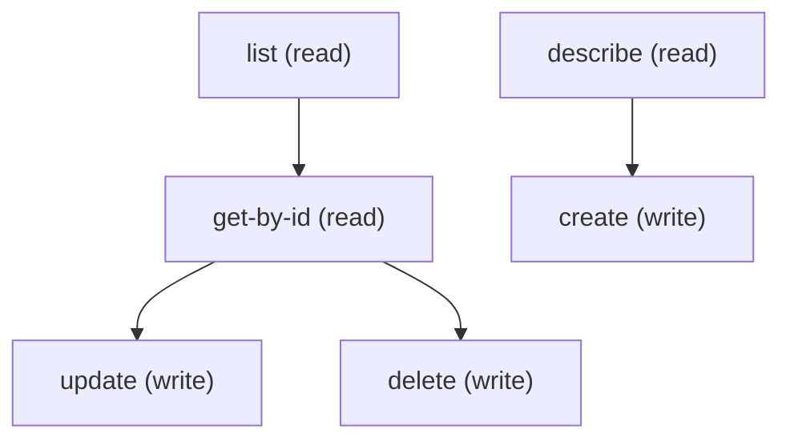

# Managing Explainability Msg Template

## When to Use This Skill

Manage Explainability Msg Template records via standard sObject REST. Use this to list, retrieve, create, update, or delete Explainability Msg Template entries in Setup.

## Workflow

Standard sObject REST provides full CRUD + describe on ExplainabilityMsgTemplate; no proprietary Aura controller is involved. Fields available at runtime come from /describe — the SOR doesn't enumerate them statically because the shape depends on the org's permission/profile setup. Run /describe first, then construct the payload from the createable fields list.

## Critical Constraints

**Preconditions:**

- User needs access to manage ExplainabilityMsgTemplate (CRUD on the ExplainabilityMsgTemplate sObject). (check: `Business Rules and Decisioning access && Business Rules and Decisioning access`)

## Operations Reference

Operations grouped by purpose. Use these as the building blocks for the workflows above.

### Summary

| Operation | Purpose | Status | Call | Depends on |
|-----------|---------|--------|------|------------|
| `describe` | read | — | `GET /services/data/v67.0/sobjects/ExplainabilityMsgTemplate/describe` | — |
| `list` | read | — | `GET /services/data/v67.0/query` | — |
| `get-by-id` | read | — | `GET /services/data/v67.0/sobjects/ExplainabilityMsgTemplate/{Id}` | `list` |
| `create` | write | — | `POST /services/data/v67.0/sobjects/ExplainabilityMsgTemplate` | `describe` |
| `update` | write | — | `PATCH /services/data/v67.0/sobjects/ExplainabilityMsgTemplate/{Id}` | `get-by-id` |
| `delete` | write | — | `DELETE /services/data/v67.0/sobjects/ExplainabilityMsgTemplate/{Id}` | `get-by-id` |

### Dependency graph

### Read operations

#### `describe`

Retrieve the ExplainabilityMsgTemplate sObject describe — fields, picklist values, FLS, createable/updateable flags.

**Call:** `GET /services/data/v67.0/sobjects/ExplainabilityMsgTemplate/describe`

**Output:** DescribeSObjectResult for ExplainabilityMsgTemplate — use this to build the field list for list / create / update payloads.

#### `list`

List ExplainabilityMsgTemplate records. Pair this with /describe first to pick field names.

**Call:** `GET /services/data/v67.0/query`

**Inputs:**

- `isDefault` *(`boolean`)* — Filter to the default template only (true) or non-defaults (false). Omit to return both.
- `messageType` *(`string`)* — Filter by message-type discriminator (matches MessageType field on ExplainabilityMsgTemplate).
- `searchKey` *(`string`)* — Free-text substring match across template name/message; case-insensitive.
- `stepType` *(`string`)* — Filter by expression-set step type (matches ExpressionSetStepType on the template).
- `usageType` *(`string`)* — Filter by emt usage-type discriminator (matches EmtUsageType on the template).

**Output:** Query response with records[] of ExplainabilityMsgTemplate — Id plus any SELECTed fields.

#### `get-by-id`

Retrieve a specific ExplainabilityMsgTemplate record by Id.

**Call:** `GET /services/data/v67.0/sobjects/ExplainabilityMsgTemplate/{Id}`

**Inputs:**

- `messageTemplateId` *(`string`)* — Id of the ExplainabilityMsgTemplate to retrieve. Pattern: ^(8U8)\w* (8U8 prefix per spec).

**Depends on:** `list`

**Output:** Single ExplainabilityMsgTemplate record with all readable fields per user FLS.

### Write operations

#### `create`

Create a new ExplainabilityMsgTemplate record. Run /describe first to learn the required + createable fields.

**Call:** `POST /services/data/v67.0/sobjects/ExplainabilityMsgTemplate`

**Inputs:**

- `body` *(`object`)* — Field/value map for the new ExplainabilityMsgTemplate. Populate from /describe's createableFields list.

**Depends on:** `describe`

**Rollback:** Call delete with the returned Id to undo the create.

#### `update`

Update an existing ExplainabilityMsgTemplate record. Merge-patch semantics.

**Call:** `PATCH /services/data/v67.0/sobjects/ExplainabilityMsgTemplate/{Id}`

**Inputs:**

- `Id` *(`ID`)* — Id of the ExplainabilityMsgTemplate to update.
- `body` *(`object`)* — Partial field/value map — only include fields you want to change.

**Depends on:** `get-by-id`

#### `delete`

Delete a ExplainabilityMsgTemplate record.

**Call:** `DELETE /services/data/v67.0/sobjects/ExplainabilityMsgTemplate/{Id}`

**Inputs:**

- `Id` *(`ID`)* — Id of the ExplainabilityMsgTemplate to delete.

**Depends on:** `get-by-id`
