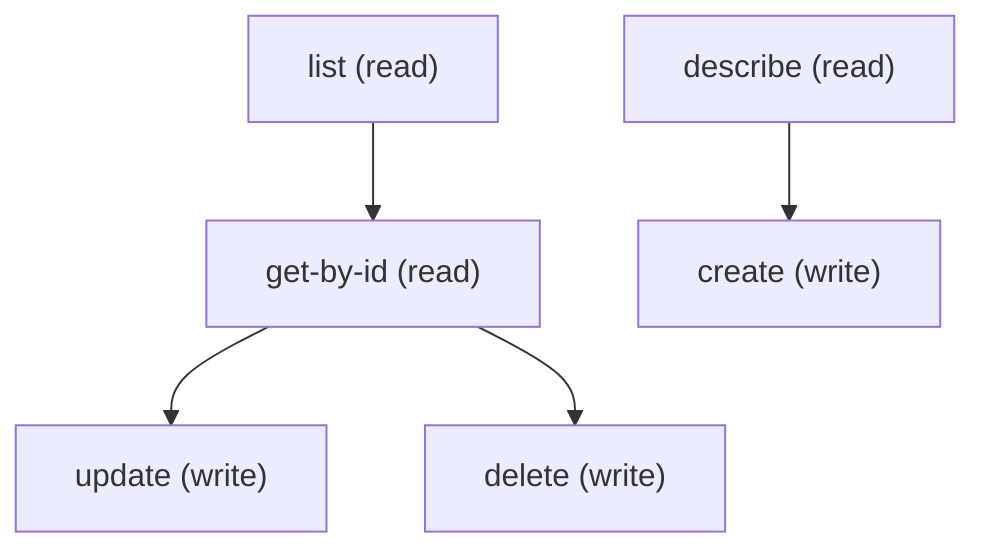

# Managing Expression Set Message Token

## When to Use This Skill

Registry of named tokens used by the Decision Explainability Service (DES) inside Business Rules Engine expression sets. Records here store token names referenced by name from expression-set step token-mapping payloads (`passedMessageTokenMappings` / `failedMessageTokenMappings` / `noResultMessageTokenMappings` arrays on calculation-procedure-step and expression-set-step inputs in industries-interaction-rule-connect-api). Tokens get substituted into Explainability Message Template message bodies at rule evaluation. No proprietary Aura controller and no per-record Connect/Tooling alternative — sObject REST is canonical. Run /describe first to discover the org's createable fields; the entity is gated by the BRE + DES feature flags.

## Workflow

Standard sObject REST provides full CRUD + describe on ExpressionSetMessageToken; no proprietary Aura controller is involved. Fields available at runtime come from /describe — the SOR doesn't enumerate them statically because the shape depends on the org's permission/profile setup. Run /describe first, then construct the payload from the createable fields list.

## Critical Constraints

**Preconditions:**

- User needs CRUD access to ExpressionSetMessageToken (check: `<udd:crud:ExpressionSetMessageToken>`)
- BRE (Business Rules Engine) and DES (Decision Explainability Service) features must be enabled at the org level AND for the running user — both gates are required for the setup page to render and for the sObject surface to behave. (check: `Business Rules and Decisioning access && Business Rules and Decisioning access`)
- User needs access to manage ExpressionSetMessageToken (CRUD on the ExpressionSetMessageToken sObject). (check: `Business Rules and Decisioning access && Business Rules and Decisioning access`)

## Operations Reference

Operations grouped by purpose. Use these as the building blocks for the workflows above.

### Summary

| Operation | Purpose | Status | Call | Depends on |
|-----------|---------|--------|------|------------|
| `describe` | read | — | `GET /services/data/v67.0/sobjects/ExpressionSetMessageToken/describe` | — |
| `list` | read | — | `GET /services/data/v67.0/query` | — |
| `get-by-id` | read | — | `GET /services/data/v67.0/sobjects/ExpressionSetMessageToken/{Id}` | `list` |
| `create` | write | — | `POST /services/data/v67.0/sobjects/ExpressionSetMessageToken` | `describe` |
| `update` | write | — | `PATCH /services/data/v67.0/sobjects/ExpressionSetMessageToken/{Id}` | `get-by-id` |
| `delete` | write | — | `DELETE /services/data/v67.0/sobjects/ExpressionSetMessageToken/{Id}` | `get-by-id` |

### Dependency graph

### Read operations

#### `describe`

Retrieve the ExpressionSetMessageToken sObject describe — fields, picklist values, FLS, createable/updateable flags.

**Call:** `GET /services/data/v67.0/sobjects/ExpressionSetMessageToken/describe`

**Output:** DescribeSObjectResult for ExpressionSetMessageToken — use this to build the field list for list / create / update payloads.

#### `list`

List ExpressionSetMessageToken records (the DES token-name registry). Pair with /describe first to pick field names. Token names returned here are the values referenced from expression-set step token-mapping payloads.

**Call:** `GET /services/data/v67.0/query`

**Inputs:**

- `where` *(`String`)* — Optional SOQL WHERE clause to filter Expression Set Message Token records.
- `limit` *(`int`)* — Optional SOQL LIMIT value.
- `q` *(`string`)*

**Output:** Query response with records[] of ExpressionSetMessageToken — Id plus any SELECTed fields.

#### `get-by-id`

Retrieve a specific ExpressionSetMessageToken record by Id.

**Call:** `GET /services/data/v67.0/sobjects/ExpressionSetMessageToken/{Id}`

**Inputs:**

- `Id` *(`ID`)* — Id of the ExpressionSetMessageToken record to fetch.

**Depends on:** `list`

**Output:** Single ExpressionSetMessageToken record with all readable fields per user FLS.

### Write operations

#### `create`

Create a new ExpressionSetMessageToken record. Run /describe first to learn the required + createable fields.

**Call:** `POST /services/data/v67.0/sobjects/ExpressionSetMessageToken`

**Inputs:**

- `body` *(`object`)* — Field/value map for the new ExpressionSetMessageToken. Populate from /describe's createableFields list.

**Depends on:** `describe`

**Rollback:** Call delete with the returned Id to undo the create.

#### `update`

Update an existing ExpressionSetMessageToken record. Merge-patch semantics.

**Call:** `PATCH /services/data/v67.0/sobjects/ExpressionSetMessageToken/{Id}`

**Inputs:**

- `Id` *(`ID`)* — Id of the ExpressionSetMessageToken to update.
- `body` *(`object`)* — Partial field/value map — only include fields you want to change.

**Depends on:** `get-by-id`

#### `delete`

Delete a ExpressionSetMessageToken record.

**Call:** `DELETE /services/data/v67.0/sobjects/ExpressionSetMessageToken/{Id}`

**Inputs:**

- `Id` *(`ID`)* — Id of the ExpressionSetMessageToken to delete.

**Depends on:** `get-by-id`
