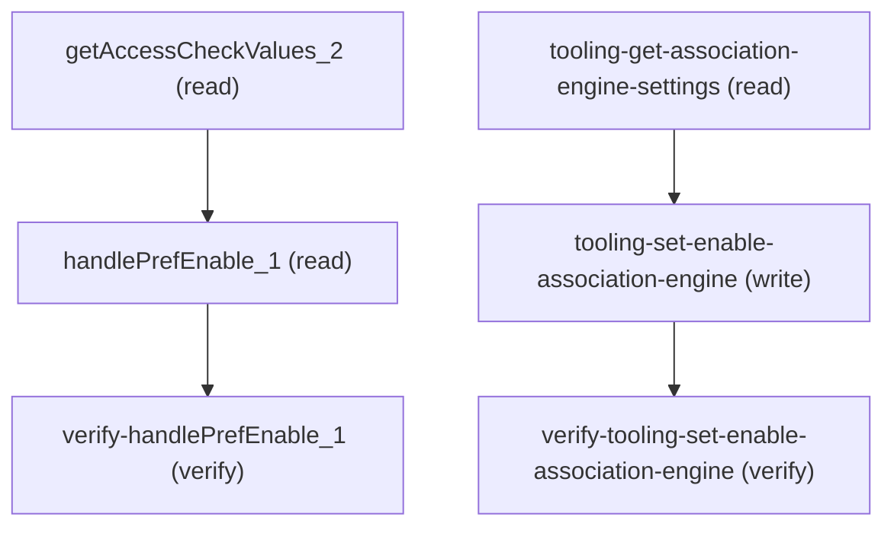

# Managing Fsc Association Engine Settings

## When to Use This Skill

Read and turn on or off the FSC Association Engine org preference. Prefer Tooling AssociationEngineSettings.enableAssociationEngine for the preference itself; use the Aura access-check read to learn whether the caller can modify it. Association-criteria management on this Setup page is a separate skill.

## Workflow

1. getAccessCheckValues_2 (Aura) — returns {allowModify, associationEngine}.
allowModify is whether Customize Application is on (the UI disables the
toggle when this is false). associationEngine is the current org-preference
state. This read also fails closed if View Setup or the Association Engine
org/user entitlement is missing.

2. tooling-set-enable-association-engine — preferred write. PATCH the
AssociationEngineSettings Tooling singleton (Id 000000000000000AAA) with
body {"FullName": "AssociationEngine", "Metadata": {"enableAssociationEngine":
<bool>}}. FullName is required; omitting it returns FIELD_INTEGRITY_EXCEPTION
"Full name must be specified to update metadata." enableAssociationEngine is
an absolute target state, not a flip. A successful PATCH returns empty / 204.

3. Re-read — either tooling-get-association-engine-settings
(Metadata.enableAssociationEngine) or getAccessCheckValues_2
(associationEngine). Assert the value equals what you sent.

Aura handlePrefEnable_1 is what the Setup toggle actually calls and it does
persist — live-verified — but prefer Tooling. The Aura write takes pref +
value; the only recognized pref is associationEngine (case-insensitive). An
unrecognized name or an empty string returns CONTROLLER_ERROR with an empty
message and does not change state. The Aura write is declared void, so the
200 body is empty even on a real persist; still re-read.

## Critical Constraints

**Preconditions:**

- User must have View Setup permission (read + write). (check: `UngroupedSettingAccessCheck.USER_PERMISSION_VIEW_SETUP`)
- User must have Customize Application permission to toggle the preference (write only). (check: `UngroupedSettingAccessCheck.USER_PERMISSION_CUSTOMIZE_APPLICATION`)
- Org must have the FSC Association Engine feature license enabled. (check: `AssociationEngineAccessCheck.ORG_HAS_ASSOCIATION_ENGINE`)
- User profile must carry the FSC Association Engine entitlement. (check: `AssociationEngineAccessCheck.USER_HAS_ASSOCIATION_ENGINE`)

**Operational rules:**

- CANONICAL SEQUENCE — check access, write via Tooling, re-read to verify.
- SCOPE — this Setup page has one agent-relevant control, the Association
Engine toggle. init and toggleAssociationEngine are UI wrappers over
getAccessCheckValues and handlePrefEnable (plus a success toast). The
association-criteria list on the same page is a separate skill; do not try
to manage criteria through this one.

## Verification Checklist

After every write operation, confirm the effect by re-reading state:

- After `handlePrefEnable_1`: call `verify-handlePrefEnable_1` (`GET /headless/invoke/platform/fsc-association-engine-settings`)
- After `tooling-set-enable-association-engine`: call `verify-tooling-set-enable-association-engine` (`GET /services/data/v67.0/tooling/query`)

## Operations Reference

Operations grouped by purpose. Use these as the building blocks for the workflows above.

### Summary

| Operation | Purpose | Status | Call | Depends on |
|-----------|---------|--------|------|------------|
| `getAccessCheckValues_2` | read | implemented | `GET /headless/invoke/platform/fsc-association-engine-settings` | — |
| `handlePrefEnable_1` | read | implemented | `PATCH /headless/invoke/platform/fsc-association-engine-settings/handle-pref-enable` | `getAccessCheckValues_2` |
| `verify-handlePrefEnable_1` | verify | implemented | `GET /headless/invoke/platform/fsc-association-engine-settings` | `handlePrefEnable_1` |
| `tooling-get-association-engine-settings` | read | implemented | `GET /services/data/v67.0/tooling/query` | — |
| `tooling-set-enable-association-engine` | write | implemented | `PATCH /services/data/v67.0/tooling/sobjects/AssociationEngineSettings/000000000000000AAA` | `tooling-get-association-engine-settings` |
| `verify-tooling-set-enable-association-engine` | verify | implemented | `GET /services/data/v67.0/tooling/query` | `tooling-set-enable-association-engine` |

### Dependency graph

### Read operations

#### `getAccessCheckValues_2`

Returns a two-key map: allowModify (true when the caller has Customize Application — the UI disables the toggle when false) and associationEngine (current org-preference state). This is NOT a map of permission-gate names; associationEngine is the preference itself. Requires View Setup plus the Association Engine org and user entitlements; otherwise the call errors. Does not require Customize Application to read. Live-verified 2026-09-02 against orgfarm-a557ae8f7b: {"associationEngine": false, "allowModify": true}.

**Call:** `GET /headless/invoke/platform/fsc-association-engine-settings`   — status: `implemented`

**Output:** Object with two booleans. allowModify: true when the caller can turn the preference on or off. associationEngine: true when Association Engine is currently enabled for the org. Both keys are always present. Live-verified 2026-09-02 against orgfarm-a557ae8f7b.

#### `handlePrefEnable_1`

Aura write the Setup toggle uses. Sets the Association Engine org preference to value (absolute on/off, not a flip). pref must be associationEngine (case-insensitive; ASSOCIATIONENGINE also works). An unrecognized name or an empty string returns CONTROLLER_ERROR with an empty message and does not change state — unlike Branch Management, this write does not silently ignore bad names. Returns void: a 200 body is empty. Prefer the Tooling write (tooling-set-enable-association-engine) for agents; keep this step because it is what the UI calls. Requires View Setup, Customize Application, and the Association Engine org and user entitlements. Live-verified 2026-09-02 against orgfarm-a557ae8f7b.

**Call:** `PATCH /headless/invoke/platform/fsc-association-engine-settings/handle-pref-enable`   — status: `implemented`

**Inputs:**

- `pref` *(`String`)*
- `value` *(`boolean`)*

**Depends on:** `getAccessCheckValues_2`

**Output:** Empty object. The Aura write is declared void. A 200 means the access gates passed and pref matched associationEngine; it is still not a substitute for re-reading associationEngine. An unrecognized pref does not return 200 — it returns CONTROLLER_ERROR with an empty message. Live-verified 2026-09-02: pref='associationEngine' returned 200 {} and persisted; pref='totallyBogusPrefName' and pref='' each returned CONTROLLER_ERROR and left the preference unchanged.

#### `tooling-get-association-engine-settings`

Public read of the same org preference the Setup toggle writes. Tooling SOQL on the AssociationEngineSettings singleton (one row per org, key prefix 0HE). Project the Metadata compound field and read enableAssociationEngine under it. This is the same value Aura returns as associationEngine — live-verified both directions. Does not return allowModify; use getAccessCheckValues_2 for that.

**Call:** `GET /services/data/v67.0/tooling/query`   — status: `implemented`

**Inputs:**

- `q` *(`String`)* — SOQL projecting Metadata, e.g. SELECT Id, FullName, Metadata FROM AssociationEngineSettings. Read enableAssociationEngine under Metadata.

**Output:** Tooling QueryResult with one record. Metadata.enableAssociationEngine is the current on/off state. FullName is AssociationEngine. Live-verified 2026-09-02 against orgfarm-a557ae8f7b.

### Write operations

#### `tooling-set-enable-association-engine`

Preferred write. PATCH the AssociationEngineSettings Tooling singleton. Body MUST include top-level FullName "AssociationEngine" plus the new state nested under Metadata, e.g. {"FullName": "AssociationEngine", "Metadata": {"enableAssociationEngine": true}}. Omitting FullName returns FIELD_INTEGRITY_EXCEPTION. enableAssociationEngine is an absolute target state. A successful PATCH is empty / 204; re-read to confirm. Live-verified 2026-09-02 against orgfarm-a557ae8f7b: this write flipped the Aura associationEngine value, and the Aura write flipped this field.

**Call:** `PATCH /services/data/v67.0/tooling/sobjects/AssociationEngineSettings/000000000000000AAA`   — status: `implemented`

**Inputs:**

- `body` *(`Object`)* — {"FullName": "AssociationEngine", "Metadata": {"enableAssociationEngine": <boolean>}}. FullName is required.

**Depends on:** `tooling-get-association-engine-settings`

**Output:** HTTP 204 / empty body on success. Re-read tooling-get-association-engine-settings or getAccessCheckValues_2 to confirm. Live-verified 2026-09-02 against orgfarm-a557ae8f7b.

### Verify operations

#### `verify-handlePrefEnable_1`

Re-read getAccessCheckValues_2 (or tooling-get-association-engine-settings) and assert associationEngine / enableAssociationEngine equals the value just written. Required after either write path. Live-verified 2026-09-02 against orgfarm-a557ae8f7b.

**Call:** `GET /headless/invoke/platform/fsc-association-engine-settings`   — status: `implemented`

**Depends on:** `handlePrefEnable_1`

#### `verify-tooling-set-enable-association-engine`

Re-read AssociationEngineSettings via Tooling SOQL and assert Metadata.enableAssociationEngine equals the value just written. Required after tooling-set-enable-association-engine. Live-verified 2026-09-02 against orgfarm-a557ae8f7b.

**Call:** `GET /services/data/v67.0/tooling/query`   — status: `implemented`

**Inputs:**

- `q` *(`String`)* — Same query as tooling-get-association-engine-settings: SELECT Id, FullName, Metadata FROM AssociationEngineSettings.

**Depends on:** `tooling-set-enable-association-engine`

**Output:** Metadata.enableAssociationEngine must equal the boolean sent on the preceding PATCH.
