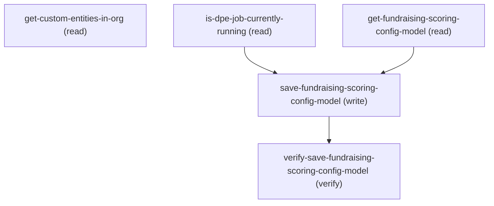

# Managing Fundraising Rfm

## When to Use This Skill

Manages the AffinityScoreDefinition that drives Nonprofit Cloud RFM (Recency, Frequency, Monetary) and CAP donor scoring. Reads/upserts the FundraisingScoringConfigModel for a given AffinityScoreType (RFM or CAP) — source/target object fields, score ranges, range count, lookback months. Save also regenerates and upserts the RFM_Score_Calculation Data Processing Engine job. Lists custom queryable sObjects available as source/target entities, and reports whether the DPE job is in flight (used to gate Save). All operations require the Fundraising Admin role guard plus View Setup.

## Workflow

Discover source/target sObjects via get-custom-entities-in-org and the existing config via get-fundraising-scoring-config-model (RFM or CAP). Gate save on is-dpe-job-currently-running == false. Save upserts the AffinityScoreDefinition, then separately (non-atomically) regenerates the RFM_Score_Calculation DPE; a DPE-regen failure leaves the AffinityScoreDefinition persisted with no rollback. Verify by re-reading the config.

## Critical Constraints

**Preconditions:**

- User must have IndustriesFundraising userIsFundraisingAdmin access (check: `Fundraising Admin role`)

## Verification Checklist

After every write operation, confirm the effect by re-reading state:

- After `save-fundraising-scoring-config-model`: call `verify-save-fundraising-scoring-config-model` (`GET /headless/invoke/platform/fundraising-rfm/get-fundraising-scoring-config-model`)

## Operations Reference

Operations grouped by purpose. Use these as the building blocks for the workflows above.

### Summary

| Operation | Purpose | Status | Call | Depends on |
|-----------|---------|--------|------|------------|
| `get-custom-entities-in-org` | read | implemented | `GET /headless/invoke/platform/fundraising-rfm` | — |
| `get-fundraising-scoring-config-model` | read | proposed | `GET /headless/invoke/platform/fundraising-rfm/get-fundraising-scoring-config-model` | — |
| `save-fundraising-scoring-config-model` | write | proposed | `PATCH /headless/invoke/platform/fundraising-rfm/save-fundraising-scoring-config-model` | `is-dpe-job-currently-running`, `get-fundraising-scoring-config-model` |
| `verify-save-fundraising-scoring-config-model` | verify | — | `GET /headless/invoke/platform/fundraising-rfm/get-fundraising-scoring-config-model` | `save-fundraising-scoring-config-model` |
| `is-dpe-job-currently-running` | read | proposed | `GET /headless/invoke/platform/fundraising-rfm/is-dpe-job-currently-running` | — |

### Dependency graph

### Read operations

#### `get-custom-entities-in-org`

Returns custom queryable sObjects (SObjectInfo records with per-user CRUD/FLS flags) available as RFM scoring source or target entities. No parameters. No public Connect/Tooling/Metadata/sObject alternative covers the typed SObjectInfo shape; the controller is the documented Setup-page interface.

**Call:** `GET /headless/invoke/platform/fundraising-rfm`   — status: `implemented`

**Output:** List of SObjectInfo records — each carries apiName, entityLabel, entityLabelPlural, keyPrefix, custom (true), customSetting, associateEntityType, associateParentEntity, plus per-user CRUD/FLS flags accessible/queryable/searchable/createable/deletable/updateable.

#### `get-fundraising-scoring-config-model`

Reads the AffinityScoreDefinition for the given affinityScoreType (RFM or CAP) and returns it as a FundraisingScoringConfigModel. Returns null when no definition exists yet; any affinityScoreType outside {RFM, CAP} is rejected as invalid input. AURA-IS-CANONICAL: substituting raw Tooling SOQL on AffinityScoreDefinition drops the AffinityScoreType allowlist and the typed FundraisingScoringConfigModel shape.

**Call:** `GET /headless/invoke/platform/fundraising-rfm/get-fundraising-scoring-config-model`   — status: `proposed`

**Inputs:**

- `affinityScoreType` *(`String`)*

**Output:** FundraisingScoringConfigModel wrapping a single affinityScoreDefinitionConfig field (mappedEntity + per-field accessors). When no AffinityScoreDefinition exists yet for the given affinityScoreType, the response body is an empty object ({}), NOT null — consumers checking for null-on-absent will misclassify a fresh org as an error.

**Notes:** error_contract: Any affinityScoreType value not exactly equal to "RFM" or "CAP" (case-sensitive) returns HTTP 500 with errorCode CONTROLLER_ERROR and message "Select a valid affinity score type." The same 500 is returned for lowercase "rfm", empty string, or a missing parameter — the enum check runs before any request-shape validation. Consumers should treat this as an input-validation contract, not a server fault.; case_sensitivity: affinityScoreType is case-sensitive at the controller boundary — only "RFM" and "CAP" (upper-case) are accepted.

#### `is-dpe-job-currently-running`

Returns true when the RFM_Score_Calculation Data Processing Engine job is actively executing; any other dpeJobDeveloperName is rejected as invalid input. AURA-IS-CANONICAL: the controller hard-restricts dpeJobDeveloperName to RFM_Score_Calculation, a server-enforced allowlist that a generic Tooling AsyncApexJob query cannot replicate.

**Call:** `GET /headless/invoke/platform/fundraising-rfm/is-dpe-job-currently-running`   — status: `proposed`

**Inputs:**

- `dpeJobDeveloperName` *(`String`)*

**Output:** Boolean — true when the RFM_Score_Calculation DPE job is currently executing in the org, false otherwise.

**Notes:** error_contract: Any dpeJobDeveloperName value not exactly equal to "RFM_Score_Calculation" returns HTTP 500 with errorCode CONTROLLER_ERROR and message "Select a valid DPE job developer name." This is a server-enforced hard allowlist, not a soft picklist — the controller has one and only one job name it will report on.; allowlist_reminder: dpeJobDeveloperName MUST be the literal string "RFM_Score_Calculation". Do not attempt to poll status of arbitrary DPE jobs through this endpoint.

### Write operations

#### `save-fundraising-scoring-config-model`

Validates all six inboundModel fields are non-null and affinityScoreType is in {RFM, CAP}, persists the AffinityScoreDefinition, then regenerates and upserts the corresponding RFM_Score_Calculation DPE definition in the same call. AURA-IS-CANONICAL: a raw Tooling upsert breaks atomicity by orphaning the DPE regeneration.

**Call:** `PATCH /headless/invoke/platform/fundraising-rfm/save-fundraising-scoring-config-model`   — status: `proposed`

**Inputs:**

- `inboundModel` *(`FundraisingScoringConfigInboundModel`)* — Value for inbound model.
  - schema: `#/components/schemas/FundraisingScoringConfigInboundModel`

**Depends on:** `is-dpe-job-currently-running`, `get-fundraising-scoring-config-model`

**Notes:** error_contract: Any missing or null inboundModel field, OR an affinityScoreType outside {RFM, CAP}, returns HTTP 500 with errorCode CONTROLLER_ERROR and the generic message "Select a valid inbound model." The save path unifies 6-field non-null validation and enum-allowlist enforcement into one error string — consumers cannot infer which field failed from the message alone and should pre-validate all six inboundModel fields client-side before calling.; atomicity: The AffinityScoreDefinition upsert (step 1) commits independently before DPE regeneration (step 3); any failure after step 1 — including but not limited to DPE regen errors — leaves the definition persisted with no rollback. Callers that receive a 500 should read back via get-fundraising-scoring-config-model before retrying, to avoid re-sending a definition that already committed.; read_before_write: Callers should first invoke get-fundraising-scoring-config-model for the same affinityScoreType to determine whether an existing definition needs to be merged, since the save is an upsert (the controller does not accept a partial patch of individual fields).; aura_canonical_rationale: AURA-IS-CANONICAL: no Connect API alternative exists for saving an AffinityScoreDefinition. Do not substitute with a raw Tooling API PATCH — that path bypasses the controller-enforced allowlist gate and the atomic DPE-regen coupling that this step provides.; validator_rules: All six inboundModel fields are required (non-null); additionally, content-level validation enforces: source weights must sum to exactly 1; each weight must be in (0, 1]; no duplicate source fields; no source field may equal a target field; all referenced sObjects and fields must exist and be queryable. Any of these failures returns the same generic 500 "Select a valid inbound model." Pre-validating all six fields for non-null is necessary but not sufficient.; permissions_prerequisite: DPE regeneration requires the running user to have the Data Pipelines permission; without it, save commits the AffinityScoreDefinition but regen fails with a 500 CONTROLLER_ERROR "We couldn't create or update the related Data Processing Engine definition... You don't have the required Data Pipelines permission."; recurring_refresh_scope: This skill produces the activated RFM_Score_Calculation DPE definition. Recurring score refresh scheduling is out of scope for this skill — no skill in this corpus schedules recurring DPE recalculation. Keeping scores fresh on a cadence requires the customer to configure their own scheduled automation (e.g., a Scheduled Flow or Apex Scheduler) that triggers recalculation.

### Verify operations

#### `verify-save-fundraising-scoring-config-model`

Reads back the AffinityScoreDefinition for the same affinityScoreType to confirm the save persisted; the saved field lists, score ranges, and counts must round-trip through the FundraisingScoringConfigModel.

**Call:** `GET /headless/invoke/platform/fundraising-rfm/get-fundraising-scoring-config-model`

**Inputs:**

- `affinityScoreType` *(`String`)*

**Depends on:** `save-fundraising-scoring-config-model`

**Notes:** aura_canonical_rationale: AURA-IS-CANONICAL: same rationale as save-fundraising-scoring-config-model. The verify step re-reads via the same Aura dispatcher path; no Connect API alternative exists.
