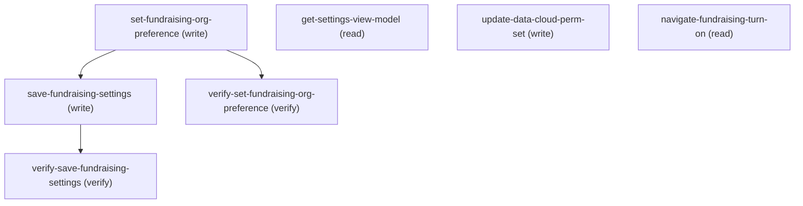

# Managing Fundraising Settings

## When to Use This Skill

Configures the Fundraising org preference and the singleton FundraisingConfig persistence row for Nonprofit Cloud / Industries Fundraising. Note: set-fundraising-org-preference is a one-way, org-wide, irreversible enable with no disable path (source-confirmed) -- dispatchable, but a caller MUST obtain an explicit, dedicated confirmation of that irreversibility from the requesting admin before calling it; navigate-fundraising-turn-on remains available as a human-driven alternative. saveFundraisingSettings persists FundraisingConfig fields: failed/lapsed transaction auto-status thresholds, installment grace days, donorMatchingMethod (Duplicate_Management_Rules | No_Matching -- source-confirmed exactly these 2 members exist; Duplicate_Management_Rules is the default value, not a separate third enum constant -- there is no hidden or unofferred value), donor external-ID custom field, recurring auto-create + auto-close flags, and NextGen Commitment Processing batch size / max threads / parallel toggle (only max threads is range-validated -- see save-fundraising-settings notes). updateDataCloudPermSet assigns the Data Cloud permission set required for the Fundraising / Data Cloud integration. The LWC toggles for Philanthropic Research / Gift Planning / Gift Agreement / Gift-* validations are NOT in this controller -- those route through sibling Industries Fundraising controllers.

## Workflow

All 4 base methods stay on the Aura controller path for headless execution -- no public Connect / Tooling / Metadata / sObject substitution preserves the full contract (composite view-model assembly, server-enforced field-validation ranges, hardcoded Data Cloud perm-set + Fundraising Admin role gate). The 4th, setFundraisingOrgPreference, is a one-way, org-wide, irreversible enable with no disable path -- dispatchable, but ONLY after obtaining an explicit, dedicated confirmation of that irreversibility from the requesting admin (distinct from any general confirm-to-write checkpoint); the Setup UI gates the equivalent "Turn On" toggle behind the same kind of explicit irreversibility-acceptance modal. Use navigate-fundraising-turn-on instead when the admin would rather accept that modal themselves.

For source-controlled deployment of a subset of the persisted FundraisingConfig row, the Metadata API type `FundraisingConfig` (directory `fundraisingConfigs/`, suffix `.fundraisingConfig`) is a documented partial-coverage alternative. Its documented Fields spec covers 6 of 10 inboundModel fields via `.fundraisingConfig` XML: donorMatchingMethod, failedTransactionCount, installmentExtDayCount, lapsedUnpaidTrxnCount, shouldClosePaidRcrCmt, shouldCreateRcrSchdTrxn. A 7th, donorExternalIdField, appears in the type's sample XML but not in its documented Fields table -- treat that one as unconfirmed rather than relying on it. It does NOT reach the NextGen Commitment Processing knobs (isNextGenCmtPrcsParallel, nextGenCmtPrcsBatchSize, nextGenCmtPrcsMaxThreads), does NOT drive the org-preference enable, and does NOT perform the write-on-read default-row initialization getSettingsViewModel does. Use the Metadata API path when an admin wants source-controlled deployment of the 6 documented fields; use Aura for NextGen tuning, donorExternalIdField, and full-atomic writes.

Order: (1) get-settings-view-model probes orgPreferenceEnabled + current FundraisingConfig values + DonorMatchingMethod picklist. (2) If orgPreferenceEnabled is false, obtain an explicit, dedicated confirmation of the one-way/irreversible/no-disable-path nature of the enable from the requesting admin, then call set-fundraising-org-preference; without that confirmation, call navigate-fundraising-turn-on instead to route the admin to accept the Setup UI's own irreversibility modal themselves. (3) Once enabled (the normal steady-state case, or immediately after step 2), save-fundraising-settings writes user-supplied FundraisingConfig field values. (4) update-data-cloud-perm-set is independent -- assigns the hardcoded Data Cloud perm set when the Fundraising / Data Cloud integration is needed. Verify writes by re-reading get-settings-view-model and comparing orgPreferenceEnabled / settingsFields (the two verify steps do exactly this).

## Critical Constraints

**Preconditions:**

- User must have Fundraising Admin role access. (check: `Fundraising Admin role`)

## Verification Checklist

After every write operation, confirm the effect by re-reading state:

- After `set-fundraising-org-preference`: call `verify-set-fundraising-org-preference` (`GET /headless/invoke/platform/fundraising-settings/get-settings-view-model`)
- After `save-fundraising-settings`: call `verify-save-fundraising-settings` (`GET /headless/invoke/platform/fundraising-settings/get-settings-view-model`)

## Operations Reference

Operations grouped by purpose. Use these as the building blocks for the workflows above.

### Summary

| Operation | Purpose | Status | Call | Depends on |
|-----------|---------|--------|------|------------|
| `set-fundraising-org-preference` | write | implemented | `PATCH /headless/invoke/platform/fundraising-settings/set-fundraising-org-preference` | — |
| `get-settings-view-model` | read | implemented | `GET /headless/invoke/platform/fundraising-settings/get-settings-view-model` | — |
| `save-fundraising-settings` | write | implemented | `PATCH /headless/invoke/platform/fundraising-settings/save-fundraising-settings` | `set-fundraising-org-preference` |
| `update-data-cloud-perm-set` | write | implemented | `PATCH /headless/invoke/platform/fundraising-settings/update-data-cloud-perm-set` | — |
| `verify-set-fundraising-org-preference` | verify | implemented | `GET /headless/invoke/platform/fundraising-settings/get-settings-view-model` | `set-fundraising-org-preference` |
| `verify-save-fundraising-settings` | verify | implemented | `GET /headless/invoke/platform/fundraising-settings/get-settings-view-model` | `save-fundraising-settings` |
| `navigate-fundraising-turn-on` | read | — | `FundraisingSettings.turnOn` | — |

### Dependency graph

### Read operations

#### `get-settings-view-model`

Returns FundraisingSettingsModel: orgPreferenceEnabled (boolean), settingsFields (FundraisingConfig field-value wrapper, populated only when the org pref is on), and donorMatchingPicklist (JSON-encoded DonorMatchingMethod picklist). Side effect: when orgPreferenceEnabled=true but no FundraisingConfig row exists, the controller auto-creates the default row and returns it. No parameters; no public read-only alternative reconstructs the composite (org-pref flag + FundraisingConfig + picklist + write-on-read default). Requires View Setup and System Administrator access.

**Call:** `GET /headless/invoke/platform/fundraising-settings/get-settings-view-model`   — status: `implemented`

**Output:** FundraisingSettingsGetsettingsviewmodelRepresentation: orgPreferenceEnabled (boolean — whether Fundraising org pref is on; settingsFields and donorMatchingPicklist are unpopulated when false), settingsFields (Fields wrapper exposing the FundraisingConfig field accessors), donorMatchingPicklist (JSON-encoded DonorMatchingMethod picklist for client rendering). Naming note: the failed-transaction threshold round-trips under different names — save-fundraising-settings writes it as failedTransCount, but it reads back here as failingTransCount. When verifying a write, compare against failingTransCount, not failedTransCount.

#### `navigate-fundraising-turn-on`

Optional human-driven alternative to dispatching set-fundraising-org-preference directly: routes a human admin to the Fundraising Settings Setup page to turn on Nonprofit Cloud for Fundraising themselves, accepting the Setup UI's own irreversibility-acceptance modal in the process. The underlying setFundraisingOrgPreference() call is a one-way, org-wide, irreversible enable with no disable path (source-confirmed) -- an agent that has NOT obtained the dedicated irreversibility confirmation required to dispatch set-fundraising-org-preference directly should route the admin here instead of proceeding without it. Once enabled (whether via this navigation or a direct confirmed dispatch), the rest of this skill -- get-settings-view-model, save-fundraising-settings, update-data-cloud-perm-set -- is fully headlessly executable.

**Call:** `FundraisingSettings.turnOn`

### Write operations

#### `set-fundraising-org-preference`

Atomic enable: turns ON the Fundraising org preference and writes the default FundraisingConfig row in one transaction. Enable-only -- no parameters, no request body, no disable path anywhere in the call chain (source-confirmed: FundraisingSettingsController.setFundraisingOrgPreference -> FundraisingSettingsServiceImpl.setOrgPreference hardcodes ORG_PREFERENCE_FUNDRAISING_ENABLED, ORG_PREFERENCE_GIFT_ENTRY_GRID_ENABLED, and ORG_PREFERENCE_FR_ENHANCED_CMT_PRSCR_ENABLED to true with no branch). This is a one-way, org-wide, irreversible action -- the Setup UI gates the equivalent "Turn On" toggle behind an explicit irreversibility-acceptance modal (source-confirmed verbatim, label industries-fundraising.xml|FundraisingSettings|fundraisingSettingsModalBodyText: "After enabling Nonprofit Cloud for Fundraising, it can't be disabled. We recommend that you try Fundraising in a sandbox before turning it on in your Salesforce org."). A caller MUST obtain an explicit, dedicated confirmation of that irreversibility from the requesting admin before dispatching this step -- distinct from any general confirm-to-write checkpoint. navigate-fundraising-turn-on remains available as a human-driven alternative for an admin who'd rather accept that modal themselves. Verify with verify-set-fundraising-org-preference (re-reads get-settings-view-model and asserts orgPreferenceEnabled=true). Requires View Setup and System Administrator access.

**Call:** `PATCH /headless/invoke/platform/fundraising-settings/set-fundraising-org-preference`   — status: `implemented`

**Output:** No response body (controller method return type is void; PATCH returns 204 No Content on success). Verify by re-reading get-settings-view-model and asserting orgPreferenceEnabled=true.

#### `save-fundraising-settings`

Persists user-supplied values into the singleton FundraisingConfig row: failed-transaction auto-status threshold (failedTransCount, field-level validated 0-15), lapsed-unpaid threshold (lapsedUnpaidTransCount, field-level validated 0-15), installment grace days (installmentExtDayCount, field-level validated 0-365), donorMatchingMethod (Duplicate_Management_Rules | No_Matching -- source-confirmed exactly these 2 members exist; Duplicate_Management_Rules is the default value, not a separate third enum constant), donorExternalIdField (CustomFieldDefinition restricted by SupportedFundraisingDonorExternalFields), createRecurringScheduleTransaction + autoCloseRecurringCommitment flags, and NextGen Commitment Processing batch size (nextGenCmtPrcsBatchSize, NOT range-validated -- see notes) / max threads (nextGenCmtPrcsMaxThreads, field-level validated 0-5) / parallel toggle. See notes.validation_enforcement_layer for how the range checks behave and notes.error_fidelity_gap for the out-of-range failure mode. No public alternative. Requires View Setup and System Administrator access.

**Call:** `PATCH /headless/invoke/platform/fundraising-settings/save-fundraising-settings`   — status: `implemented`

**Inputs:**

- `inboundModel` *(`FundraisingSettingsInboundModel`)* — Value for inbound model.
  - schema: `#/components/schemas/FundraisingSettingsInboundModel`

**Depends on:** `set-fundraising-org-preference`

**Output:** No response body (controller method return type is void; PATCH returns 204 No Content on success). Verify by re-reading get-settings-view-model.settingsFields and comparing to the inboundModel that was sent.

**Notes:** metadata_api_alternative: Documented partial-coverage sibling write surface: Metadata API type `FundraisingConfig` (directory `fundraisingConfigs/`, suffix `.fundraisingConfig`) deploys 6 of 10 inboundModel fields via source-controlled XML, per its documented Fields table.

Field-name map (inboundModel → FundraisingConfig): donorMatchingMethod → donorMatchingMethod; failedTransCount → failedTransactionCount; installmentExtDayCount → installmentExtDayCount; lapsedUnpaidTransCount → lapsedUnpaidTrxnCount; createRecurringScheduleTransaction → shouldCreateRcrSchdTrxn; autoCloseRecurringCommitment → shouldClosePaidRcrCmt.

Unconfirmed 7th field: donorExternalIdField → donorExternalIdField appears in the type's sample XML but is not in its documented Fields table — treat as unverified, not a confirmed sibling mapping.

Not covered by FundraisingConfig (Aura-only): isNextGenCmtPrcsParallel, nextGenCmtPrcsBatchSize, nextGenCmtPrcsMaxThreads. Use Aura when any NextGen knob is set or when donorExternalIdField needs a confirmed write path; use FundraisingConfig for source-controlled deployment of the 6 documented fields.; validation_enforcement_layer: The 0-15 (failed/lapsed), 0-365 (installment), and 0-5 (max threads) ranges are enforced as a hard rejection with no partial write (live-confirmed: an out-of-range 999 write was rejected outright). nextGenCmtPrcsBatchSize has no equivalent range enforcement -- out-of-range values are silently accepted with no cap, unlike the other four fields. There is no public (non-Aura) write path that reproduces this same enforcement behavior, which is why this step has no substitution alternative.; error_fidelity_gap: Out-of-range writes fail as a bare 500 INTERNAL_ERROR, not a 400 or a validation-shaped error message (live-confirmed on the 999 negative-range probe). The guard works -- the value is rejected and no partial write occurs -- but an agent cannot distinguish "bad input I should retry with a corrected value" from "server fault, retrying won't help."

#### `update-data-cloud-perm-set`

Assigns the Data Cloud permission set required for the Fundraising / Data Cloud integration to the calling user. Returns boolean (true on success). Gated by Fundraising Admin role (server-enforced -- not duplicated by sObject CRUD). The target permission set is fixed, not admin-configurable; substituting with a raw PermissionSetAssignment Tooling create would force the agent to discover the permission-set name out-of-band and drop the admin-role gate this step enforces.

**Call:** `PATCH /headless/invoke/platform/fundraising-settings/update-data-cloud-perm-set`   — status: `implemented`

**Output:** Boolean — true when the Data Cloud permission-set assignment succeeded. The boolean is itself the verify signal; no separate read-back endpoint is exposed by this controller.

**Notes:** access_guard_detail: Source-confirmed: this is the most tightly gated of the 4 steps. It carries the same View Setup and System Administrator access gate as all 4 methods, AND an additional controller-level Fundraising Admin role check none of the other 3 methods have.; cross_skill_grant_inconsistency: This step directly and unconditionally grants the Data Cloud Salesforce Connector permission set to the calling admin on every successful call. It is admin-gated and self-scoped -- it grants permissions to the calling admin only, not an org-wide or package consent grant.

### Verify operations

#### `verify-set-fundraising-org-preference`

Read get-settings-view-model and assert orgPreferenceEnabled=true to confirm set-fundraising-org-preference took effect. Same controller method as the get-settings-view-model read step; getSettingsViewModel returns the org-pref flag the enable just flipped.

**Call:** `GET /headless/invoke/platform/fundraising-settings/get-settings-view-model`   — status: `implemented`

**Depends on:** `set-fundraising-org-preference`

**Notes:** role_as_confirmation_support: Useful both before and after set-fundraising-org-preference: pre-check whether the org preference is already enabled (the normal steady-state case) before deciding whether the dedicated irreversibility confirmation and dispatch are even needed, and post-write to confirm the enable landed (orgPreferenceEnabled=true).

#### `verify-save-fundraising-settings`

Read get-settings-view-model and compare settingsFields against the inboundModel sent to save-fundraising-settings to confirm the FundraisingConfig values persisted. Same controller method as the get-settings-view-model read step; getSettingsViewModel returns the persisted FundraisingConfig wrapped in settingsFields. Note the failedTransCount/failingTransCount naming asymmetry documented on get-settings-view-model's output -- comparison logic must map failedTransCount to failingTransCount, not compare field names literally.

**Call:** `GET /headless/invoke/platform/fundraising-settings/get-settings-view-model`   — status: `implemented`

**Depends on:** `save-fundraising-settings`
