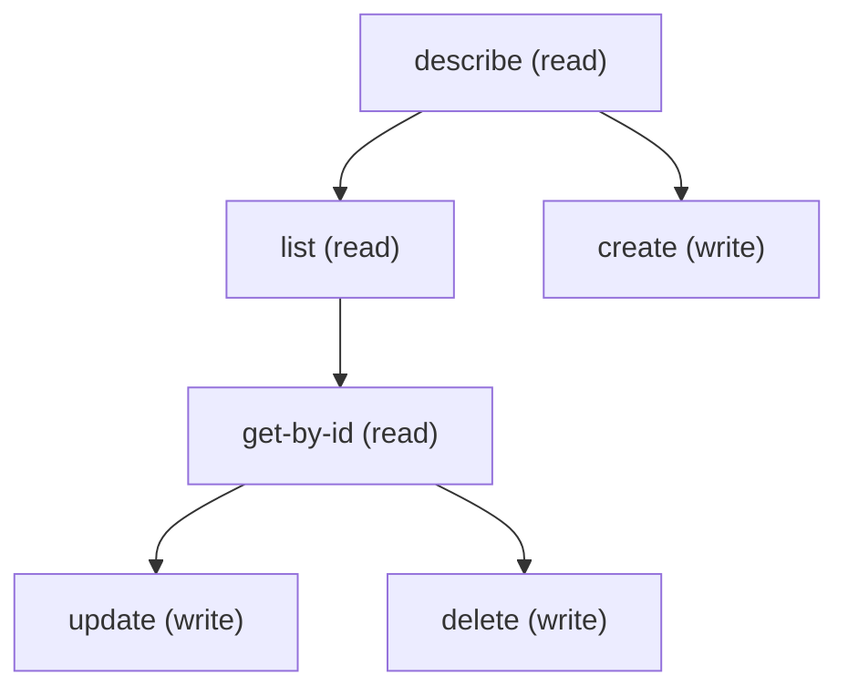

# Managing Hc Score Category Settings

## When to Use This Skill

CRUD on ScoreCategory records via standard sObject REST — describe, list, get-by-id, create, update, delete. Run /describe first, then build payloads from createableFields. The hierarchical projection (parent/child tree, decorated with iconUrl/parentName/developerName via the ScoreCategoryHierarchy type) is NOT served here; use the sibling SOR ScoreCategorySettings (op `industries.industries-healthcare.score-category-setup-page.getScoreCategories`) when the agent needs the tree shape.

## Workflow

Standard sObject REST provides full CRUD + describe on ScoreCategory; no proprietary controller is involved. Run /describe first, then build payloads from createableFields — the shape depends on the org's permission/profile setup, so the SOR does not enumerate fields statically. Wire constraints an admin will hit: CategoryName is required and capped at 25 chars; MasterLabel caps at 40; Description caps at 255; Language is a restricted locale picklist and defaults to en_US when omitted at create; DeveloperName is settable at create despite /describe reporting createable:false, and auto-derives from CategoryName when omitted (must begin with a letter, alphanumeric + underscore only, no consecutive or trailing underscores, unique within the org). ParentCategoryId is a self-FK, so parent/child relationships are reachable via plain SOQL on this SOR when only the tree shape is needed; use the sibling SOR ScoreCategorySettings when the tree needs the decorated projection (iconUrl / parentName / developerName). Deleting a parent cascades to its children automatically.

## Critical Constraints

**Preconditions:**

- User needs CRUD access to ScoreCategory. (check: `<udd:crud:ScoreCategory>`)
- Org must have the Health Cloud / Holistic Patient Index feature line provisioned (the ScoreCategory entity ships with Health Cloud — orgs without Health Cloud provisioned will not see the entity).

## Operations Reference

Operations grouped by purpose. Use these as the building blocks for the workflows above.

### Summary

| Operation | Purpose | Status | Call | Depends on |
|-----------|---------|--------|------|------------|
| `describe` | read | — | `GET /services/data/v67.0/sobjects/ScoreCategory/describe` | — |
| `list` | read | — | `GET /services/data/v67.0/query` | `describe` |
| `get-by-id` | read | — | `GET /services/data/v67.0/sobjects/ScoreCategory/{Id}` | `list` |
| `create` | write | — | `POST /services/data/v67.0/sobjects/ScoreCategory` | `describe` |
| `update` | write | — | `PATCH /services/data/v67.0/sobjects/ScoreCategory/{Id}` | `get-by-id` |
| `delete` | write | — | `DELETE /services/data/v67.0/sobjects/ScoreCategory/{Id}` | `get-by-id` |

### Dependency graph

### Read operations

#### `describe`

Retrieve the ScoreCategory sObject describe — fields, picklist values, FLS, createable/updateable flags.

**Call:** `GET /services/data/v67.0/sobjects/ScoreCategory/describe`

**Output:** DescribeSObjectResult for ScoreCategory — use this to build the field list for list / create / update payloads.

**Notes:** developerName_describe_mismatch: /describe reports DeveloperName createable:false — but the wire actually ACCEPTS DeveloperName in the create
payload and honors the caller-supplied value. Agents that trust describe alone will not know they can
override the auto-derived value. POST with an explicit DeveloperName returns 201 and the record keeps
the supplied value.; child_relationships: {'ChildScoreCategories': {'cascadeDelete': True, 'note': 'Deleting a parent ScoreCategory automatically deletes its children. A subsequent GET on a\nchild record after the parent is gone returns 404 NOT_FOUND; a subsequent DELETE on the same\nrecord returns 404 INVALID_CROSS_REFERENCE_KEY instead — the two verbs report different error\ncodes for the same gone-due-to-cascade record.'}}

#### `list`

List ScoreCategory records via SOQL. Pair with /describe first to pick field names. ParentCategoryId is a self-FK, so a query that selects it (and optionally the parent's Name via a relationship traversal) returns the parent/child tree shape without leaving this SOR — reach for the sibling SOR ScoreCategorySettings only when the decorated projection (iconUrl / parentName / developerName) is needed.

**Call:** `GET /services/data/v67.0/query`

**Inputs:**

- `where` *(`String`)* — Optional SOQL WHERE clause to filter Score Category records.
- `limit` *(`int`)* — Optional SOQL LIMIT value.
- `q` *(`string`)*

**Depends on:** `describe`

**Output:** Query response with records[] of ScoreCategory — Id plus any SELECTed fields.

**Notes:** soql_relationship_name: SOQL traversal from ScoreCategory back to its parent uses the relationship name "ParentCategory", NOT the
standard "Parent" token most sObjects expose. A query like "SELECT ParentCategory.CategoryName FROM
ScoreCategory" succeeds; "SELECT Parent.CategoryName FROM ScoreCategory" returns 400 INVALID_FIELD with
"Didn't understand relationship 'Parent'". The relationship name is discoverable via
GET /sobjects/ScoreCategory/describe under fields.ParentCategoryId.relationshipName. When constructing
tree-view queries agents should traverse via ParentCategory.{field} rather than the generic Parent.{field}.; query_example: SELECT Id, CategoryName, MasterLabel, ParentCategoryId, ParentCategory.CategoryName, Description, IconUrl FROM ScoreCategory ORDER BY ParentCategoryId NULLS FIRST

#### `get-by-id`

Retrieve a specific ScoreCategory record by Id.

**Call:** `GET /services/data/v67.0/sobjects/ScoreCategory/{Id}`

**Inputs:**

- `Id` *(`ID`)* — Id of the ScoreCategory record to fetch.

**Depends on:** `list`

**Output:** Single ScoreCategory record with all readable fields per user FLS.

### Write operations

#### `create`

Create a ScoreCategory record. CategoryName is required (max 25 chars); MasterLabel is the admin display label (max 40). Language defaults to en_US when omitted. DeveloperName auto-derives from CategoryName — override only when a specific API name is needed (must begin with a letter, alphanumeric + underscore only, no consecutive or trailing underscores, unique within the org).

**Call:** `POST /services/data/v67.0/sobjects/ScoreCategory`

**Inputs:**

- `body` *(`object`)* — Field/value map for the new ScoreCategory. Populate from /describe's createableFields list.

**Depends on:** `describe`

**Output:** Standard sObject REST create response — {"id": "<new-Id>", "success": true, "errors": []}. Use the id in downstream get-by-id / update / delete steps. On failure, HTTP status is 400 and body is an array of {"errorCode","message","fields":[...]} entries.

**Rollback:** Call delete with the returned Id to undo the create.

**Notes:** error_contracts: {'duplicate_developer_name': '400 DUPLICATE_VALUE (NOT DUPLICATE_DEVELOPER_NAME) when a POST supplies a DeveloperName already in use. Message is generic ("duplicate value found: <unknown> duplicates value on record with id: <unknown>") — the field name is not echoed, so callers must attribute by context.', 'bad_parent_reference': '400 INSUFFICIENT_ACCESS_ON_CROSS_REFERENCE_ENTITY when ParentCategoryId points at a nonexistent or inaccessible record. Same error covers "no such record" and "record exists but user lacks CRUD/FLS" — the caller cannot distinguish from the error alone.', 'unknown_field': '400 INVALID_FIELD when the body carries a field name not on ScoreCategory ("No such column \'<name>\' on sobject of type ScoreCategory"). Run /describe first to enumerate valid field names.', 'oversized_payload_5xx': 'MasterLabel > ~255 chars can return 500 UNKNOWN_EXCEPTION with a support ErrorId instead of a clean 400 STRING_TOO_LONG. Treat any 500 as a retryable/report-worthy server condition; enforce reasonable client-side length caps rather than probing the boundary.', 'self_parenting_foot_gun': "Wire does NOT reject self-parenting — setting ParentCategoryId to the record's own Id is accepted with 204/201, with no cycle detection. Validate client-side before writing."}

#### `update`

Update an existing ScoreCategory record. Merge-patch semantics.

**Call:** `PATCH /services/data/v67.0/sobjects/ScoreCategory/{Id}`

**Inputs:**

- `Id` *(`ID`)* — Id of the ScoreCategory to update.
- `body` *(`object`)* — Partial field/value map — only include fields you want to change.

**Depends on:** `get-by-id`

**Rollback:** GET the record before update to capture the prior state, then PATCH the same fields back with the captured values to undo.

**Notes:** error_contracts: {'system_field_write': '400 INVALID_FIELD_FOR_INSERT_UPDATE when PATCH body includes a non-updateable/system field (CreatedDate, CreatedById, LastModifiedDate, LastModifiedById, SystemModstamp, IsDeleted, Id).', 'null_clears_optional': 'PATCH with a field set to null returns 204 and clears the value (verified on Description). Use this instead of omitting the field, which would preserve the prior value under merge semantics.', 'developer_name_mutable': 'DeveloperName can be renamed via PATCH — wire returns 204 and the record reflects the new value on read-back. The base sObject uniqueness constraint still applies (renaming to a value already in use returns 400 DUPLICATE_VALUE).'}; field_constraints_on_patch: CategoryName remains capped at 25 chars under PATCH. MasterLabel and Description are enforced more loosely than /describe reports (short overflows accepted; very large payloads may 500). Language stays restricted-picklist.

#### `delete`

Delete a ScoreCategory record.

**Call:** `DELETE /services/data/v67.0/sobjects/ScoreCategory/{Id}`

**Inputs:**

- `Id` *(`ID`)* — Id of the ScoreCategory to delete.

**Depends on:** `get-by-id`

**Notes:** cascade_delete: Deleting a parent ScoreCategory automatically deletes all its children (ChildScoreCategories relationship carries
cascadeDelete=true). A subsequent GET on a child record after the parent is deleted returns 404 NOT_FOUND;
a subsequent DELETE on the same child returns 404 INVALID_CROSS_REFERENCE_KEY instead — not 204 either way,
but the two verbs report different error codes for the same gone-due-to-cascade record. Callers who need
to delete only the parent and re-parent children must first PATCH each child's ParentCategoryId to null
or to another parent before deleting the original parent.; developer_name_uniqueness_release: A hard DELETE releases the DeveloperName uniqueness constraint immediately — a subsequent POST with the same
DeveloperName the deleted record used returns 201, not the DUPLICATE_VALUE error a still-live record would
produce. This makes delete-then-recreate a valid pattern for renaming or shape-correcting a category without
needing an intermediate name. There is no Recycle Bin restore path for ScoreCategory (it is not a standard
soft-delete sObject), so the release is permanent.
