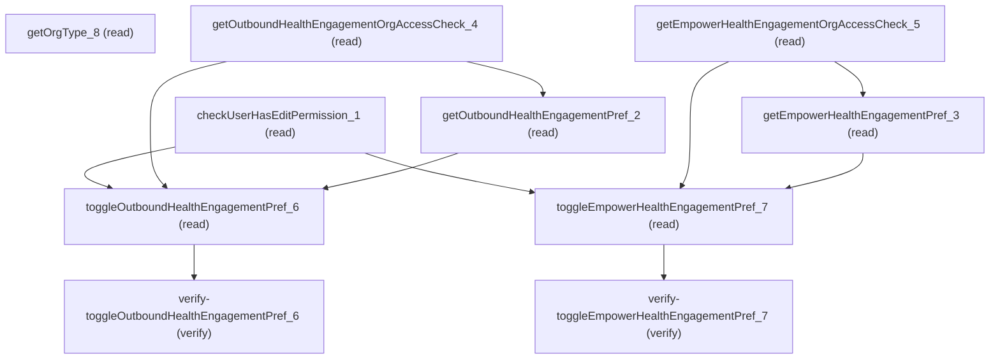

# Querying Health Engagement Settings

## When to Use This Skill

Read and toggle two Health Cloud org preferences — Outbound Health Engagement (proactive patient outreach, `IndustriesSettings.OrgPreferences.outboundHealthEngagement`) and Empower Health Engagement (patient self-service, `IndustriesSettings.OrgPreferences.empowerHealthEngagement`). All routes are AURA-IS-CANONICAL: the health-engagement setup endpoint enforces a per-call `Health Cloud outbound enabled/EmpowerHealthEngagement` AccessCheck before write (throws `AuraHandledException` with a localized NoAccessMessage on denial), self-heals a stale-true preference when access is later revoked, and emits PFT telemetry on toggle. Substituting Metadata API `IndustriesSettings.enable*HealthEngagement` deploy is contract-lossy. Pre-call sequence: check user edit permission → read org access check for each feature → read current pref → toggle. `getOrgType` exposes the Health Engagement configuration variant used for UI routing.

## Workflow

Two independent org preferences on one Setup page: Outbound Health Engagement
(proactive outreach) and Empower Health Engagement (patient self-service).
Each preference has its own read/access-check/toggle triple; the two triples
do not compose — pick the one the customer named.

Per-preference workflow (Outbound shown; Empower is symmetric):

### Phase 1: Gate the page

checkUserHasEditPermission_1 requires Customize Application or
System Admin. Same gate for both preferences.

### Phase 2: Check org access

getOutboundHealthEngagementOrgAccessCheck_4 is the org
licence/feature gate. Side effect — a false response auto-resets the preference
to false server-side.

### Phase 3: Read current value

getOutboundHealthEngagementPref_2 returns the current
preference value.

### Phase 4: Write the toggle

toggleOutboundHealthEngagementPref_6 PATCHes the
preference. The request body carries a required boolean under `value` (a missing
boolean surfaces as a deserialization error before the AccessCheck runs). Success
returns an empty response body; on AccessCheck denial the step throws
AuraHandledException carrying a localized NoAccessMessage label.

### Phase 5: Verify the write

verify-toggleOutboundHealthEngagementPref_6 reads back the
value (the toggle returns void, so a post-write GET is the only confirmation of
the new state).

Access denial contract: when the per-preference AccessCheck is off, the toggle
step throws AuraHandledException carrying a localized NoAccessMessage label.
Agents must not retry — remediation is org licensing, not caller-side.

Metadata API is not a viable substitute: an IndustriesSettings deploy is
scratch-org gated and drops the per-call AccessCheck + PFT emit; every step
here is AURA-IS-CANONICAL.

## Critical Constraints

**Preconditions:**

- Health Cloud must be licensed and provisioned for the org. The `HealthEngagementSettings` Setup page is only reachable when the HealthCloud feature is enabled (the controller's per-method AccessCheck flags `Outbound Health Engagement feature` / `orgHasEmpowerHealthEngagement` will otherwise return false and the toggles will be hidden / non-functional). (check: `Outbound Health Engagement feature / Health Engagement enabled`)
- The running user must hold Customize Application or System Administrator permission. Every controller method is access-guarded by `Customize Application permission`; unprivileged users see read-only toggles and a 403-equivalent on write. (check: `Customize Application permission`)

## Verification Checklist

After every write operation, confirm the effect by re-reading state:

- After `toggleOutboundHealthEngagementPref_6`: call `verify-toggleOutboundHealthEngagementPref_6` (`GET /headless/invoke/industries/industries-healthcare/health-engagement-setup/get-outbound-health-engagement-pref`)
- After `toggleEmpowerHealthEngagementPref_7`: call `verify-toggleEmpowerHealthEngagementPref_7` (`GET /headless/invoke/industries/industries-healthcare/health-engagement-setup/get-empower-health-engagement-pref`)

## Operations Reference

Operations grouped by purpose. Use these as the building blocks for the workflows above.

### Summary

| Operation | Purpose | Status | Call | Depends on |
|-----------|---------|--------|------|------------|
| `checkUserHasEditPermission_1` | read | implemented | `GET /headless/invoke/industries/industries-healthcare/health-engagement-setup/check-user-has-edit-permission` | — |
| `getOrgType_8` | read | implemented | `GET /headless/invoke/industries/industries-healthcare/health-engagement-setup/get-org-type` | — |
| `getOutboundHealthEngagementOrgAccessCheck_4` | read | implemented | `GET /headless/invoke/industries/industries-healthcare/health-engagement-setup/get-outbound-health-engagement-org-access-check` | — |
| `getEmpowerHealthEngagementOrgAccessCheck_5` | read | implemented | `GET /headless/invoke/industries/industries-healthcare/health-engagement-setup/get-empower-health-engagement-org-access-check` | — |
| `getOutboundHealthEngagementPref_2` | read | implemented | `GET /headless/invoke/industries/industries-healthcare/health-engagement-setup/get-outbound-health-engagement-pref` | `getOutboundHealthEngagementOrgAccessCheck_4` |
| `getEmpowerHealthEngagementPref_3` | read | implemented | `GET /headless/invoke/industries/industries-healthcare/health-engagement-setup/get-empower-health-engagement-pref` | `getEmpowerHealthEngagementOrgAccessCheck_5` |
| `toggleOutboundHealthEngagementPref_6` | read | implemented | `PATCH /headless/invoke/industries/industries-healthcare/health-engagement-setup/toggle-outbound-health-engagement-pref` | `checkUserHasEditPermission_1`, `getOutboundHealthEngagementOrgAccessCheck_4`, `getOutboundHealthEngagementPref_2` |
| `toggleEmpowerHealthEngagementPref_7` | read | implemented | `PATCH /headless/invoke/industries/industries-healthcare/health-engagement-setup/toggle-empower-health-engagement-pref` | `checkUserHasEditPermission_1`, `getEmpowerHealthEngagementOrgAccessCheck_5`, `getEmpowerHealthEngagementPref_3` |
| `verify-toggleOutboundHealthEngagementPref_6` | verify | — | `GET /headless/invoke/industries/industries-healthcare/health-engagement-setup/get-outbound-health-engagement-pref` | `toggleOutboundHealthEngagementPref_6` |
| `verify-toggleEmpowerHealthEngagementPref_7` | verify | — | `GET /headless/invoke/industries/industries-healthcare/health-engagement-setup/get-empower-health-engagement-pref` | `toggleEmpowerHealthEngagementPref_7` |

### Dependency graph

### Read operations

#### `checkUserHasEditPermission_1`

Returns whether the running user holds Customize Application or System Administrator. Gates whether toggle controls are editable on the Setup page. AURA-IS-CANONICAL — no public API exposes this single-perm probe; Tooling `UserPermissionAccess` requires a follow-up join and doesn't replicate the controller's Customize Application permission semantics.

**Call:** `GET /headless/invoke/industries/industries-healthcare/health-engagement-setup/check-user-has-edit-permission`   — status: `implemented`

**Output:** boolean — true when the running user holds Customize Application or System Administrator permission.

#### `getOrgType_8`

Returns a string identifying this org's Health Engagement configuration variant; the Setup UI uses it to choose between alternative configuration files. AURA-IS-CANONICAL — no Connect / Tooling / sObject / Metadata surface exposes this Setup-page-specific org-flavor read.

**Call:** `GET /headless/invoke/industries/industries-healthcare/health-engagement-setup/get-org-type`   — status: `implemented`

**Output:** string — Health Engagement configuration-variant identifier; the Setup UI keys alternative config files off this value.

#### `getOutboundHealthEngagementOrgAccessCheck_4`

Returns whether the org has Outbound Health Engagement feature AccessCheck enabled. SIDE EFFECT: when access is denied AND `IndustriesSettings.OrgPreferences.outboundHealthEngagement` is currently true, force-resets the pref to false (controller line 105). AURA-IS-CANONICAL — the self-heal is server-enforced; no Metadata/Tooling read replicates it.

**Call:** `GET /headless/invoke/industries/industries-healthcare/health-engagement-setup/get-outbound-health-engagement-org-access-check`   — status: `implemented`

**Output:** boolean — true when the org has `Outbound Health Engagement feature` access. False also indicates the side-effect auto-reset of the outboundHealthEngagement pref to false has fired this call.

#### `getEmpowerHealthEngagementOrgAccessCheck_5`

Returns whether the org has Health Engagement enabled AccessCheck enabled. SIDE EFFECT: when access is denied AND `IndustriesSettings.OrgPreferences.empowerHealthEngagement` is currently true, force-resets the pref to false (controller line 119). AURA-IS-CANONICAL — the self-heal is server-enforced; no Metadata/Tooling read replicates it.

**Call:** `GET /headless/invoke/industries/industries-healthcare/health-engagement-setup/get-empower-health-engagement-org-access-check`   — status: `implemented`

**Output:** boolean — true when the org has `Health Engagement enabled` access. False also indicates the side-effect auto-reset of the empowerHealthEngagement pref to false has fired this call.

#### `getOutboundHealthEngagementPref_2`

Returns the current boolean state of `IndustriesSettings.OrgPreferences.outboundHealthEngagement`. AURA-IS-CANONICAL — Metadata API retrieve of `IndustriesSettings` operates at XML-deploy/retrieve granularity over the whole Settings type, not a single-pref read; no sObject column exposes this org pref directly.

**Call:** `GET /headless/invoke/industries/industries-healthcare/health-engagement-setup/get-outbound-health-engagement-pref`   — status: `implemented`

**Depends on:** `getOutboundHealthEngagementOrgAccessCheck_4`

**Output:** boolean — current value of `IndustriesSettings.OrgPreferences.outboundHealthEngagement`.

#### `getEmpowerHealthEngagementPref_3`

Returns the current boolean state of `IndustriesSettings.OrgPreferences.empowerHealthEngagement`. AURA-IS-CANONICAL — Metadata API retrieve of `IndustriesSettings` operates at XML-deploy/retrieve granularity over the whole Settings type, not a single-pref read; no sObject column exposes this org pref directly.

**Call:** `GET /headless/invoke/industries/industries-healthcare/health-engagement-setup/get-empower-health-engagement-pref`   — status: `implemented`

**Depends on:** `getEmpowerHealthEngagementOrgAccessCheck_5`

**Output:** boolean — current value of `IndustriesSettings.OrgPreferences.empowerHealthEngagement`.

#### `toggleOutboundHealthEngagementPref_6`

Sets `IndustriesSettings.OrgPreferences.outboundHealthEngagement` to the request body `value` (controller line 135). Throws `AuraHandledException` with the localized `OutboundHealthEngagementNoAccessMessage` label when Outbound Health Engagement feature AccessCheck is denied; emits a PFT `proactiveEngagement.enabled` / `.disabled` telemetry event on success. AURA-IS-CANONICAL — Metadata API `IndustriesSettings.enableOutboundHealthEngagement` deploy drops the per-call AccessCheck enforcement, the localized error contract, and the PFT emit, and is not supported in scratch org definitions.

**Call:** `PATCH /headless/invoke/industries/industries-healthcare/health-engagement-setup/toggle-outbound-health-engagement-pref`   — status: `implemented`

**Inputs:**

- `value` *(`boolean`)*

**Depends on:** `checkUserHasEditPermission_1`, `getOutboundHealthEngagementOrgAccessCheck_4`, `getOutboundHealthEngagementPref_2`

#### `toggleEmpowerHealthEngagementPref_7`

Sets `IndustriesSettings.OrgPreferences.empowerHealthEngagement` to the request body `value` (controller line 150). Throws `AuraHandledException` with the localized `EmpowerHealthEngagementNoAccessMessage` label when Health Engagement enabled AccessCheck is denied; emits a PFT telemetry event on success. AURA-IS-CANONICAL — Metadata API `IndustriesSettings.enableEmpowerHealthEngagement` deploy drops the per-call AccessCheck enforcement, the localized error contract, and the PFT emit, and is not supported in scratch org definitions.

**Call:** `PATCH /headless/invoke/industries/industries-healthcare/health-engagement-setup/toggle-empower-health-engagement-pref`   — status: `implemented`

**Inputs:**

- `value` *(`boolean`)*

**Depends on:** `checkUserHasEditPermission_1`, `getEmpowerHealthEngagementOrgAccessCheck_5`, `getEmpowerHealthEngagementPref_3`

### Verify operations

#### `verify-toggleOutboundHealthEngagementPref_6`

Read back via `getOutboundHealthEngagementPref` to confirm the toggle wrote the requested value to `IndustriesSettings.OrgPreferences.outboundHealthEngagement`. The toggle returns `void`, so a verifying read is the only post-write confirmation.

**Call:** `GET /headless/invoke/industries/industries-healthcare/health-engagement-setup/get-outbound-health-engagement-pref`

**Depends on:** `toggleOutboundHealthEngagementPref_6`

**Output:** boolean — should match the value passed to the preceding toggle call.

#### `verify-toggleEmpowerHealthEngagementPref_7`

Read back via `getEmpowerHealthEngagementPref` to confirm the toggle wrote the requested value to `IndustriesSettings.OrgPreferences.empowerHealthEngagement`. The toggle returns `void`, so a verifying read is the only post-write confirmation.

**Call:** `GET /headless/invoke/industries/industries-healthcare/health-engagement-setup/get-empower-health-engagement-pref`

**Depends on:** `toggleEmpowerHealthEngagementPref_7`

**Output:** boolean — should match the value passed to the preceding toggle call.
