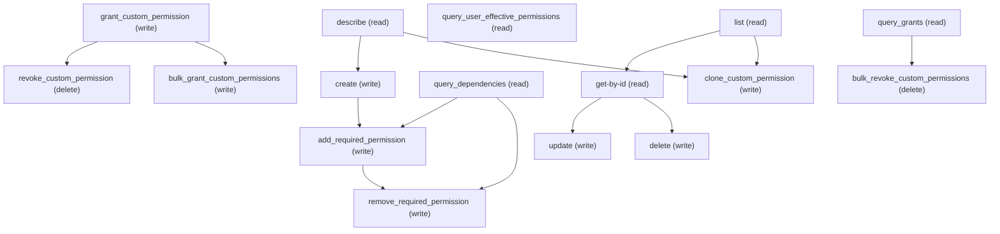

# Managing Custom Permissions

## When to Use This Skill

Manage Custom Permission definitions and grants. READS use sObject REST
(describe + SOQL). WRITES (create/update/delete the permission definition
itself) MUST use Metadata API — sObject REST returns 400
CANNOT_INSERT_UPDATE_ACTIVATE_ENTITY. The primary admin workflow is
GRANTING a custom permission to a PermissionSet — that uses sObject CRUD
on SetupEntityAccess (POST with ParentId=PermissionSet, SetupEntityId=
CustomPermission). KeyPrefix is 0CP (not 0PR).

## Workflow

## API access mechanics (CustomPermission)

CustomPermission is a full Metadata API type, `minApiVersion` 190.

### Read path (works via sObject REST)
- **describe**: `GET /sobjects/CustomPermission/describe`.
- **list / get**: SOQL against the `CustomPermission` sObject (list, or filter by Id).
- `/describe` reports `createable=false`, `updateable=false`, `deletable=false` (already noted on the `describe` step).

### Write path (must use Metadata API)
- `POST` / `PATCH` / `DELETE` against `/sobjects/CustomPermission` are rejected — POST/PATCH return `400 CANNOT_INSERT_UPDATE_ACTIVATE_ENTITY`, DELETE returns `INSUFFICIENT_ACCESS_OR_READONLY` (these specific error codes are already documented on the `create`/`update`/`delete` steps). Route create/update/delete through the Metadata API instead.
- Tooling API describe for CustomPermission returns `404` — do not attempt the Tooling API path.

## Critical Constraints

**Preconditions:**

- User needs access to manage CustomPermission (CRUD on the CustomPermission sObject). (check: `Old.notME,Admin.userCanViewCustomPermissions`)

**Destructive operations — require explicit user confirmation:**

- **`revoke_custom_permission`** — Revoke a CustomPermission grant from a PermissionSet by deleting the
SetupEntityAccess record. Resolve the Id via SOQL:
SELECT Id FROM SetupEntityAccess WHERE ParentId='<permSetId>'
AND SetupEntityId='<customPermId>'.

ORDERING CONSTRAINT: if perm A depends on perm B (CustomPermissionDependency),
both granted to the same PermissionSet, you cannot revoke B's grant while
A's grant is still active — server returns 400 DEPENDENCY_EXISTS. Revoke
dependent grants first (A), then the required-perm grant (B).

  - Rollback: No automatic rollback.
- **`bulk_revoke_custom_permissions`** — Bulk-revoke CustomPermission grants via Composite sObjects DELETE.
Pass up to 200 SetupEntityAccess record Ids as a comma-separated list
in the ids query parameter. Use allOrNone=false for partial-success
semantics.

  - Rollback: No automatic rollback.

## Operations Reference

Operations grouped by purpose. Use these as the building blocks for the workflows above.

### Summary

| Operation | Purpose | Status | Call | Depends on |
|-----------|---------|--------|------|------------|
| `describe` | read | — | `GET /services/data/v67.0/sobjects/CustomPermission/describe` | — |
| `list` | read | — | `GET /services/data/v67.0/query` | — |
| `get-by-id` | read | — | `GET /services/data/v67.0/sobjects/CustomPermission/{Id}` | `list` |
| `create` | write | — | `POST /headless/metadata` | `describe` |
| `update` | write | — | `PUT /headless/metadata` | `get-by-id` |
| `delete` | write | — | `DELETE /headless/metadata` | `get-by-id` |
| `query_user_effective_permissions` | read | — | `GET /services/data/v67.0/query` | — |
| `grant_custom_permission` | write | — | `POST /services/data/v67.0/sobjects/SetupEntityAccess` | — |
| `revoke_custom_permission` | delete | — | `DELETE /services/data/v67.0/sobjects/SetupEntityAccess/{id}` | `grant_custom_permission` |
| `query_grants` | read | — | `GET /services/data/v67.0/query` | — |
| `query_dependencies` | read | — | `GET /services/data/v67.0/query` | — |
| `add_required_permission` | write | — | `PUT /headless/metadata` | `create`, `query_dependencies` |
| `remove_required_permission` | write | — | `PUT /headless/metadata` | `add_required_permission`, `query_dependencies` |
| `bulk_grant_custom_permissions` | write | — | `POST /services/data/v67.0/composite/sobjects` | `grant_custom_permission` |
| `bulk_revoke_custom_permissions` | delete | — | `DELETE /services/data/v67.0/composite/sobjects` | `query_grants` |
| `clone_custom_permission` | write | — | `POST /headless/metadata` | `describe`, `list` |

### Dependency graph

### Read operations

#### `describe`

Retrieve the CustomPermission sObject describe — fields, picklist values,
FLS, createable/updateable flags. IMPORTANT: describe confirms
createable=false, updateable=false, deletable=false — writes MUST go
through Metadata API. KeyPrefix is 0CP (not 0PR as previously documented).

**Call:** `GET /services/data/v67.0/sobjects/CustomPermission/describe`

**Output:** DescribeSObjectResult for CustomPermission — use this to build the field list for list / create / update payloads.

#### `list`

List CustomPermission records. Pair this with /describe first to pick field names.

**Call:** `GET /services/data/v67.0/query`

**Inputs:**

- `where` *(`String`)* — Optional SOQL WHERE clause to filter Custom Permission records.
- `limit` *(`int`)* — Optional SOQL LIMIT value.
- `q` *(`string`)* — The full SOQL query string sent as the `q` query parameter. Defaults to
"SELECT Id FROM CustomPermission"; fold the optional where/limit guidance
above into this query — they describe how to shape `q`, they are not sent
as separate parameters.

**Output:** Query response with records[] of CustomPermission — Id plus any SELECTed fields.

#### `get-by-id`

Retrieve a specific CustomPermission record by Id.

**Call:** `GET /services/data/v67.0/sobjects/CustomPermission/{Id}`

**Inputs:**

- `Id` *(`ID`)* — Id of the CustomPermission record to fetch.

**Depends on:** `list`

**Output:** Single CustomPermission record with all readable fields per user FLS.

#### `query_user_effective_permissions`

Discover which CustomPermissions a User effectively has via assigned
PermissionSets. Two-step pattern (single SOQL with sub-query is the
cleanest form):
(1) Find the user's assigned permsets:
    SELECT PermissionSetId FROM PermissionSetAssignment
    WHERE AssigneeId='<userId>'
(2) Find granted custom perms on those permsets:
    SELECT SetupEntityId, Parent.Label,
           SetupEntityId
    FROM SetupEntityAccess
    WHERE SetupEntityType='CustomPermission'
      AND ParentId IN (<assigned permset ids>)
Or as a single nested SOQL using the IN-subquery form.
IMPORTANT: this only surfaces perms granted via PermissionSet
assignment — perms inherited via Profile assignment require a
different join (Profile → ParentId on Profile-derived PermissionSet
→ SetupEntityAccess). PermissionSetGroup membership requires
querying PermissionSetGroupComponent then descending to
SetupEntityAccess on each component permset.

**Call:** `GET /services/data/v67.0/query`

**Inputs:**

- `q` *(`String`)* — Example (single nested query):
SELECT SetupEntityId, Parent.Label FROM SetupEntityAccess
WHERE SetupEntityType='CustomPermission' AND ParentId IN
(SELECT PermissionSetId FROM PermissionSetAssignment
 WHERE AssigneeId='005xx0000000001')

**Output:** {records[] with SetupEntityId (the CustomPermission Id),
Parent.Label (the granting PermissionSet's label)}.
Resolve SetupEntityId → DeveloperName via a follow-up
SELECT Id, DeveloperName FROM CustomPermission WHERE Id IN (...).

**Notes:** coverage_note: Profile-direct perm grants (rare — most orgs have moved to
PermissionSet-based assignment) require querying the user's
Profile-derived PermissionSet (the one with IsOwnedByProfile=true
tied to their Profile) and joining the same way.; psg_membership: PermissionSetGroup expands at runtime; to surface PSG-derived
perms, query PermissionSetGroupComponent.PermissionSetId for the
user's assigned PSGs, then descend to SetupEntityAccess on each
component permset.

#### `query_grants`

SOQL query against SetupEntityAccess to discover which PermissionSets
have a given CustomPermission granted. Two common patterns:
(a) "Which permsets have this perm?" — filter by SetupEntityId
(b) "Which custom perms does this permset grant?" — filter by ParentId
AND SetupEntityType='CustomPermission'

**Call:** `GET /services/data/v67.0/query`

**Inputs:**

- `q` *(`String`)* — Example (all grants for one perm):
SELECT Id, ParentId, Parent.Label FROM SetupEntityAccess
WHERE SetupEntityId='0CPxx000000001' AND SetupEntityType='CustomPermission'

**Output:** {records[] with Id (SetupEntityAccess — pass to revoke), ParentId
(PermissionSet), SetupEntityId (CustomPermission), SetupEntityType}.

#### `query_dependencies`

SOQL query against CustomPermissionDependency to discover required-perm
relationships. A CustomPermission can declare dependencies on other
CustomPermissions — Salesforce does NOT auto-cascade grant required
perms when you grant the dependent perm. Admins must manually ensure
all required perms are also granted. Use this query to surface what
needs to be co-granted.

**Call:** `GET /services/data/v67.0/query`

**Inputs:**

- `q` *(`String`)* — Example (what does perm X require?):
SELECT Id, CustomPermissionId, RequiredCustomPermissionId,
RequiredCustomPermission.DeveloperName
FROM CustomPermissionDependency
WHERE CustomPermissionId='0CPxx000000001'

**Output:** {records[] with CustomPermissionId (the dependent), RequiredCustomPermissionId
(the dependency). SF does NOT auto-cascade — you must grant all
RequiredCustomPermissionId values to the same PermissionSet or the
grant is incomplete.}

**Notes:** cascade_warning: Salesforce does NOT auto-cascade required permissions. If Perm A
requires Perm B, granting A without also granting B means the feature
gated by A+B will not function. Query this table before granting a
complex perm, and ensure all RequiredCustomPermissionIds are also
granted to the target PermissionSet.

### Write operations

#### `create`

⚠️ BROKEN via sObject REST — POST /sobjects/CustomPermission returns 400
CANNOT_INSERT_UPDATE_ACTIVATE_ENTITY. To CREATE a CustomPermission, use the
Metadata API via this step's endpoint: POST the {type, fullName, xmlRep}
deploy envelope to /headless/metadata (type=CustomPermission,
fullName=namespace__PermName, xmlRep=the serialized <CustomPermission>
document carrying <label> and optional <description>). A single-component
/headless/metadata deploy persists the definition in one call — not a
multi-component package deploy.

**Call:** `POST /headless/metadata`

**Inputs:**

- `type` *(`String`)* — The Metadata API type being created — always "CustomPermission" for
this step. Names the metadata type in the {type, fullName, xmlRep}
deploy envelope.

- `fullName` *(`String`)* — DeveloperName for the new CustomPermission (namespace__PermName format
for managed packages, or just PermName for unmanaged). Must be unique
in the org. Carried as the envelope's fullName (the component key).

- `xmlRep` *(`String`)* — Serialized CustomPermission metadata document — the full-record body the
Metadata API deploys. Carries the human-readable <label> and, optionally,
<description>:
  <CustomPermission xmlns="http://soap.sforce.com/2006/04/metadata">
    <label>Manage Widgets</label>
    <description>Grants access to the Widgets console</description>
  </CustomPermission>
To also declare a required-permission dependency, add a
<requiredPermission> block (see add_required_permission).

**Depends on:** `describe`

**Rollback:** Call delete with type=CustomPermission and the same fullName to undo the create.

#### `update`

⚠️ BROKEN via sObject REST — PATCH /sobjects/CustomPermission/{Id} returns
400 CANNOT_INSERT_UPDATE_ACTIVATE_ENTITY. To UPDATE a CustomPermission
(e.g. change its label or description), retrieve the existing metadata
component via MDAPI retrieve, modify the XML, and redeploy. The <fullName>
(developer name) is immutable — to rename, delete + recreate.

**Call:** `PUT /headless/metadata`

**Inputs:**

- `type` *(`String`)* — The Metadata API type being updated — always "CustomPermission" for
this step. Names the metadata type in the {type, fullName, xmlRep}
deploy envelope.

- `fullName` *(`String`)* — DeveloperName of the existing CustomPermission to update. Identifies the
component to retrieve, and is the envelope's fullName (the component key).
Discover via SOQL:
SELECT DeveloperName FROM CustomPermission WHERE Id='0CPxx...'

- `xmlRep` *(`String`)* — Serialized CustomPermission metadata document — the FULL-RECORD body the
update deploys (Metadata API update is a full PUT, not a partial patch).
Retrieve the existing component, change <label> and/or <description>, and
redeploy the whole document:
  <CustomPermission xmlns="http://soap.sforce.com/2006/04/metadata">
    <label>Manage Widgets</label>
    <description>Updated description</description>
  </CustomPermission>
The <fullName> (DeveloperName) is immutable — to rename, delete + recreate.

**Depends on:** `get-by-id`

#### `delete`

DELETE a CustomPermission directly via the hosted Metadata API:
DELETE /headless/metadata?type=CustomPermission&fullName={fullName}
(supply the CustomPermission's DeveloperName as {fullName})
→ 204 (record deleted). This requires the org permission
FileBasedMetadataDelete to be enabled; without it the call returns
403 INSUFFICIENT_ACCESS from the access check. The CustomPermission type is
allowlisted for CREATE/READ/UPDATE/DELETE on /headless/metadata via core
PR #110662.

Note: DELETE via sObject REST is NOT supported —
DELETE /sobjects/CustomPermission/{Id} returns INSUFFICIENT_ACCESS_OR_READONLY
and /describe reports deletable=false. The destructiveChanges.xml MDAPI deploy
is a legacy fallback that is no longer required and must not be reintroduced on
the hosted path — it needs a file-based metadata deploy that the hosted
/headless/metadata surface does not provide. Prefer the direct DELETE above.

**Call:** `DELETE /headless/metadata`

**Inputs:**

- `fullName` *(`String`)* — DeveloperName of the CustomPermission to delete. Passed as the fullName
query parameter alongside type=CustomPermission on the DELETE call:
DELETE /headless/metadata?type=CustomPermission&fullName={fullName}
(the value to supply is the DeveloperName).
Discover via SOQL:
SELECT DeveloperName FROM CustomPermission WHERE Id='0CPxx...'
(For the destructiveChanges fallback, the same fullName becomes a
<members> entry under <name>CustomPermission</name> in the manifest.)

- `type` *(`string`)* — The Metadata API type being deleted — always "CustomPermission" for
this step. Passed as the type query parameter on the DELETE call:
DELETE /headless/metadata?type=CustomPermission&fullName={fullName}

**Depends on:** `get-by-id`

#### `grant_custom_permission`

Grant a CustomPermission to a PermissionSet by creating a SetupEntityAccess
junction record. This is the PRIMARY admin workflow — more common than
creating/editing the permission definition itself. Required fields:
ParentId (PermissionSet Id) + SetupEntityId (CustomPermission Id).
CONSTRAINTS:
- ParentId accepts ONLY non-managed user PermissionSets. Managed permsets
  → INVALID_CROSS_REFERENCE_KEY. PermissionSetGroups → FIELD_INTEGRITY_EXCEPTION.
  Profile-derived permsets → FIELD_INTEGRITY_EXCEPTION.
  Filter: WHERE IsOwnedByProfile=false AND IsCustom=true
- SetupEntityType is auto-derived from SetupEntityId's keyPrefix — do NOT
  POST it (createable=false for that field).
- SetupEntityId is POLYMORPHIC across 11 entity types; for CustomPermission,
  the keyPrefix is 0CP.

**Call:** `POST /services/data/v67.0/sobjects/SetupEntityAccess`

**Inputs:**

- `ParentId` *(`String`)* — PermissionSet Id to grant the permission to. Must be a non-managed,
user-created PermissionSet (IsOwnedByProfile=false AND IsCustom=true).
Managed permsets, PermissionSetGroups, and Profile-derived permsets
are rejected. Discover eligible targets:
SELECT Id, Label FROM PermissionSet WHERE IsOwnedByProfile=false
AND IsCustom=true AND NamespacePrefix=null

- `SetupEntityId` *(`String`)* — CustomPermission Id (keyPrefix 0CP). The permission to grant.
Polymorphic across 11 entity types — SetupEntityType is auto-derived
from the keyPrefix and MUST NOT be included in the POST body
(createable=false).

**Output:** 201 {id, success, errors[]}.

**Rollback:** revoke_custom_permission

**Notes:** error_contracts: 400 INVALID_CROSS_REFERENCE_KEY — ParentId is a managed PermissionSet
(IsCustom=false) or a non-existent Id.
400 "id value of incorrect type" — ParentId is a PermissionSetGroup
(different entity type, wrong keyPrefix for the FK field).
400 DUPLICATE_VALUE — this grant already exists.
Note: Profile-derived PermissionSets (IsOwnedByProfile=true) may
ACCEPT the grant on some orgs — behavior is org/release-dependent.
Recommend filtering to IsOwnedByProfile=false for safety.
; polymorphic_note: SetupEntityId is polymorphic across 11 entity types (CustomPermission,
ConnectedApplication, ExternalDataSource, CustomObject, etc.).
SetupEntityType is derived from the keyPrefix — never POST it manually.

#### `add_required_permission`

Add a required-permission dependency to a CustomPermission. This is the
API equivalent of the "Edit" button on the Required Custom Permissions
section of the CustomPermission detail page.

PRECONDITION: Both the parent CustomPermission AND the target required
CustomPermission MUST already exist in the org. If either does not exist,
create it first (see the create step). You need at least two distinct
CustomPermission definitions to establish a dependency.

CustomPermissionDependency sObject is READ-ONLY (createable=false,
updateable=false, deletable=false) — the dependency is managed as a
<requiredPermission> child element in the CustomPermission metadata XML.
Steps (single-component /headless/metadata — no multi-component package
or sf CLI required, as of the 262/patch framework fix; see notes):
1. Ensure the target required CustomPermission already exists in the org
   (create it via the create step first if it does not).
2. Send the PARENT's xmlRep carrying a <requiredPermission> block that
   references the target by DeveloperName:
   <requiredPermission>
     <customPermission>{RequiredPerm_DeveloperName}</customPermission>
     <dependency>true</dependency>
   </requiredPermission>
   Use PUT to amend an existing parent, or POST at parent create-time.
   The referenced target does NOT need to be included in the request —
   only the parent is sent; the framework resolves the reference against
   the perm already present in the org.
After the call, CustomPermissionDependency sObject reflects the new
relationship (queryable via query_dependencies step).

**Call:** `PUT /headless/metadata`

**Inputs:**

- `parent_fullName` *(`String`)* — DeveloperName of the CustomPermission that will DEPEND on another.
Discover via SOQL: SELECT DeveloperName FROM CustomPermission
WHERE Id='0CPxx...'

- `required_fullName` *(`String`)* — DeveloperName of the CustomPermission being added as a requirement.
Must already exist in the org. After deploy, granting the parent perm
to a PermissionSet will REQUIRE this perm to also be granted (SF
enforces at grant time).

**Depends on:** `create`, `query_dependencies`

**Output:** Deploy Succeeded.

**Rollback:** remove_required_permission

**Notes:** single_component_supported: As of the 262/patch framework fix (W-23448962), single-component
/headless/metadata create/update/delete requests behave like the
synchronous create path, a SINGLE-COMPONENT request carrying only the
PARENT's xmlRep with a <requiredPermission> block now correctly persists
the dependency, provided the referenced target CustomPermission already
exists in the org.
HISTORICAL (pre-262/patch): the parent-only request returned 200 but the
<requiredPermission> element was SILENTLY DROPPED — callers had to deploy
both components in one multi-component package via sf CLI. That workaround
is NO LONGER required and must not be reintroduced (hosted-MCP agents have
no sf CLI). Re-verified on orgfarm-8b18a62938 (2026-07-27): single-component
POST → dependency row created; PUT <dependency>false</dependency> → row removed.
; xml_structure: The <requiredPermission> element lives inside the parent
CustomPermission's .customPermission-meta.xml:
<CustomPermission xmlns="http://soap.sforce.com/2006/04/metadata">
  <isLicensed>false</isLicensed>
  <label>...</label>
  <requiredPermission>
    <customPermission>Required_Perm_DeveloperName</customPermission>
    <dependency>true</dependency>
  </requiredPermission>
</CustomPermission>
Multiple <requiredPermission> blocks can exist (one per dependency).
; enforcement: After adding, Salesforce enforces the dependency at grant time:
attempting to grant the parent perm without the required perm already
granted on the same PermissionSet will fail with "Custom permission X
requires the following custom permission(s): Y".

#### `remove_required_permission`

Remove a required-permission dependency from a CustomPermission. This is
the API equivalent of unchecking a requirement in the "Edit" UI on the
Required Custom Permissions section.

PRECONDITION: A dependency between the parent and the target
CustomPermission MUST already exist (established via
add_required_permission). Query CustomPermissionDependency first to
confirm the relationship exists before attempting removal.

Steps (single-component /headless/metadata — same as add; see the
add_required_permission notes for the 262/patch fix that made this work):
1. Take the parent CustomPermission's xmlRep.
2. Set <dependency>false</dependency> on the target <requiredPermission>
   block (the one where <customPermission> = the target DeveloperName).
   NOTE: simply removing the element does NOT work (deploys are additive);
   you must explicitly set <dependency>false</dependency>.
3. PUT the parent only. The referenced target does NOT need to be included
   in the request (single-component request is sufficient post-262/patch).
After the call, the CustomPermissionDependency row disappears and
grant-time enforcement for that dependency is removed.

**Call:** `PUT /headless/metadata`

**Inputs:**

- `parent_fullName` *(`String`)* — DeveloperName of the CustomPermission that currently depends on
another (the one being edited).

- `required_fullName` *(`String`)* — DeveloperName of the CustomPermission being removed as a requirement.

**Depends on:** `add_required_permission`, `query_dependencies`

**Output:** Deploy Succeeded.

**Notes:** cascade_note: Removing a required-permission dependency does NOT revoke existing
grants. If PermissionSet X already has both perms granted, both
grants remain. The enforcement is only at grant-time — removing the
dependency simply stops SF from requiring the dependent perm on
future grant operations.

#### `bulk_grant_custom_permissions`

Bulk-grant CustomPermissions via Composite sObjects API. Supports two
patterns:
(a) "1 perm → N permsets" — grant a single CustomPermission to multiple
    PermissionSets in one call (up to 200 records per request).
(b) "N perms → 1 permset" — grant multiple CustomPermissions to a single
    PermissionSet in one call.
Use allOrNone=false for partial-success semantics (some grants succeed
even if others hit DUPLICATE_VALUE or INVALID_CROSS_REFERENCE_KEY).

**Call:** `POST /services/data/v67.0/composite/sobjects`

**Inputs:**

- `records` *(`Array`)* — Array of SetupEntityAccess objects, each with {ParentId, SetupEntityId}.
Max 200 per request. Same constraints as single grant: ParentId must
be non-managed user PermissionSet; SetupEntityType must NOT be included.

- `allOrNone` *(`Boolean`)* — false (recommended) = partial success; true = atomic (all fail if
any one fails). Default: false.

**Depends on:** `grant_custom_permission`

**Output:** Array of {id, success, errors[]} — one entry per input record.
Partial success: check each entry's success flag individually.

**Notes:** error_contracts: Per-record errors (same as single grant): DUPLICATE_VALUE,
INVALID_CROSS_REFERENCE_KEY, FIELD_INTEGRITY_EXCEPTION.
With allOrNone=false, failing records don't block succeeding ones.

#### `clone_custom_permission`

Clone a CustomPermission by reading the source definition and deploying a
NEW component under a new name and label. The base SOR claimed
"Clone is a UI button with no API equivalent" — this is incorrect.
Steps:
1. Read the source: SOQL the source CustomPermission for its MasterLabel
   and Description. CustomPermission.DeveloperName never carries the
   namespace, so filter on NamespacePrefix too: pass the unqualified
   DeveloperName, and for a managed-package source (fullName ns__Name)
   split the ns prefix into NamespacePrefix.
   SELECT MasterLabel, Description FROM CustomPermission
   WHERE DeveloperName='<DeveloperName>' AND NamespacePrefix=<ns or null>.
2. Compose the new component's xmlRep: a <CustomPermission> document
   carrying the new <label> (and optional <description>) under the new
   fullName.
3. Deploy: POST the {type: CustomPermission, fullName: new_fullName,
   xmlRep} envelope to /headless/metadata — a single-component deploy in
   one call (see the create step for the envelope shape).
Optional: also copy SetupEntityAccess grants from the source to the clone
(via query_grants on source + bulk_grant on clone). To carry over any
required-permission dependency, use add_required_permission on the clone.

**Call:** `POST /headless/metadata`

**Inputs:**

- `source_fullName` *(`String`)* — fullName of the source CustomPermission to clone. For an unmanaged
perm this is just its DeveloperName; for a managed-package perm it is
ns__DeveloperName. The read query filters on the unqualified
DeveloperName (plus NamespacePrefix) because CustomPermission.DeveloperName
never includes the namespace.
Discover via SOQL: SELECT DeveloperName, NamespacePrefix FROM
CustomPermission WHERE Id='0CPxx000000001'

- `new_fullName` *(`String`)* — DeveloperName for the cloned permission (must be unique in org).
- `new_label` *(`String`)* — Label for the cloned permission.

**Depends on:** `describe`, `list`

**Notes:** grant_copy: Cloning the permission definition does NOT copy its grants. To
replicate grants, query_grants on the source perm's Id, then
bulk_grant_custom_permissions with the same ParentIds + the new
permission's Id.

### Destructive operations

#### `revoke_custom_permission`

Revoke a CustomPermission grant from a PermissionSet by deleting the
SetupEntityAccess record. Resolve the Id via SOQL:
SELECT Id FROM SetupEntityAccess WHERE ParentId='<permSetId>'
AND SetupEntityId='<customPermId>'.

ORDERING CONSTRAINT: if perm A depends on perm B (CustomPermissionDependency),
both granted to the same PermissionSet, you cannot revoke B's grant while
A's grant is still active — server returns 400 DEPENDENCY_EXISTS. Revoke
dependent grants first (A), then the required-perm grant (B).

**Call:** `DELETE /services/data/v67.0/sobjects/SetupEntityAccess/{id}`

**Inputs:**

- `id` *(`String`)* — SetupEntityAccess record Id (NOT the PermissionSet or CustomPermission Id).

**Depends on:** `grant_custom_permission`

**Notes:** ordering_constraint: Cannot revoke a required-perm grant while a dependent perm grant is
still active on the same PermissionSet. Server returns
400 DEPENDENCY_EXISTS. Revoke order: dependent first, required last.
Use query_dependencies to discover the dependency graph before
revoking; pre-flight a revoke order that respects it.
; patch_unsupported: SetupEntityAccess.updateable=false. PATCH returns 400
CANNOT_INSERT_UPDATE_ACTIVATE_ENTITY. To "change" a grant, DELETE
the existing record + INSERT a new one.

#### `bulk_revoke_custom_permissions`

Bulk-revoke CustomPermission grants via Composite sObjects DELETE.
Pass up to 200 SetupEntityAccess record Ids as a comma-separated list
in the ids query parameter. Use allOrNone=false for partial-success
semantics.

**Call:** `DELETE /services/data/v67.0/composite/sobjects`

**Inputs:**

- `ids` *(`String`)* — Comma-separated SetupEntityAccess record Ids (max 200). Discover
via query_grants filtered by the target perm or permset.

- `allOrNone` *(`Boolean`)* — false = partial success (default); true = atomic.

**Depends on:** `query_grants`

**Output:** Array of {id, success, errors[]}.
