# Managing Privacy Agent Settings

## When to Use This Skill

Configure Salesforce Privacy Agent for the org. Five concepts: Regulation (GDPR/CCPA/custom), ComplianceRule (per-regulation), Framework (active runbook version tying regulations + rules), ComplianceIssue (scan-produced rows), ComplianceScanJob (async scans of org data and configuration). Bootstrap: provision-org (regulationKeys → initial framework). Then select a framework (save/draft/publish-framework-selection), run scans (run-compliance-scan-job for data, run-health-check for configuration), read issues from the dashboard surfaces, remediate via invoke-remediation-plan. Custom regulation/rule lifecycle: create-regulation(-with-rules) / edit-regulation(-with-rules) / delete-regulation. Rule extraction: extract-rules-from-document → save-extracted-rules → delete-content-document. Reads require read access to Privacy Agent; writes require manage access.

## Workflow

Bootstrap (one-time): provision-org → save-framework-selection (or save-draft-framework-selection → publish-framework-selection). Scan loop: is-compliance-scan-enabled → run-compliance-scan-job → poll get-dashboard-summary-data.complianceScanInProgressJobId → read issues via get-compliance-issues / get-new-issues / get-resolved-issues. Health-check loop is symmetric: is-privacy-agent-scan-enabled → run-health-check. Rule lifecycle: get-regulations → get-related-rules(regulationId) → check-rule-deactivation-issues (deactivation pre-flight) → update-rule-status / bulk-activate-rules. Custom rule import: upload ContentDocument → extract-rules-from-document → save-extracted-rules → delete-content-document. Custom regulation: create-regulation(-with-rules) → edit-regulation(-with-rules) → delete-regulation. Remediation: get-recommended-plans-for-issue (issueId from get-compliance-issues) → invoke-remediation-plan. Pair every write with its verify-* step.

## Critical Constraints

**Preconditions:**

- User must have PrivacyAgent ManagePrivacyAgent access (check: `Manage Privacy Agent permission`)
- User must have PrivacyAgent ReadPrivacyAgent access (check: `Read Privacy Agent permission`)

**Destructive operations — require explicit user confirmation:**

- **`delete-content-document`** — Deletes the uploaded ContentDocument AND prunes its references from Privacy Agent rule rows. Substituting a raw sObject delete leaves dangling references.
  - Rollback: No automatic rollback.
- **`delete-regulation`** — Deletes a custom regulation (and its rule linkage) by id. Server-side updates the runbook version reference. Requires manage access to Privacy Agent.
  - Rollback: No automatic rollback.

## Verification Checklist

After every write operation, confirm the effect by re-reading state:

- After `run-compliance-scan-job`: call `verify-run-compliance-scan-job` (`GET /headless/invoke/platform/privacy-agent-settings/get-dashboard-summary-data`)
- After `run-health-check`: call `verify-run-health-check` (`GET /headless/invoke/platform/privacy-agent-settings/get-dashboard-summary-data`)
- After `cancel-compliance-scan-job`: call `verify-cancel-compliance-scan-job` (`GET /headless/invoke/platform/privacy-agent-settings/get-dashboard-summary-data`)
- After `save-framework-selection`: call `verify-save-framework-selection` (`GET /headless/invoke/platform/privacy-agent-settings/get-regulations`)
- After `publish-framework-selection`: call `verify-publish-framework-selection` (`GET /headless/invoke/platform/privacy-agent-settings/get-regulations`)
- After `update-rule-status`: call `verify-update-rule-status` (`GET /headless/invoke/platform/privacy-agent-settings/get-related-rules`)
- After `bulk-activate-rules`: call `verify-bulk-activate-rules` (`GET /headless/invoke/platform/privacy-agent-settings/get-related-rules`)
- After `save-extracted-rules`: call `verify-save-extracted-rules` (`GET /headless/invoke/platform/privacy-agent-settings/get-related-rules`)
- After `create-regulation`: call `verify-create-regulation` (`GET /headless/invoke/platform/privacy-agent-settings/get-regulations`)
- After `create-regulation-with-rules`: call `verify-create-regulation-with-rules` (`GET /headless/invoke/platform/privacy-agent-settings/get-regulations`)
- After `edit-regulation`: call `verify-edit-regulation` (`GET /headless/invoke/platform/privacy-agent-settings/get-regulations`)
- After `edit-regulation-with-rules`: call `verify-edit-regulation-with-rules` (`GET /headless/invoke/platform/privacy-agent-settings/get-related-rules`)
- After `delete-regulation`: call `verify-delete-regulation` (`GET /headless/invoke/platform/privacy-agent-settings/get-regulations`)
- After `provision-org`: call `verify-provision-org` (`GET /headless/invoke/platform/privacy-agent-settings`)

## Operations Reference

Operations grouped by purpose. Use these as the building blocks for the workflows above.

### Summary

| Operation | Purpose | Status | Call | Depends on |
|-----------|---------|--------|------|------------|
| `is-privacy-agent-available` | read | proposed | `GET /headless/invoke/platform/privacy-agent-settings` | — |
| `get-dashboard-summary-data` | read | proposed | `GET /headless/invoke/platform/privacy-agent-settings/get-dashboard-summary-data` | — |
| `get-compliance-issues` | read | proposed | `GET /headless/invoke/platform/privacy-agent-settings/get-compliance-issues` | — |
| `get-new-issues` | read | proposed | `GET /headless/invoke/platform/privacy-agent-settings/get-new-issues` | — |
| `get-unchanged-issues` | read | proposed | `GET /headless/invoke/platform/privacy-agent-settings/get-unchanged-issues` | — |
| `get-resolved-issues` | read | proposed | `GET /headless/invoke/platform/privacy-agent-settings/get-resolved-issues` | — |
| `get-compliance-remediation-plan` | read | proposed | `GET /headless/invoke/platform/privacy-agent-settings/get-compliance-remediation-plan` | — |
| `get-compliance-score-card` | read | proposed | `GET /headless/invoke/platform/privacy-agent-settings/get-compliance-score-card` | — |
| `get-recent-activity` | read | proposed | `GET /headless/invoke/platform/privacy-agent-settings/get-recent-activity` | — |
| `get-setup-status` | read | proposed | `GET /headless/invoke/platform/privacy-agent-settings/get-setup-status` | — |
| `get-home-page-data` | read | proposed | `GET /headless/invoke/platform/privacy-agent-settings/get-home-page-data` | — |
| `run-health-check` | write | proposed | `POST /services/data/v66.0/privacyagent/health/scan` | `is-privacy-agent-scan-enabled` |
| `is-privacy-agent-scan-enabled` | read | proposed | `GET /headless/invoke/platform/privacy-agent-settings/is-privacy-agent-scan-enabled` | — |
| `is-compliance-scan-enabled` | read | proposed | `GET /headless/invoke/platform/privacy-agent-settings/is-compliance-scan-enabled` | — |
| `run-compliance-scan-job` | write | proposed | `PATCH /headless/invoke/platform/privacy-agent-settings/run-compliance-scan-job` | `is-compliance-scan-enabled` |
| `cancel-compliance-scan-job` | write | proposed | `PATCH /headless/invoke/platform/privacy-agent-settings/cancel-compliance-scan-job` | `get-dashboard-summary-data` |
| `get-regulations` | read | proposed | `GET /headless/invoke/platform/privacy-agent-settings/get-regulations` | — |
| `save-framework-selection` | write | proposed | `PATCH /headless/invoke/platform/privacy-agent-settings/save-framework-selection` | `get-regulations`, `check-can-manage-privacy-agent` |
| `save-draft-framework-selection` | write | proposed | `PATCH /headless/invoke/platform/privacy-agent-settings/save-draft-framework-selection` | `get-regulations`, `check-can-manage-privacy-agent` |
| `publish-framework-selection` | write | proposed | `PATCH /headless/invoke/platform/privacy-agent-settings/publish-framework-selection` | `save-draft-framework-selection` |
| `get-related-rules` | read | proposed | `GET /headless/invoke/platform/privacy-agent-settings/get-related-rules` | `get-regulations` |
| `check-rule-deactivation-issues` | read | proposed | `GET /headless/invoke/platform/privacy-agent-settings/check-rule-deactivation-issues` | `get-related-rules` |
| `update-rule-status` | write | proposed | `PATCH /headless/invoke/platform/privacy-agent-settings/update-rule-status` | `get-related-rules`, `check-rule-deactivation-issues` |
| `bulk-activate-rules` | write | proposed | `PATCH /headless/invoke/platform/privacy-agent-settings/bulk-activate-rules` | `get-related-rules` |
| `extract-rules-from-document` | write | proposed | `PATCH /headless/invoke/platform/privacy-agent-settings/extract-rules-from-document` | — |
| `save-extracted-rules` | write | proposed | `PATCH /headless/invoke/platform/privacy-agent-settings/save-extracted-rules` | `extract-rules-from-document`, `get-regulations` |
| `delete-content-document` | delete | proposed | `DELETE /headless/invoke/platform/privacy-agent-settings/delete-content-document` | `save-extracted-rules` |
| `get-compliance-issue-insights` | read | proposed | `GET /headless/invoke/platform/privacy-agent-settings/get-compliance-issue-insights` | — |
| `get-audit-logs` | read | proposed | `GET /headless/invoke/platform/privacy-agent-settings/get-audit-logs` | — |
| `search-audit-logs` | read | proposed | `GET /headless/invoke/platform/privacy-agent-settings/search-audit-logs` | — |
| `get-audit-log-detail` | read | proposed | `GET /headless/invoke/platform/privacy-agent-settings/get-audit-log-detail` | `get-audit-logs` |
| `get-latest-audit-log-timestamp` | read | proposed | `GET /headless/invoke/platform/privacy-agent-settings/get-latest-audit-log-timestamp` | — |
| `get-recommended-plans-for-issue` | read | proposed | `GET /headless/invoke/platform/privacy-agent-settings/get-recommended-plans-for-issue` | `get-compliance-issues` |
| `invoke-remediation-plan` | write | proposed | `PATCH /headless/invoke/platform/privacy-agent-settings/invoke-remediation-plan` | `get-recommended-plans-for-issue` |
| `provision-org` | write | proposed | `PATCH /headless/invoke/platform/privacy-agent-settings/provision-org` | — |
| `check-can-manage-privacy-agent` | read | implemented | `GET /headless/invoke/platform/privacy-agent-settings/check-can-manage-privacy-agent` | — |
| `check-can-read-privacy-agent` | read | implemented | `GET /headless/invoke/platform/privacy-agent-settings/check-can-read-privacy-agent` | — |
| `create-regulation` | write | proposed | `PATCH /headless/invoke/platform/privacy-agent-settings/create-regulation` | — |
| `create-regulation-with-rules` | write | proposed | `PATCH /headless/invoke/platform/privacy-agent-settings/create-regulation-with-rules` | `check-can-manage-privacy-agent` |
| `edit-regulation-with-rules` | write | proposed | `PATCH /headless/invoke/platform/privacy-agent-settings/edit-regulation-with-rules` | `get-regulations` |
| `edit-regulation` | write | proposed | `PATCH /headless/invoke/platform/privacy-agent-settings/edit-regulation` | `get-regulations` |
| `delete-regulation` | delete | proposed | `DELETE /headless/invoke/platform/privacy-agent-settings/delete-regulation` | `get-regulations` |
| `checkCanManagePrivacyAgent_3` | read | implemented | `GET /headless/invoke/platform/privacy-agent/check-can-manage-privacy-agent` | — |
| `getPrivacyAgentScanPreference_1` | read | implemented | `GET /headless/invoke/platform/privacy-agent/get-privacy-agent-scan-preference` | `checkCanManagePrivacyAgent_3` |
| `setPrivacyAgentScanPreference_2` | write | implemented | `PATCH /headless/invoke/platform/privacy-agent/set-privacy-agent-scan-preference` | `getPrivacyAgentScanPreference_1` |
| `verify-run-compliance-scan-job` | verify | — | `GET /headless/invoke/platform/privacy-agent-settings/get-dashboard-summary-data` | `run-compliance-scan-job` |
| `verify-run-health-check` | verify | — | `GET /headless/invoke/platform/privacy-agent-settings/get-dashboard-summary-data` | `run-health-check` |
| `verify-cancel-compliance-scan-job` | verify | — | `GET /headless/invoke/platform/privacy-agent-settings/get-dashboard-summary-data` | `cancel-compliance-scan-job` |
| `verify-save-framework-selection` | verify | — | `GET /headless/invoke/platform/privacy-agent-settings/get-regulations` | `save-framework-selection` |
| `verify-publish-framework-selection` | verify | — | `GET /headless/invoke/platform/privacy-agent-settings/get-regulations` | `publish-framework-selection` |
| `verify-update-rule-status` | verify | — | `GET /headless/invoke/platform/privacy-agent-settings/get-related-rules` | `update-rule-status` |
| `verify-bulk-activate-rules` | verify | — | `GET /headless/invoke/platform/privacy-agent-settings/get-related-rules` | `bulk-activate-rules` |
| `verify-save-extracted-rules` | verify | — | `GET /headless/invoke/platform/privacy-agent-settings/get-related-rules` | `save-extracted-rules` |
| `verify-create-regulation` | verify | — | `GET /headless/invoke/platform/privacy-agent-settings/get-regulations` | `create-regulation` |
| `verify-create-regulation-with-rules` | verify | — | `GET /headless/invoke/platform/privacy-agent-settings/get-regulations` | `create-regulation-with-rules` |
| `verify-edit-regulation` | verify | — | `GET /headless/invoke/platform/privacy-agent-settings/get-regulations` | `edit-regulation` |
| `verify-edit-regulation-with-rules` | verify | — | `GET /headless/invoke/platform/privacy-agent-settings/get-related-rules` | `edit-regulation-with-rules` |
| `verify-delete-regulation` | verify | — | `GET /headless/invoke/platform/privacy-agent-settings/get-regulations` | `delete-regulation` |
| `verify-provision-org` | verify | — | `GET /headless/invoke/platform/privacy-agent-settings` | `provision-org` |

### Dependency graph

```mermaid
graph TD
  is_privacy_agent_available["is-privacy-agent-available (read)"]
  get_dashboard_summary_data["get-dashboard-summary-data (read)"]
  get_compliance_issues["get-compliance-issues (read)"]
  get_new_issues["get-new-issues (read)"]
  get_unchanged_issues["get-unchanged-issues (read)"]
  get_resolved_issues["get-resolved-issues (read)"]
  get_compliance_remediation_plan["get-compliance-remediation-plan (read)"]
  get_compliance_score_card["get-compliance-score-card (read)"]
  get_recent_activity["get-recent-activity (read)"]
  get_setup_status["get-setup-status (read)"]
  get_home_page_data["get-home-page-data (read)"]
  run_health_check["run-health-check (write)"]
  is_privacy_agent_scan_enabled["is-privacy-agent-scan-enabled (read)"]
  is_compliance_scan_enabled["is-compliance-scan-enabled (read)"]
  run_compliance_scan_job["run-compliance-scan-job (write)"]
  cancel_compliance_scan_job["cancel-compliance-scan-job (write)"]
  get_regulations["get-regulations (read)"]
  save_framework_selection["save-framework-selection (write)"]
  save_draft_framework_selection["save-draft-framework-selection (write)"]
  publish_framework_selection["publish-framework-selection (write)"]
  get_related_rules["get-related-rules (read)"]
  check_rule_deactivation_issues["check-rule-deactivation-issues (read)"]
  update_rule_status["update-rule-status (write)"]
  bulk_activate_rules["bulk-activate-rules (write)"]
  extract_rules_from_document["extract-rules-from-document (write)"]
  save_extracted_rules["save-extracted-rules (write)"]
  delete_content_document["delete-content-document (delete)"]
  get_compliance_issue_insights["get-compliance-issue-insights (read)"]
  get_audit_logs["get-audit-logs (read)"]
  search_audit_logs["search-audit-logs (read)"]
  get_audit_log_detail["get-audit-log-detail (read)"]
  get_latest_audit_log_timestamp["get-latest-audit-log-timestamp (read)"]
  get_recommended_plans_for_issue["get-recommended-plans-for-issue (read)"]
  invoke_remediation_plan["invoke-remediation-plan (write)"]
  provision_org["provision-org (write)"]
  check_can_manage_privacy_agent["check-can-manage-privacy-agent (read)"]
  check_can_read_privacy_agent["check-can-read-privacy-agent (read)"]
  create_regulation["create-regulation (write)"]
  create_regulation_with_rules["create-regulation-with-rules (write)"]
  edit_regulation_with_rules["edit-regulation-with-rules (write)"]
  edit_regulation["edit-regulation (write)"]
  delete_regulation["delete-regulation (delete)"]
  checkCanManagePrivacyAgent_3["checkCanManagePrivacyAgent_3 (read)"]
  getPrivacyAgentScanPreference_1["getPrivacyAgentScanPreference_1 (read)"]
  setPrivacyAgentScanPreference_2["setPrivacyAgentScanPreference_2 (write)"]
  verify_run_compliance_scan_job["verify-run-compliance-scan-job (verify)"]
  verify_run_health_check["verify-run-health-check (verify)"]
  verify_cancel_compliance_scan_job["verify-cancel-compliance-scan-job (verify)"]
  verify_save_framework_selection["verify-save-framework-selection (verify)"]
  verify_publish_framework_selection["verify-publish-framework-selection (verify)"]
  verify_update_rule_status["verify-update-rule-status (verify)"]
  verify_bulk_activate_rules["verify-bulk-activate-rules (verify)"]
  verify_save_extracted_rules["verify-save-extracted-rules (verify)"]
  verify_create_regulation["verify-create-regulation (verify)"]
  verify_create_regulation_with_rules["verify-create-regulation-with-rules (verify)"]
  verify_edit_regulation["verify-edit-regulation (verify)"]
  verify_edit_regulation_with_rules["verify-edit-regulation-with-rules (verify)"]
  verify_delete_regulation["verify-delete-regulation (verify)"]
  verify_provision_org["verify-provision-org (verify)"]
  is_privacy_agent_scan_enabled --> run_health_check
  is_compliance_scan_enabled --> run_compliance_scan_job
  get_dashboard_summary_data --> cancel_compliance_scan_job
  get_regulations --> save_framework_selection
  check_can_manage_privacy_agent --> save_framework_selection
  get_regulations --> save_draft_framework_selection
  check_can_manage_privacy_agent --> save_draft_framework_selection
  save_draft_framework_selection --> publish_framework_selection
  get_regulations --> get_related_rules
  get_related_rules --> check_rule_deactivation_issues
  get_related_rules --> update_rule_status
  check_rule_deactivation_issues --> update_rule_status
  get_related_rules --> bulk_activate_rules
  extract_rules_from_document --> save_extracted_rules
  get_regulations --> save_extracted_rules
  save_extracted_rules --> delete_content_document
  get_audit_logs --> get_audit_log_detail
  get_compliance_issues --> get_recommended_plans_for_issue
  get_recommended_plans_for_issue --> invoke_remediation_plan
  check_can_manage_privacy_agent --> create_regulation_with_rules
  get_regulations --> edit_regulation_with_rules
  get_regulations --> edit_regulation
  get_regulations --> delete_regulation
  checkCanManagePrivacyAgent_3 --> getPrivacyAgentScanPreference_1
  getPrivacyAgentScanPreference_1 --> setPrivacyAgentScanPreference_2
  run_compliance_scan_job --> verify_run_compliance_scan_job
  run_health_check --> verify_run_health_check
  cancel_compliance_scan_job --> verify_cancel_compliance_scan_job
  save_framework_selection --> verify_save_framework_selection
  publish_framework_selection --> verify_publish_framework_selection
  update_rule_status --> verify_update_rule_status
  bulk_activate_rules --> verify_bulk_activate_rules
  save_extracted_rules --> verify_save_extracted_rules
  create_regulation --> verify_create_regulation
  create_regulation_with_rules --> verify_create_regulation_with_rules
  edit_regulation --> verify_edit_regulation
  edit_regulation_with_rules --> verify_edit_regulation_with_rules
  delete_regulation --> verify_delete_regulation
  provision_org --> verify_provision_org
```

### Read operations

#### `is-privacy-agent-available`

Returns whether Privacy Agent is provisioned and accessible to the current user. Use as the entry-point gate before driving any other Privacy Agent step.

**Call:** `GET /headless/invoke/platform/privacy-agent-settings`   — status: `proposed`

#### `get-dashboard-summary-data`

Returns DashboardSummaryData aggregating compliance-issue counts, in-progress scan-job state (complianceScanInProgressJobId), and overall setup status. Powers the Privacy Agent home dashboard.

**Call:** `GET /headless/invoke/platform/privacy-agent-settings/get-dashboard-summary-data`   — status: `proposed`

#### `get-compliance-issues`

Returns ComplianceIssueData with issue lists bucketed by status (new/unchanged/resolved). Use the per-bucket steps when only one bucket is needed.

**Call:** `GET /headless/invoke/platform/privacy-agent-settings/get-compliance-issues`   — status: `proposed`

#### `get-new-issues`

Returns just-detected, unresolved ComplianceIssueItem rows from the most recent scan. Cheaper than getComplianceIssues when only the new bucket is needed.

**Call:** `GET /headless/invoke/platform/privacy-agent-settings/get-new-issues`   — status: `proposed`

#### `get-unchanged-issues`

Returns unresolved ComplianceIssueItem rows persisted from prior scans (not resolved or ignored since first detected).

**Call:** `GET /headless/invoke/platform/privacy-agent-settings/get-unchanged-issues`   — status: `proposed`

#### `get-resolved-issues`

Returns ComplianceIssueItem rows resolved or ignored within the last 30 days. Powers the resolved-issues dashboard view.

**Call:** `GET /headless/invoke/platform/privacy-agent-settings/get-resolved-issues`   — status: `proposed`

#### `get-compliance-remediation-plan`

Returns the org-wide ComplianceRemediationPlanItem rows across all compliance issues, each with suggested action, affected objects, status, riskLevel, and editable planParameters.

**Call:** `GET /headless/invoke/platform/privacy-agent-settings/get-compliance-remediation-plan`   — status: `proposed`

#### `get-compliance-score-card`

Returns ComplianceScoreCard with the org's overall score and open-issue counts bucketed by risk tier (high, medium, low).

**Call:** `GET /headless/invoke/platform/privacy-agent-settings/get-compliance-score-card`   — status: `proposed`

#### `get-recent-activity`

Returns a typed RecentActivityItem list summarising recent compliance activity (scans, rule changes, issue resolutions).

**Call:** `GET /headless/invoke/platform/privacy-agent-settings/get-recent-activity`   — status: `proposed`

#### `get-setup-status`

Returns SetupStatusData (welcome dismissed, completed-steps list, setup-complete flag) used to drive the setup-progress wizard.

**Call:** `GET /headless/invoke/platform/privacy-agent-settings/get-setup-status`   — status: `proposed`

#### `get-home-page-data`

Returns a composite HomePageData envelope mixing dashboard summary, score card, and setup-status signals into one read.

**Call:** `GET /headless/invoke/platform/privacy-agent-settings/get-home-page-data`   — status: `proposed`

#### `is-privacy-agent-scan-enabled`

Returns whether org-level health-check scanning is enabled. Gates the run-health-check action.

**Call:** `GET /headless/invoke/platform/privacy-agent-settings/is-privacy-agent-scan-enabled`   — status: `proposed`

#### `is-compliance-scan-enabled`

Returns whether compliance-scan jobs (data scanning against the active framework) are enabled. Gates the run-compliance-scan-job action.

**Call:** `GET /headless/invoke/platform/privacy-agent-settings/is-compliance-scan-enabled`   — status: `proposed`

#### `get-regulations`

Returns RegulationData listing all available regulations (standard plus custom), the active runbookVersionId, and per-regulation framework state. Drives the framework-selection picker.

**Call:** `GET /headless/invoke/platform/privacy-agent-settings/get-regulations`   — status: `proposed`

#### `get-related-rules`

Returns ComplianceRuleItem rows linked to the given regulation (active state, computed lastEvaluated, sourceRegulation, ruleClassification, sourceDocumentRef).

**Call:** `GET /headless/invoke/platform/privacy-agent-settings/get-related-rules`   — status: `proposed`

**Inputs:**

- `regulationId` *(`String`)*

**Depends on:** `get-regulations`

#### `check-rule-deactivation-issues`

Pre-flight returning {hasOpenIssues, openIssueCount} for the given rule. Call before update-rule-status when toggling isActive=false to surface whether deactivation would orphan open compliance issues.

**Call:** `GET /headless/invoke/platform/privacy-agent-settings/check-rule-deactivation-issues`   — status: `proposed`

**Inputs:**

- `ruleId` *(`String`)*

**Depends on:** `get-related-rules`

#### `get-compliance-issue-insights`

Returns aggregated insights over open compliance issues — issuesByType, issuesBySeverity, issuesByRegulation maps, plus a summary string. Powers the dashboard insights panel.

**Call:** `GET /headless/invoke/platform/privacy-agent-settings/get-compliance-issue-insights`   — status: `proposed`

#### `get-audit-logs`

Returns the typed ComplianceAuditLogItem list (recent compliance-related changes by user, time, category).

**Call:** `GET /headless/invoke/platform/privacy-agent-settings/get-audit-logs`   — status: `proposed`

#### `search-audit-logs`

Paged search over compliance audit logs with searchQuery + categoryFilter + pageNumber/pageSize. Returns a SearchAuditLogsResult envelope.

**Call:** `GET /headless/invoke/platform/privacy-agent-settings/search-audit-logs`   — status: `proposed`

**Inputs:**

- `searchQuery` *(`String`)*
- `categoryFilter` *(`String`)*
- `pageNumber` *(`Integer`)*
- `pageSize` *(`Integer`)*

#### `get-audit-log-detail`

Returns a single ComplianceAuditLogItem by auditlogId — full detail (target record, change set, user, timestamp).

**Call:** `GET /headless/invoke/platform/privacy-agent-settings/get-audit-log-detail`   — status: `proposed`

**Inputs:**

- `auditlogId` *(`String`)*

**Depends on:** `get-audit-logs`

#### `get-latest-audit-log-timestamp`

Returns the timestamp string of the most recent compliance audit log entry. Used to surface last-activity on the dashboard.

**Call:** `GET /headless/invoke/platform/privacy-agent-settings/get-latest-audit-log-timestamp`   — status: `proposed`

#### `get-recommended-plans-for-issue`

Returns the ComplianceRemediationPlanItem rows recommended for the given issueId. Each plan describes suggested action, affectedObjectsDetails, status, riskLevel, and planParameters.

**Call:** `GET /headless/invoke/platform/privacy-agent-settings/get-recommended-plans-for-issue`   — status: `proposed`

**Inputs:**

- `issueId` *(`String`)*

**Depends on:** `get-compliance-issues`

#### `check-can-manage-privacy-agent`

Returns whether the current user has manage access to Privacy Agent. Pre-flight check before write operations (save-framework-selection, update-rule-status, regulation CRUD, etc.).

**Call:** `GET /headless/invoke/platform/privacy-agent-settings/check-can-manage-privacy-agent`   — status: `implemented`

#### `check-can-read-privacy-agent`

Returns whether the current user has read access to Privacy Agent. Pre-flight check before the dashboard reads.

**Call:** `GET /headless/invoke/platform/privacy-agent-settings/check-can-read-privacy-agent`   — status: `implemented`

#### `checkCanManagePrivacyAgent_3`

Verify that the current user has the necessary permissions to manage Privacy Agent settings. This is a pre-flight authorization check that gates access to the toggle control.

**Call:** `GET /headless/invoke/platform/privacy-agent/check-can-manage-privacy-agent`   — status: `implemented`

#### `getPrivacyAgentScanPreference_1`

Retrieve the current state of the Privacy Agent Scan preference (enabled or disabled). The result populates the "Enable Privacy Agent Scan" toggle on the settings page.

**Call:** `GET /headless/invoke/platform/privacy-agent/get-privacy-agent-scan-preference`   — status: `implemented`

**Depends on:** `checkCanManagePrivacyAgent_3`

### Write operations

#### `run-health-check`

Triggers an async health-check scan inspecting the org's configuration for compliance issues against the active framework. Subsequent get-dashboard-summary-data reads expose the running jobId.

**Call:** `POST /services/data/v66.0/privacyagent/health/scan`   — status: `proposed`

**Depends on:** `is-privacy-agent-scan-enabled`

#### `run-compliance-scan-job`

Kicks off an async scan evaluating org data against active runbook rules; emits ComplianceIssueItem rows. Job id surfaces via get-dashboard-summary-data complianceScanInProgressJobId.

**Call:** `PATCH /headless/invoke/platform/privacy-agent-settings/run-compliance-scan-job`   — status: `proposed`

**Depends on:** `is-compliance-scan-enabled`

#### `cancel-compliance-scan-job`

Cancels a running compliance-scan job by id. jobId comes from get-dashboard-summary-data complianceScanInProgressJobId.

**Call:** `PATCH /headless/invoke/platform/privacy-agent-settings/cancel-compliance-scan-job`   — status: `proposed`

**Inputs:**

- `jobId` *(`String`)* — Id of the job.

**Depends on:** `get-dashboard-summary-data`

#### `save-framework-selection`

Persists the supplied framework selection (regulation/rule activation map) and immediately commits it as the org's active runbook version. Requires manage access to Privacy Agent.

**Call:** `PATCH /headless/invoke/platform/privacy-agent-settings/save-framework-selection`   — status: `proposed`

**Inputs:**

- `frameworkSelection` *(`Object`)* — Structured value describing framework selection.

**Depends on:** `get-regulations`, `check-can-manage-privacy-agent`

#### `save-draft-framework-selection`

Saves the framework selection as a DRAFT runbook version (not yet active). Returns FrameworkSaveDraftResult with the draft id; pair with publish-framework-selection to commit.

**Call:** `PATCH /headless/invoke/platform/privacy-agent-settings/save-draft-framework-selection`   — status: `proposed`

**Inputs:**

- `frameworkSelection` *(`Object`)* — Structured value describing framework selection.

**Depends on:** `get-regulations`, `check-can-manage-privacy-agent`

#### `publish-framework-selection`

Publishes a previously-saved draft framework selection as the active runbook version. Use after save-draft-framework-selection.

**Call:** `PATCH /headless/invoke/platform/privacy-agent-settings/publish-framework-selection`   — status: `proposed`

**Inputs:**

- `frameworkSelection` *(`Object`)* — Structured value describing framework selection.

**Depends on:** `save-draft-framework-selection`

#### `update-rule-status`

Updates a single rule's active state with conflictDecision arbitration when the change conflicts with another rule. Use check-rule-deactivation-issues first when deactivating. Requires manage access to Privacy Agent.

**Call:** `PATCH /headless/invoke/platform/privacy-agent-settings/update-rule-status`   — status: `proposed`

**Inputs:**

- `ruleId` *(`String`)* — Id of the rule.
- `isActive` *(`boolean`)* — Whether active is enabled.
- `conflictDecision` *(`String`)* — Value for the conflict decision field.

**Depends on:** `get-related-rules`, `check-rule-deactivation-issues`

#### `bulk-activate-rules`

Activates the supplied list of ruleIds in a single batch and returns the count of rules activated. Server-side validation runs across the batch atomically. Requires manage access to Privacy Agent.

**Call:** `PATCH /headless/invoke/platform/privacy-agent-settings/bulk-activate-rules`   — status: `proposed`

**Inputs:**

- `ruleIds` *(`List<String>`)* — Value for rule ids.

**Depends on:** `get-related-rules`

#### `extract-rules-from-document`

Parses an uploaded ContentDocument (regulation source PDF/DOCX) and returns draft ComplianceRuleItem candidates. Persist via save-extracted-rules; clean up the source via delete-content-document.

**Call:** `PATCH /headless/invoke/platform/privacy-agent-settings/extract-rules-from-document`   — status: `proposed`

**Inputs:**

- `contentDocumentId` *(`String`)* — Id of the content document.

#### `save-extracted-rules`

Persists draft rules (typically from extract-rules-from-document) onto an existing regulation, preserving sourceDocumentRef linkage. Requires manage access to Privacy Agent.

**Call:** `PATCH /headless/invoke/platform/privacy-agent-settings/save-extracted-rules`   — status: `proposed`

**Inputs:**

- `regulationId` *(`String`)* — Id of the regulation.
- `rules` *(`List<Map<String, Object>>`)* — Value for rules.

**Depends on:** `extract-rules-from-document`, `get-regulations`

#### `invoke-remediation-plan`

Executes a remediation plan against the supplied affectedObjectsDetails using remediationParameters. Server-side runs the plan steps and updates the source compliance issue.

**Call:** `PATCH /headless/invoke/platform/privacy-agent-settings/invoke-remediation-plan`   — status: `proposed`

**Inputs:**

- `remediationPlanId` *(`String`)* — Id of the remediation plan.
- `affectedObjectsDetails` *(`String`)* — Value for the affected objects details field.
- `remediationParameters` *(`String`)* — Value for the remediation parameters field.

**Depends on:** `get-recommended-plans-for-issue`

#### `provision-org`

First-time provisioning: enables Privacy Agent against supplied regulationKeys (GDPR, CCPA, etc.) and creates the initial framework version. Prerequisite for all other steps.

**Call:** `PATCH /headless/invoke/platform/privacy-agent-settings/provision-org`   — status: `proposed`

**Inputs:**

- `regulationKeys` *(`List<String>`)* — Value for regulation keys.

#### `create-regulation`

Creates a new custom regulation record (metadata only; no rules). Returns RegulationItem with the new id; use create-regulation-with-rules to seed rules at creation.

**Call:** `PATCH /headless/invoke/platform/privacy-agent-settings/create-regulation`   — status: `proposed`

**Inputs:**

- `regulation` *(`Object`)* — Structured value describing regulation.

#### `create-regulation-with-rules`

Creates a new custom regulation plus its initial rule set atomically. Each rule supplies name, ruleDescription, contentDocumentIds, sourceDocumentRef, isActive. Requires manage access to Privacy Agent.

**Call:** `PATCH /headless/invoke/platform/privacy-agent-settings/create-regulation-with-rules`   — status: `proposed`

**Inputs:**

- `regulation` *(`Object`)* — Structured value describing regulation.
- `rules` *(`List<Map<String, Object>>`)* — Value for rules.

**Depends on:** `check-can-manage-privacy-agent`

#### `edit-regulation-with-rules`

Updates a regulation and its rules atomically. Rules with an id are updated, rules without an id are created, and removedDocumentIds drops content documents. Requires manage access to Privacy Agent.

**Call:** `PATCH /headless/invoke/platform/privacy-agent-settings/edit-regulation-with-rules`   — status: `proposed`

**Inputs:**

- `regulation` *(`Object`)* — Structured value describing regulation.
- `rules` *(`List<Map<String, Object>>`)* — Value for rules.

**Depends on:** `get-regulations`

#### `edit-regulation`

Updates an existing regulation's metadata (name, summary, country, region, etc.) without touching its rules.

**Call:** `PATCH /headless/invoke/platform/privacy-agent-settings/edit-regulation`   — status: `proposed`

**Inputs:**

- `regulation` *(`Object`)* — Structured value describing regulation.

**Depends on:** `get-regulations`

#### `setPrivacyAgentScanPreference_2`

Update the Privacy Agent Scan preference by toggling the enabled Boolean. This is invoked when the admin flips the "Enable Privacy Agent Scan" toggle. The enabled input (Boolean, required) determines whether the scan is active. Source: current toggle state derived from output of getPrivacyAgentScanPreference_1.

**Call:** `PATCH /headless/invoke/platform/privacy-agent/set-privacy-agent-scan-preference`   — status: `implemented`

**Inputs:**

- `enabled` *(`Boolean`)*

**Depends on:** `getPrivacyAgentScanPreference_1`

### Verify operations

#### `verify-run-compliance-scan-job`

Read DashboardSummaryData and confirm complianceScanInProgressJobId is populated, indicating the scan job was enqueued.

**Call:** `GET /headless/invoke/platform/privacy-agent-settings/get-dashboard-summary-data`

**Depends on:** `run-compliance-scan-job`

#### `verify-run-health-check`

Read DashboardSummaryData to confirm the health-check job was enqueued (running jobId surfaces here).

**Call:** `GET /headless/invoke/platform/privacy-agent-settings/get-dashboard-summary-data`

**Depends on:** `run-health-check`

#### `verify-cancel-compliance-scan-job`

Read DashboardSummaryData to confirm complianceScanInProgressJobId is no longer populated, indicating cancellation took effect.

**Call:** `GET /headless/invoke/platform/privacy-agent-settings/get-dashboard-summary-data`

**Depends on:** `cancel-compliance-scan-job`

#### `verify-save-framework-selection`

Read RegulationData to confirm the framework selection is reflected in the active runbook version.

**Call:** `GET /headless/invoke/platform/privacy-agent-settings/get-regulations`

**Depends on:** `save-framework-selection`

#### `verify-publish-framework-selection`

Read RegulationData to confirm the published runbookVersionId matches the framework that was published.

**Call:** `GET /headless/invoke/platform/privacy-agent-settings/get-regulations`

**Depends on:** `publish-framework-selection`

#### `verify-update-rule-status`

Read ComplianceRuleItem rows for the regulation to confirm the rule's isActive reflects the requested change.

**Call:** `GET /headless/invoke/platform/privacy-agent-settings/get-related-rules`

**Depends on:** `update-rule-status`

#### `verify-bulk-activate-rules`

Read ComplianceRuleItem rows to confirm the targeted rules are now isActive=true.

**Call:** `GET /headless/invoke/platform/privacy-agent-settings/get-related-rules`

**Depends on:** `bulk-activate-rules`

#### `verify-save-extracted-rules`

Read ComplianceRuleItem rows for the regulation to confirm the saved extracted rules are now linked.

**Call:** `GET /headless/invoke/platform/privacy-agent-settings/get-related-rules`

**Depends on:** `save-extracted-rules`

#### `verify-create-regulation`

Read RegulationData to confirm the new custom regulation appears with the supplied metadata.

**Call:** `GET /headless/invoke/platform/privacy-agent-settings/get-regulations`

**Depends on:** `create-regulation`

#### `verify-create-regulation-with-rules`

Read RegulationData to confirm the new regulation appears; pair with get-related-rules to confirm seeded rules.

**Call:** `GET /headless/invoke/platform/privacy-agent-settings/get-regulations`

**Depends on:** `create-regulation-with-rules`

#### `verify-edit-regulation`

Read RegulationData to confirm the regulation's metadata patch is reflected.

**Call:** `GET /headless/invoke/platform/privacy-agent-settings/get-regulations`

**Depends on:** `edit-regulation`

#### `verify-edit-regulation-with-rules`

Read related rules to confirm rule create/update/remove operations from the with-rules patch took effect.

**Call:** `GET /headless/invoke/platform/privacy-agent-settings/get-related-rules`

**Depends on:** `edit-regulation-with-rules`

#### `verify-delete-regulation`

Read RegulationData to confirm the deleted regulation is no longer present.

**Call:** `GET /headless/invoke/platform/privacy-agent-settings/get-regulations`

**Depends on:** `delete-regulation`

#### `verify-provision-org`

Confirm Privacy Agent is now provisioned and accessible after first-run provisioning.

**Call:** `GET /headless/invoke/platform/privacy-agent-settings`

**Depends on:** `provision-org`

### Destructive operations

#### `delete-content-document`

Deletes the uploaded ContentDocument AND prunes its references from Privacy Agent rule rows. Substituting a raw sObject delete leaves dangling references.

**Call:** `DELETE /headless/invoke/platform/privacy-agent-settings/delete-content-document`   — status: `proposed`

**Inputs:**

- `contentDocumentId` *(`String`)*

**Depends on:** `save-extracted-rules`

#### `delete-regulation`

Deletes a custom regulation (and its rule linkage) by id. Server-side updates the runbook version reference. Requires manage access to Privacy Agent.

**Call:** `DELETE /headless/invoke/platform/privacy-agent-settings/delete-regulation`   — status: `proposed`

**Inputs:**

- `regulationId` *(`String`)*

**Depends on:** `get-regulations`
